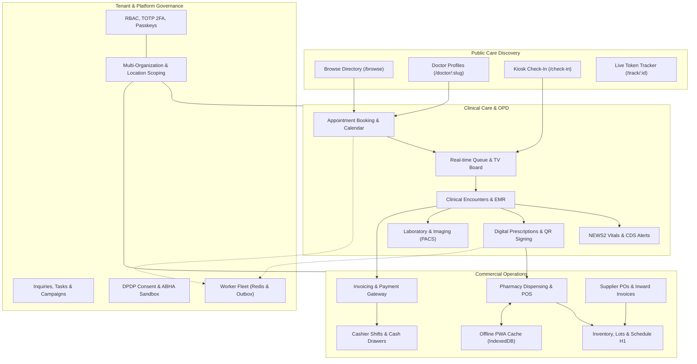
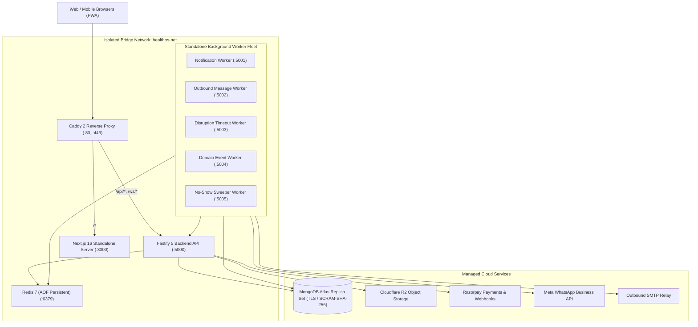
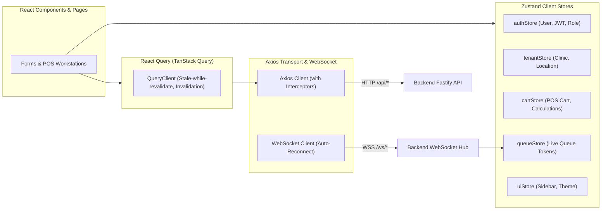
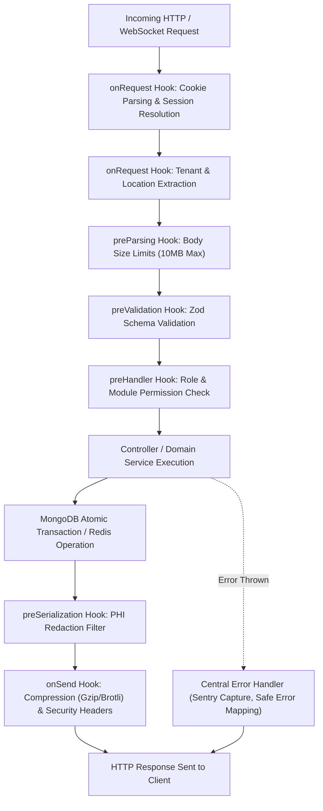
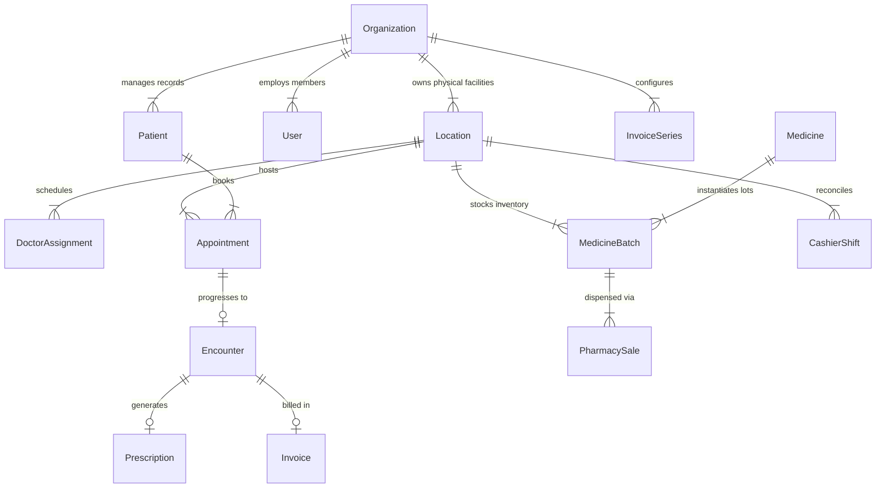
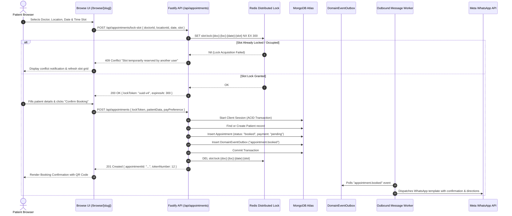
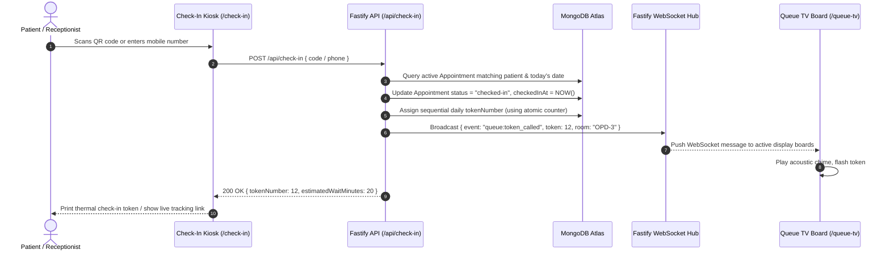
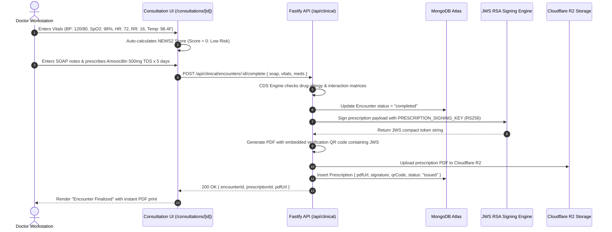
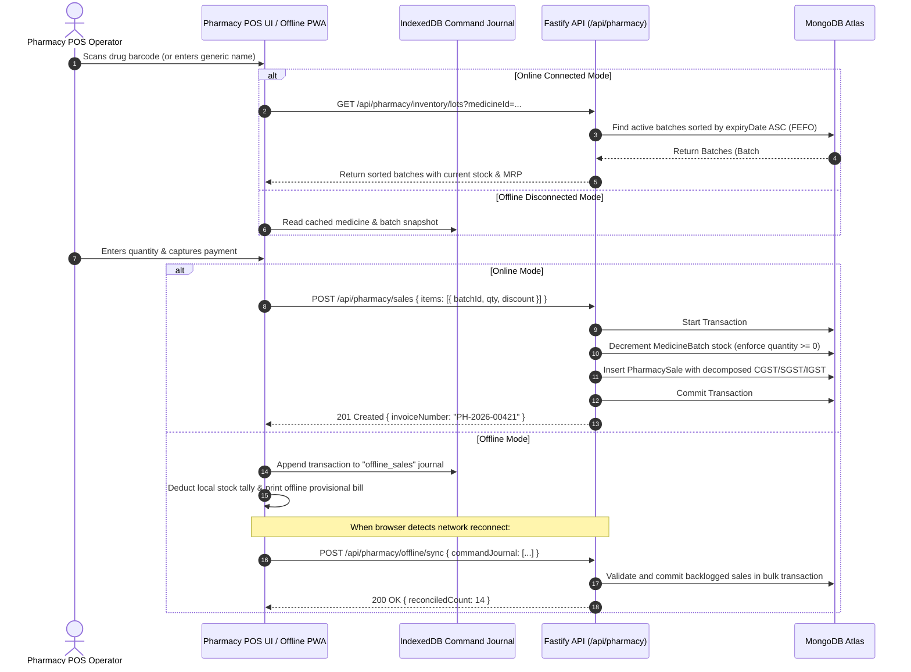

# Ekavyu Healthcare Platform — Project Master Documentation

**Repository Scope:** Multi-repo workspace (`frontend`, `backend`, `ekavyu-coming-soon`, root deployment orchestration)  
**System Designation:** Ekavyu — Digital Healthcare Infrastructure  
**Official Brand Tagline:** *Care That Keeps Moving*  
**Document Type:** Single Source of Truth & Technical Architecture Reference  
**Audience:** Principal Architects, Full-Stack Engineers, AI Coding Agents, Security Auditors  
**Audit Date:** 2026-11-21  
**Development Phase:** Active Development (Pre-Production Greenfield; Zero Legacy Production Obligations)

---

## Executive Summary & Navigable Table of Contents

This document provides a single source of truth for the **Ekavyu Healthcare Platform**. It is compiled through direct source-code inspection of the frontend, backend, database models, worker processes, API routes, and operational deployment files. It accurately reflects the actual implementation, constraints, and current development state.

### Table of Contents
1. [Section A: Project Overview](#section-a-project-overview)
2. [Section B: Technology Stack](#section-b-technology-stack)
3. [Section C: System Architecture](#section-c-system-architecture)
4. [Section D: Complete Module and Feature Inventory](#section-d-complete-module-and-feature-inventory)
5. [Section E: Frontend Architecture](#section-e-frontend-architecture)
6. [Section F: Backend Architecture](#section-f-backend-architecture)
7. [Section G: Database Architecture](#section-g-database-architecture)
8. [Section H: Authentication and Security](#section-h-authentication-and-security)
9. [Section I: End-to-End Workflows](#section-i-end-to-end-workflows)
10. [Section J: Infrastructure and Deployment](#section-j-infrastructure-and-deployment)
11. [Section K: Testing and Code Quality](#section-k-testing-and-code-quality)
12. [Section L: Feature Status Matrix](#section-l-feature-status-matrix)
13. [Section M: Known Issues and Improvement Opportunities](#section-m-known-issues-and-improvement-opportunities)
14. [Section N: Developer and AI Handoff Guide](#section-n-developer-and-ai-handoff-guide)
15. [Section O: Open Questions and Unknowns](#section-o-open-questions-and-unknowns)

---

# Section A: Project Overview

## 1. Project Purpose & Problem Statement
Ekavyu is an enterprise-grade digital health suite designed to streamline healthcare delivery across fragmented operational domains. Independent clinics, multi-specialty polyclinics, diagnostic facilities, and retail pharmacies typically struggle with fragmented software stacks: disjointed appointment schedulers, standalone billing machines, manual pen-and-paper prescriptions, uncoordinated inventory systems, and zero real-time visibility for visiting patients.

Ekavyu resolves these bottlenecks through an integrated, multi-tenant platform unifying:
- **Public Patient Discovery & Queue Flow:** Geolocation-aware browsing of verified clinics, doctors, diagnostic labs, and pharmacies; self-service online booking, token reservation, and live queue status.
- **Clinical Encounter Automation:** Comprehensive electronic medical records (EMR), structured SOAP templates, vitals tracking with automated Early Warning Scores (NEWS2), clinical decision support alerts, and digitally verifiable e-prescriptions.
- **Pharmacy Point-of-Sale (POS) & Supply Chain:** High-speed barcode-driven dispensary, FEFO/FIFO inventory tracking, Schedule H/H1 narcotic compliance registers, automated purchase order generation, GST compliance (CGST/SGST/IGST), and offline PWA capability for uninterrupted billing during internet disruption.
- **Financial & Revenue Operations:** Point-of-care invoicing, multi-split payment capture (Cash, UPI, Card, NetBanking via Razorpay), cashier shift/drawer reconciliation, corporate/insurance pre-authorization, and claims tracking.
- **Patient Engagement & CRM:** Automated WhatsApp/SMS appointment notifications, disruption alerts, prescription PDF delivery, intake lead management, and follow-up campaign tracking.

## 2. Product Modules & Interconnection Topology
The platform consists of deeply interconnected clinical, operational, and financial subsystems:



## 3. Current Development Status
- **Development Phase:** Pre-production greenfield development. Per repository rules (dated 20 October 2026), there are no legacy production users or historical data migrations to support.
- **Architecture Integrity:** Frontend and backend are maintained as independent repositories (`jk-frontend` and `jk-backend`) with strict boundary checks, distinct CI verification gates, and shared contract validation scripts.
- **Codebase Health:** Clean repository trees with automated type verification, risk-based Vitest suites, and containerized Docker definitions for development and staging topologies.

---

# Section B: Technology Stack

## 1. Technology Matrix & Dependency Specifications

### A. Frontend Technology Stack
- **Framework & Runtime:** Next.js `16.3.4` (App Router, Standalone Output), React `19.2.8`, Node.js `>=24 <25`.
- **Language:** TypeScript `^6.0.2` / `@typescript/native ^7.0.2`.
- **Styling & Design System:** Tailwind CSS `^4.0.0`, `@tailwindcss/postcss ^4`, PostCSS `^8.5.30`, Lucide React `^1.43.0` icons.
- **State Management & Data Fetching:**
  - Client Global State: Zustand `^5.0.12` (modular stores with persistence).
  - Server State & Cache: `@tanstack/react-query ^5.101.4`.
  - HTTP Transport: Axios `^1.15.2` with custom request/response interceptors.
- **Security & Authentication:** `@simplewebauthn/browser ^14.0.0` (FIDO2 / WebAuthn passkeys), browser Web Crypto APIs.
- **Mapping & Geolocation:** Leaflet `^1.9.4`, `@types/leaflet ^1.9.21` (OpenStreetMap raster tiles).
- **Offline & PWA:** Service Worker (`sw.js`), Cache API, IndexedDB command journal, `fflate 0.8.3` (compression), standalone HTML/CSS fallback page (`pharmacy-offline.html`).
- **Testing & Verification:** Vitest `^5.0.0`, `@testing-library/react ^16.3.2`, `@testing-library/jest-dom ^7.0.1`, JSDOM `^29.1.1`.
- **Alternative Runtimes:** `@vinext/cloudflare ^1.1.1`, `vinext ^1.2.1`, Vite `^8.3.3` (Cloudflare Workers experimental adapter).

### B. Backend Technology Stack
- **Framework & HTTP Engine:** Fastify `^5.12.3`, Node.js `>=24 <25`.
- **Database & ODM:** MongoDB Atlas Replica Set (4.4+ / 7.0+), Mongoose `^9.9.5`.
- **In-Memory Cache & Message Broker:** Redis `7-alpine` via `ioredis ^6.0.0`.
- **Cryptographic & Auth Primitives:** `jsonwebtoken ^9.0.3` (RS256 asymmetric signing), `bcryptjs ^3.0.3` (cost factor 12), `speakeasy ^2.0.0` (TOTP), `@simplewebauthn/server ^14.0.3` (Passkeys), AES-256-GCM (`crypto` module).
- **Fastify Plugins:**
  - `@fastify/cors ^11.2.0`: Dynamic origin validation and credential handling.
  - `@fastify/cookie ^11.0.2`: HttpOnly, Secure, SameSite session cookies.
  - `@fastify/rate-limit ^11.0.0`: Redis-backed distributed rate limiter.
  - `@fastify/websocket ^11.3.0`: Real-time duplex channels for live queues and notifications.
  - `@fastify/compress ^9.2.0`: Gzip/Brotli payload compression.
  - `@fastify/swagger ^9.8.1` & `@fastify/swagger-ui ^6.1.0`: OpenAPI documentation (non-production).
- **Cloud Integrations:**
  - Object Storage: Cloudflare R2 (S3 API) via `@aws-sdk/client-s3 ^3.1127.0` and `@aws-sdk/s3-request-presigner ^3.1127.0`.
  - Payment Gateway: Razorpay SDK & Webhooks.
  - Messaging: Meta WhatsApp Cloud API v25.0, Nodemailer `^10.0.1` (SMTP).
  - Observability: Sentry Node `^11.4.0`, Pino structured JSON logging.
- **Workers & Background Jobs:** 5 standalone worker loops with distributed Redis leasing (`workerLease.ts`) and HTTP health probes (`workerHealthServer.ts`).

---

# Section C: System Architecture

## 1. High-Level Architectural Diagram



## 2. Layer Responsibilities & Data Boundary Rules

1. **Client / Edge Layer:**
   - Caddy reverse proxy terminates TLS with automatic Let's Encrypt certificates.
   - Forwards `/api/*` and `/ws/*` traffic to the Fastify backend; routes all other routes to the Next.js standalone container.
   - Enforces strict security headers: `X-Frame-Options: SAMEORIGIN`, `X-Content-Type-Options: nosniff`, `Referrer-Policy: strict-origin-when-cross-origin`, and `Permissions-Policy`.

2. **Frontend Presentation Layer (`src/app/`):**
   - Implements React Server Components (RSC) where beneficial and client components (`"use client"`) for stateful workflows.
   - All network mutations pass through Axios client instances configured with base URLs and automatic 401 token refresh interceptors.
   - Multi-tenant context is synchronized via `tenantStore.ts` and `authStore.ts`.

3. **Backend API Service Layer (`backend/index.ts`, `routes/`, `services/`):**
   - Fastify hooks enforce session resolution, RS256 token verification, organization validation, and rate limiting.
   - Controllers delegate all persistence, external API calls, and domain rules to dedicated `services/`.
   - Domain mutations publish records to the `DomainEventOutbox` within atomic MongoDB transactions.

4. **Background Asynchronous Worker Layer (`backend/workers/`):**
   - Independent Node processes execute continuous loops (`workerLoop.ts`) protected by distributed Redis leases (`workerLease.ts`).
   - Prevents duplicate job execution across horizontally scaled backend replicas.
   - Dedicated micro-health servers (ports 5001–5005) allow Docker container orchestrators to monitor worker liveness without polluting API traffic.

5. **Persistence & Data Isolation Layer:**
   - Multi-tenancy is enforced on every single collection using an explicit `organizationId` (or `tenantId`) field.
   - MongoDB replica sets provide atomic multi-document ACID transactions across inventories, billing, and queue appointments.
   - Redis handles ephemeral locks, session caching, rate-limit buckets, and pub/sub channels.

---

# Section D: Complete Module and Feature Inventory

This section details every implemented product module across the codebase, identifying the exact user journeys, backend services, database collections, and UI components involved.

```
+-----------------------------------------------------------------------------------+
|                            EKAVYU MODULE ECOSYSTEM                                |
+-----------------------------------------------------------------------------------+
| 01. Organization & Multi-Location  | 07. Pharmacy Point-of-Sale & Dispensary     |
| 02. Authentication & Security      | 08. Inventory, Batches & Schedule H1        |
| 03. Patient Management & EMR       | 09. Laboratory & Imaging Diagnostics        |
| 04. Appointment Booking & Slots    | 10. Customer Relationship Management (CRM)  |
| 05. Real-Time Queue & Kiosk TV     | 11. Multi-Channel Notifications (WhatsApp)  |
| 06. Billing, Invoicing & Cashier   | 12. Privacy, DPDP Compliance & Platform Admin|
+-----------------------------------------------------------------------------------+
```

---

### Module 01: Organization, Locations & Facility Management

- **Purpose & Scope:** Multi-tenant organization container supporting multi-specialty clinics, hospital chains, and retail pharmacies. Manages physical locations, operating hours, service catalogs, departments, staff roles, and custom branding.
- **User Roles & Access:** Organization Owner (`owner`), Organization Administrator (`org_admin`), Location Manager (`location_manager`).
- **UI Screens & Components:**
  - `src/app/(dashboard)/dashboard/organizations/page.tsx`: Organization details, business registration, tax settings.
  - `src/app/(dashboard)/dashboard/locations/page.tsx`: Location cards, physical addresses, GPS geocoding, operating schedules.
  - `src/app/(dashboard)/dashboard/settings/modules/page.tsx`: Feature-gating switches to enable/disable specific modules per facility.
  - `src/components/shared/LocationSelector.tsx`: Global facility switcher component.
- **Interaction Flow:**
  1. Administrator creates/edits organization profile (legal entity, GSTIN, PAN, drug licenses).
  2. Creates physical branches (`Location`), specifying weekly operating hours, consultation fees, and emergency availability.
  3. Enables specific operational modules (e.g., enable Pharmacy & Billing, disable Inpatient).
  4. System updates public discovery profiles for patient browsing.
- **Backend Services & Routes:**
  - Routes: `routes/locations.ts`, `routes/moduleRegistry.ts`, `routes/organizationBranding.ts`.
  - Services: `services/locationService.ts`, `services/moduleRegistryService.ts`.
- **Database Models Used:** `Organization`, `Location`, `Department`, `ModuleRegistry`, `OrganizationBrandingAsset`.
- **Validations & Edge Cases:**
  - Slugs must be globally unique and URL-safe.
  - Deleting a location with active appointments or un-reconciled inventory is strictly rejected.
  - Location coordinates validate against standard latitude/longitude boundaries for geospatial queries.

---

### Module 02: Authentication, Security & Staff Permissions

- **Purpose & Scope:** Multi-method identity provider supporting password-based login, phone OTP login, hardware FIDO2 passkeys (WebAuthn), TOTP two-factor authentication, staff onboarding invites, and fine-grained Role-Based Access Control (RBAC).
- **User Roles & Access:** All roles (`admin`, `owner`, `doctor`, `nurse`, `pharmacist`, `cashier`, `receptionist`, `patient`).
- **UI Screens & Components:**
  - `src/app/(auth)/login/page.tsx`: Password, OTP, and Passkey login tabs.
  - `src/app/(auth)/register/page.tsx`: New account creation wizard.
  - `src/app/(auth)/accept-invite/page.tsx`: Staff invitation acceptance.
  - `src/app/(dashboard)/dashboard/security/page.tsx`: 2FA QR code generator, passkey enrollment, active session list with one-click revocation.
- **Interaction Flow:**
  1. User authenticates via password or passkey.
  2. If TOTP 2FA is active, an intermediate challenge screen verifies the 6-digit authenticator code or hashed single-use recovery code.
  3. Server sets an HttpOnly, Secure `ekavyu_session` cookie containing an RS256-signed JWT.
  4. Session is recorded in MongoDB with device metadata and TTL expiration.
- **Backend Services & Routes:**
  - Routes: `routes/auth.ts`, `routes/role.ts`, `routes/staff.ts`, `routes/sso.ts`.
  - Services: `services/authService.ts`, `services/sessionResolver.ts`, `services/permissions.ts`.
- **Database Models Used:** `User`, `Session`, `RefreshToken`, `Passkey`, `PasskeyChallenge`, `PendingTwoFactorSetup`, `OtpVerification`, `OrgMember`, `Role`.
- **Validations & Edge Cases:**
  - Brute force lockout after 5 consecutive failures (30-minute lockout).
  - Password strength enforced via Zod schema (min 8 chars, uppercase, lowercase, numbers, symbols).
  - WebAuthn challenge replay protection via Redis nonce storage.

---

### Module 03: Patient Management & Electronic Medical Records (EMR)

- **Purpose & Scope:** Comprehensive patient directory, demographic capture, emergency contacts, ABDM ABHA ID linking, medical histories, allergy alerts, clinical encounters, SOAP notes, and NEWS2 observation scoring.
- **User Roles & Access:** Receptionist (registration), Doctor (clinical examination & diagnosis), Nurse (vitals entry), Patient (portal access).
- **UI Screens & Components:**
  - `src/app/(dashboard)/dashboard/patients/page.tsx`: Searchable patient directory with phone and name indexing.
  - `src/app/(dashboard)/dashboard/patients/[id]/page.tsx`: Patient master profile, past consultations, active prescriptions, lab reports.
  - `src/app/(dashboard)/dashboard/patients/[id]/timeline/page.tsx`: Chronological longitudinal medical timeline.
  - `src/app/(dashboard)/dashboard/consultations/[id]/page.tsx`: Doctor consultation interface: vitals capture, SOAP note editor, ICD-10 diagnosis picker, e-prescription composer.
- **Interaction Flow:**
  1. Receptionist or patient registers patient record; phone number uniqueness is verified per tenant.
  2. Nurse enters vitals (BP, pulse, SpO2, respiratory rate, temperature); system automatically calculates the National Early Warning Score (NEWS2) and renders severity badges.
  3. Doctor reviews history, types clinical notes or selects pre-configured SOAP templates, specifies differential diagnoses, and issues digital prescriptions.
- **Backend Services & Routes:**
  - Routes: `routes/clinical.ts`, `routes/family.ts`, `routes/patientPortal.ts`, `routes/soapTemplate.ts`.
  - Services: `services/patientService.ts`, `services/encounterService.ts`, `services/clinicalObservationService.ts`.
- **Database Models Used:** `Patient`, `FamilyRelationship`, `Encounter`, `ClinicalNote`, `Observation`, `ObservationScore`, `ObservationAlert`, `SoapTemplate`.
- **Validations & Edge Cases:**
  - Protected Health Information (PHI) is automatically redacted in logs via `utilities/phiAnonymizer.ts`.
  - Encounter records cannot be edited once marked `completed`; amendments require an explicit audit-trailed addendum note.

---

### Module 04: Appointment Scheduling, Slot Locks & Disruptions

- **Purpose & Scope:** Multi-channel appointment booking engine (public web, staff desk, kiosk) with granular doctor schedule templates, break intervals, real-time slot conflict prevention, and disruption handling.
- **User Roles & Access:** Patient (public booking), Receptionist (walk-ins & phone bookings), Doctor (schedule overrides).
- **UI Screens & Components:**
  - `src/app/browse/[slug]/page.tsx`: Public slot picker with real-time availability.
  - `src/app/(dashboard)/dashboard/appointments/page.tsx`: Comprehensive staff calendar, day/week views, booking drawer.
  - `src/components/appointment/SlotPicker.tsx`: Reactive slot selection grid.
- **Interaction Flow:**
  1. User selects doctor, date, and desired time slot.
  2. System issues a short-term Redis lock on the specific slot to prevent double-booking.
  3. Patient confirms contact info and payment preference (Pay at Clinic or Prepaid via Razorpay).
  4. Backend creates an `Appointment` document within an ACID transaction and releases the lock.
  5. An asynchronous event triggers WhatsApp and email confirmation messages.
  6. If a doctor becomes unavailable, the staff marks a `Disruption`; affected patients are notified automatically with one-click reschedule options.
- **Backend Services & Routes:**
  - Routes: `routes/appointments.ts`, `routes/doctorAvailability.ts`, `routes/shifts.ts`.
  - Services: `services/appointmentService.ts`, `services/doctorScheduleService.ts`.
- **Database Models Used:** `Appointment`, `AppointmentPayment`, `Doctor`, `DoctorAssignment`, `DoctorDayOverride`, `ShiftRoster`.
- **Validations & Edge Cases:**
  - Slot locking guarantees zero overlapping appointments per doctor location.
  - Past slots cannot be booked; booking windows honor minimum advance notice settings.
  - Unattended appointments past their grace period are processed by `noShowSweepWorker.ts`.

---

### Module 05: Real-Time Queue Management & Kiosk Display

- **Purpose & Scope:** Operational token generation, queue prioritization, live estimated wait times, and public TV waiting-room board displaying token statuses.
- **User Roles & Access:** Receptionist (token issue, queue reordering), Doctor (calling patients), Patient/Public (TV display, smartphone tracker).
- **UI Screens & Components:**
  - `src/app/queue-tv/page.tsx`: High-contrast, large-font public TV dashboard showing "Now Serving", "Next", and room numbers.
  - `src/app/track/[appointmentId]/page.tsx`: Responsive mobile page showing live queue position and estimated wait time.
  - `src/app/(dashboard)/dashboard/queue/page.tsx`: Staff queue management panel with drag-and-drop reordering.
- **Interaction Flow:**
  1. Patient checks in at reception or scans QR code at kiosk (`/check-in`).
  2. System issues sequential daily token number per department/doctor.
  3. Doctor clicks "Call Next" in their consultation view.
  4. Backend broadcasts the updated state over WebSockets (`/ws/queue`).
  5. TV display plays an audible alert and highlights the new token; mobile tracking screens update instantly.
- **Backend Services & Routes:**
  - Routes: `routes/checkIn.ts`, Fastify WebSocket routes (`index.ts`).
  - Services: `services/queueService.ts`.
- **Database Models Used:** `Appointment`, `OpdSession`, `OpdTemplate`.
- **Validations & Edge Cases:**
  - Automatic reconnection logic in frontend `useWebSocket.ts` handles network hiccups.
  - Skipped patients can be recalled to the queue without forfeiting their record.

---

### Module 06: Billing, Invoicing & Cashier Till Operations

- **Purpose & Scope:** Point-of-care financial engine supporting custom itemized invoices, hospital service master catalogs, multi-tender payments, cashier shift/till reconciliation, credit notes, and automated invoice numbering.
- **User Roles & Access:** Cashier, Billing Executive, Organization Administrator.
- **UI Screens & Components:**
  - `src/app/(dashboard)/dashboard/billing/page.tsx`: Invoices list, payment status filters, collection summaries.
  - `src/app/(dashboard)/dashboard/billing/services/page.tsx`: Service catalog configuration (consultation rates, procedure fees, bed charges).
  - `src/app/(dashboard)/dashboard/shifts/page.tsx`: Cashier shift opening, float entry, cash drawer count, shift handoff reports.
- **Interaction Flow:**
  1. Cashier opens shift, entering opening float amount.
  2. System aggregates consultation fees, lab procedures, and medication lines into an `Invoice`.
  3. Patient tenders payment (Cash, Card, or dynamic UPI QR via Razorpay).
  4. Once payment succeeds, an `InvoiceCollectionReceipt` is issued with thermal print options.
  5. At shift close, cashier counts physical cash; system calculates variances and locks the shift.
- **Backend Services & Routes:**
  - Routes: `routes/billing.ts`, `routes/serviceCatalog.ts`, `routes/shifts.ts`, `routes/upiWebhook.ts`.
  - Services: `services/billingService.ts`, `services/invoiceNumberingService.ts`.
- **Database Models Used:** `Invoice`, `InvoiceSeries`, `InvoiceCollectionReceipt`, `InvoiceCreditNote`, `ServiceCatalog`, `CashierShift`.
- **Validations & Edge Cases:**
  - Sequential invoice numbers are guaranteed strictly contiguous per tenant using MongoDB atomic counters.
  - Invoices cannot be deleted; adjustments require formal Credit Notes (`InvoiceCreditNote`).

---

### Module 07: Pharmacy Point-of-Sale (POS) & Dispensary

- **Purpose & Scope:** Retail and hospital outpatient pharmacy dispensing system featuring fast barcode lookup, lot allocation, item-level discounts, GST tax decomposition, electronic prescription import, and offline PWA capability.
- **User Roles & Access:** Pharmacist, Pharmacy Cashier.
- **UI Screens & Components:**
  - `src/app/(dashboard)/dashboard/pharmacy/page.tsx`: Pharmacy operations dashboard, stock health widgets, daily sales.
  - `src/components/pharmacy/PharmacyPOS.tsx`: High-velocity dispensing screen with keyboard shortcuts, lot selector, and cart calculations.
  - `public/pharmacy-offline.html`: Offline fallback interface for continuing sales when backend connectivity drops.
- **Interaction Flow:**
  1. Pharmacist scans barcode or types generic/brand medicine name.
  2. System suggests lots matching FEFO (First Expired, First Out) rules.
  3. System automatically calculates CGST, SGST, IGST, and rounding adjustments using `pharmacyCalculation.ts`.
  4. Pharmacist captures payment and prints itemized GST receipt.
  5. If offline, the transaction is appended to an IndexedDB command journal and synchronized automatically upon reconnect.
- **Backend Services & Routes:**
  - Routes: `routes/pharmacy.ts`, `routes/pharmacyPurchases.ts`, `routes/scheduleH1.ts`.
  - Services: `services/pharmacyService.ts`, `services/pharmacyCalculation.ts`.
- **Database Models Used:** `PharmacyDispense`, `PharmacySale`, `PharmacyReturn`, `PharmacyTaxProfile`, `ScheduleH1Register`, `PharmacyOfflineDevice`.
- **Validations & Edge Cases:**
  - Schedule H and H1 drugs require mandatory doctor registration numbers and patient addresses; automatically logged to `ScheduleH1Register`.
  - Attempting to dispense expired batches is hard-blocked by backend validators.

---

### Module 08: Pharmacy Inventory, Lot Tracking & Procurement

- **Purpose & Scope:** End-to-end pharmaceutical supply chain management: supplier master catalogs, purchase orders, goods receipt notes (GRN), batch-level tracking, expiry alerts, and stock adjustments.
- **User Roles & Access:** Pharmacy Inventory Manager, Procurement Officer.
- **UI Screens & Components:**
  - `src/app/(dashboard)/dashboard/pharmacy/inventory/page.tsx`: Master medicine list, stock quantities, reorder levels.
  - `src/app/(dashboard)/dashboard/pharmacy/lots/page.tsx`: Batch-level view showing batch number, manufacturing date, expiry date, purchase price, MRP.
  - `src/app/supplier-order/page.tsx`: External supplier portal for reviewing and fulfilling purchase orders.
- **Interaction Flow:**
  1. Low stock alerts trigger automatic draft Purchase Orders (`PharmacyPurchaseOrder`).
  2. Supplier receives purchase request via secure token link.
  3. Upon physical stock delivery, storekeeper records `PharmacyPurchaseReceipt`, entering batch numbers, expiry dates, and supplier invoice numbers.
  4. System updates stock balances and creates new `MedicineBatch` records within an atomic transaction.
- **Backend Services & Routes:**
  - Routes: `routes/pharmacyPurchases.ts`, `routes/pharmacyOnboarding.ts`.
  - Services: `services/inventoryService.ts`.
- **Database Models Used:** `Medicine`, `MedicineBatch`, `PharmacyPurchaseOrder`, `PharmacyPurchaseReceipt`, `PharmacyPurchaseReturn`, `PharmacyParty` (Suppliers), `StockMovement`.
- **Validations & Edge Cases:**
  - Duplicate batch numbers for the same medicine and location are prevented by compound unique indexes.
  - Negative inventory is blocked; stock adjustments require formal audit justification reason codes.

---

### Module 09: Laboratory & Imaging Diagnostics

- **Purpose & Scope:** Diagnostic workflow management for pathology tests, sample collection, lab result entry against normal reference intervals, abnormal parameter flagging, radiology orders, and Orthanc DICOM PACS integration.
- **User Roles & Access:** Laboratory Technician, Radiologist, Ordering Doctor.
- **UI Screens & Components:**
  - `src/app/(dashboard)/dashboard/laboratory/page.tsx`: Worklist of pending lab tests, sample collection statuses, result entry forms.
  - `src/app/(dashboard)/dashboard/radiology/page.tsx`: Radiology imaging worklist, PACS study link viewer.
- **Interaction Flow:**
  1. Doctor orders lab panel during consultation.
  2. Phlebotomist / Lab tech marks sample as collected.
  3. Lab tech inputs observed values; system automatically compares against reference ranges (gender/age specific) and highlights out-of-range parameters.
  4. Authorized pathologist signs off; final report is published to patient timeline and notification sent.
- **Backend Services & Routes:**
  - Routes: `routes/laboratory.ts`, `routes/imaging.ts`.
  - Services: `services/labService.ts`.
- **Database Models Used:** `LabOrder`, `LabTest`, `ImagingStudy`.
- **Validations & Edge Cases:**
  - Critical abnormal lab values trigger real-time alert notifications to the ordering physician.
  - Results cannot be modified after pathologist sign-off without creating an amended version.

---

### Module 10: Customer Relationship Management (CRM)

- **Purpose & Scope:** Patient acquisition and retention engine tracking prospective inquiries, follow-up calls, task assignments, communication logs, and patient conversion metrics.
- **User Roles & Access:** CRM Executive, Front Desk Coordinator, Clinic Administrator.
- **UI Screens & Components:**
  - `src/app/(dashboard)/dashboard/crm/overview/page.tsx`: Pipeline funnel (New Lead -> Contacted -> Qualified -> Converted).
  - `src/app/(dashboard)/dashboard/crm/tasks/page.tsx`: Task list for patient recall and treatment plan follow-ups.
  - `src/app/(dashboard)/dashboard/crm/communications/page.tsx`: Centralized log of WhatsApp, SMS, and email interactions.
- **Interaction Flow:**
  1. Inquiries arrive via website contact form, phone, or walk-in.
  2. CRM coordinator logs inquiry details and schedules follow-up tasks.
  3. When the lead books a consultation, the system converts the inquiry into a formal `Patient` profile, linking the source campaign.
- **Backend Services & Routes:**
  - Routes: `routes/crm.ts`, `routes/tasks.ts`.
  - Services: `services/crmService.ts`.
- **Database Models Used:** `Inquiry`, `CrmActivity`, `Task`, `SiteVisit`.
- **Validations & Edge Cases:**
  - Duplicate phone number detection flags existing patient records during inquiry intake.

---

### Module 11: Multi-Channel Notifications & Outbox Worker

- **Purpose & Scope:** Asynchronous notification dispatcher supporting transactional WhatsApp messages (Meta Cloud API), automated appointment reminders, prescription delivery, SMS alerts, and transactional emails via SMTP.
- **User Roles & Access:** Automated system worker, Notification Preference settings for all users.
- **UI Screens & Components:**
  - `src/app/(dashboard)/dashboard/notifications/page.tsx`: In-app notification center.
  - `src/components/layout/NotificationPanel.tsx`: Slide-out real-time notification drawer.
- **Interaction Flow:**
  1. Clinical or billing actions create an `OutboundMessage` or `DomainEventOutbox` entry.
  2. `outboundMessageWorker.ts` and `notificationDeliveryWorker.ts` poll Redis/MongoDB queues using distributed leasing.
  3. Messages are formatted using pre-approved WhatsApp templates and dispatched via Meta Cloud API v25.0.
  4. Delivery receipts and incoming patient replies are ingested via `routes/whatsappWebhook.ts`.
- **Backend Services & Routes:**
  - Routes: `routes/notifications.ts`, `routes/notificationPreferences.ts`, `routes/whatsappWebhook.ts`.
  - Services: `services/notificationService.ts`.
- **Database Models Used:** `Notification`, `NotificationDelivery`, `NotificationLog`, `NotificationPreference`, `OutboundMessage`, `DomainEventOutbox`, `WhatsAppAccount`, `WhatsAppTemplate`.
- **Validations & Edge Cases:**
  - Automatic exponential backoff retries with dead-letter queueing for undeliverable messages.
  - User notification opt-outs and channel preferences are strictly honored before dispatch.

---

### Module 12: Privacy, DPDP Compliance, ABHA & Platform Administration

- **Purpose & Scope:** National health authority sandbox interoperability (ABDM / ABHA ID), Digital Personal Data Protection (DPDP) Act consent tracking, audit trails with cryptographic hash chaining, and superadmin tenant governance.
- **User Roles & Access:** Platform Superadmin (`admin`), Organization Data Protection Officer (DPO).
- **UI Screens & Components:**
  - `src/app/(dashboard)/dashboard/admin/users/page.tsx`: Global user directory, status toggling, role assignment.
  - `src/app/(dashboard)/dashboard/admin/monitor/page.tsx`: System telemetry, error rates, database connection pools.
  - `src/app/(dashboard)/dashboard/audit/page.tsx`: Immutable audit log inspector with filterable actor, action, and resource criteria.
- **Interaction Flow:**
  1. Every read or write of sensitive clinical records triggers `auditMiddleware.ts`.
  2. The system calculates an SHA-256 cryptographic hash of the audit entry linked to the previous record (`AuditChainHead`, `AuditCheckpoint`), ensuring tamper evidence.
  3. Patients can record DPDP consent mandates or request data export via the patient portal.
- **Backend Services & Routes:**
  - Routes: `routes/abdm.ts`, `routes/dpdp.ts`, `routes/setupRequests.ts`, `routes/syntheticHealth.ts`.
  - Services: `services/auditLogService.ts`, `services/dpdpService.ts`.
- **Database Models Used:** `AuditLog`, `AuditChainHead`, `AuditCheckpoint`, `DPDPConsent`, `DataBreachIncident`, `PatientRecordAccess`, `SaaSPlan`, `SaaSInvoice`, `UsageRecord`.
- **Validations & Edge Cases:**
  - Superadmin actions are isolated behind dedicated route guards (`requireAdmin`).
  - Synthetic health probes (`/api/health/synthetic`) execute isolated end-to-end canary transactions without touching tenant clinical data.


---

# Section E: Frontend Architecture

## 1. Application Layout, Routing & Navigation Hierarchy

The frontend is constructed using the Next.js 16 App Router (`src/app/`), adhering to clean architectural boundaries:

```
src/app/
├── layout.tsx                # Root layout: metadata, fonts (Inter), QueryClient, AuthProvider, Toaster
├── page.tsx                  # Landing homepage (HomeNavigation, Hero, Features, Pricing, Footer)
├── globals.css               # Tailwind CSS v4 directives, design tokens, print stylesheets
├── not-found.tsx             # Semantic 404 handler
├── global-error.tsx          # Catch-all boundary for unhandled client exceptions
├── robots.ts                 # Dynamic robots.txt (noindex for previews/staging)
├── sitemap.ts                # Dynamic sitemap (queries backend public locations & doctors)
│
├── (auth)/                   # Authentication route group (centered card layout)
│   ├── layout.tsx            # Auth layout: redirect authenticated users to /dashboard
│   ├── login/page.tsx        # Password, OTP, and WebAuthn passkey login
│   ├── register/page.tsx     # Account registration
│   ├── reset-password/       # Password recovery token verification
│   ├── accept-invite/        # Staff onboarding invite processor
│   └── onboarding/           # Clinic setup & facility creation wizard
│
├── (dashboard)/              # Authenticated workspace route group
│   ├── layout.tsx            # Dashboard shell: Sidebar, Header, NotificationPanel, Tenant sync
│   ├── template.tsx          # Page transition animation wrapper
│   └── dashboard/            # 25+ domain workspace sub-routes
│       ├── admin/            # Superadmin: users, system monitor, setup requests, platform billing
│       ├── analytics/        # Executive BI: revenue, appointment volume, department utilization
│       ├── appointments/     # Calendar scheduler, booking drawer, slot manager
│       ├── audit/            # Cryptographic audit log viewer
│       ├── billing/          # Invoices, service catalog masters, payment tracking
│       ├── bills/            # Outpatient point-of-sale billing
│       ├── clinics/          # Clinic organization profile and tax configurations
│       ├── consultations/    # EMR consultation workstation, SOAP notes, e-prescriptions
│       ├── crm/              # Inquiries, follow-ups, communication logs, campaigns
│       ├── feedback/         # Patient satisfaction survey aggregation
│       ├── insurance/        # Insurance tariffs, pre-authorizations, claim statuses
│       ├── laboratory/       # Lab orders, phlebotomy tracking, result entry, reference ranges
│       ├── locations/        # Facility physical branches, GPS coordinates, operating hours
│       ├── notifications/    # Centralized notification inbox & channel preferences
│       ├── organizations/    # Legal entity master, licensing, module subscriptions
│       ├── patient-portal/   # Patient self-service: appointments, records, prescription downloads
│       ├── patients/         # Patient master directory, medical history, longitudinal timeline
│       ├── pharmacy/         # Pharmacy POS, medicine catalog, batch management, GRN purchases
│       ├── queue/            # Live queue dispatch, priority escalation, room assignments
│       ├── radiology/        # Imaging worklist, DICOM/PACS viewer integration
│       ├── security/         # Personal security: TOTP setup, passkey management, active sessions
│       ├── settings/         # Facility settings, module enablement, invoice series formats
│       ├── shifts/           # Cashier shift opening, float reconciliation, cash drawer balance
│       ├── staff/            # Staff directory, role assignments, custom permission matrices
│       └── teleconsultation/ # Video consultation room, chat, remote prescription workflow
│
└── [Public Routes]/          # Unauthenticated patient & public discovery pages
    ├── browse/               # Directory of clinics, pharmacies & doctors (List & Map views)
    ├── browse/[slug]/        # Location profile: doctors, services, amenities, direct booking
    ├── doctor/[slug]/        # Doctor public profile: credentials, reviews, availability
    ├── check-in/             # Kiosk check-in interface (Token scan / phone lookup)
    ├── track/[appointmentId] # Live queue token tracker with real-time wait estimation
    ├── queue-tv/             # High-contrast waiting room TV board (Full screen, WebSockets)
    ├── pickup/               # Pharmacy prescription pickup status tracker
    ├── pricing/              # Platform subscription tiers & feature matrix
    └── supplier-order/       # External pharmaceutical supplier order fulfillment portal
```

## 2. Reusable UI Components & Design System

The application leverages a bespoke UI primitive system (`src/components/ui/`) styled with Tailwind CSS v4:
- **Form Controls:** `Input.tsx`, `Select.tsx` (searchable/multi-select), `Checkbox.tsx`, `Radio.tsx`, `TextArea.tsx`, `Toggle.tsx`, `DatePicker.tsx`, `TimePicker.tsx`, `PhoneInput.tsx`.
- **Feedback & Overlays:** `Modal.tsx` (focus-trapped dialogs), `ConfirmDialog.tsx`, `Toast.tsx` / `Toaster.tsx` (ephemeral notifications), `Tooltip.tsx`, `Spinner.tsx`, `Skeleton.tsx`.
- **Data Display:** `Table.tsx` (sortable, paginated), `Badge.tsx`, `StatusBadge.tsx` (semantic status mapping), `Card.tsx`, `Avatar.tsx`, `EmptyState.tsx`, `CurrencyDisplay.tsx` (INR formatting).
- **Navigation & Layout:** `Sidebar.tsx` (role-filtered links, collapsible), `Header.tsx` (facility switcher, user dropdown), `BreadcrumbNav.tsx`, `Tabs.tsx`, `Stepper.tsx` (multi-step wizards), `Pagination.tsx`.
- **Specialized Clinical Components:** `NEWS2Badge.tsx` (vitals warning level), `DrugInteractionAlert.tsx`, `PrescriptionPreview.tsx`, `LeafletMap.tsx`.

## 3. State Management & API Integration Layer

The frontend divides state cleanly between client-ephemeral state, persisted preferences, and server cache:



- **Axios Interceptors (`src/lib/axios.ts`):** Automatically injects the current facility context (`X-Location-ID`, `X-Organization-ID`), captures 401 Unauthorized responses to attempt transparent token renewal, and routes 403 Forbidden events to an authorization toast.
- **Zustand 5 Stores (`src/store/`):**
  - `authStore.ts`: Tracks active user session, role claims, and authentication state (persisted to localStorage).
  - `tenantStore.ts`: Manages active organization and location selections, driving tenant headers.
  - `cartStore.ts`: Manages high-performance pharmacy POS cart lines, lot selection, and real-time GST tax totals.
  - `queueStore.ts`: Maintains live queue state updated via WebSocket events.
- **Offline PWA Architecture (`src/offline/` & `public/sw.js`):**
  - The Service Worker caches application shells and pharmacy static assets.
  - When network failure occurs, the pharmacy POS switches to offline mode, writing sales to an IndexedDB journal.
  - Upon reconnection, `useOffline.ts` reconciles pending offline sales with the backend authority.

---

# Section F: Backend Architecture

## 1. Fastify Application Bootstrap & Middleware Pipeline

The backend server (`backend/index.ts`) is engineered for low latency, high throughput, and strict security isolation:



### Core Middleware Stack:
1. **`@fastify/cors`:** Dynamic origin whitelist against `CORS_ALLOWED_ORIGINS`.
2. **`@fastify/cookie`:** Encrypted cookie reader extracting the `ekavyu_session` JWT.
3. **`@fastify/rate-limit`:** Redis-backed rate limiting (100 req/min general, 5 req/min on sensitive auth endpoints).
4. **`tenantMiddleware.ts`:** Resolves and validates tenant boundaries; prevents cross-organization data leakage.
5. **`permissionMiddleware.ts`:** Evaluates RBAC permissions against target controller operations.
6. **`auditMiddleware.ts`:** Captures actor ID, IP, user-agent, and before/after payloads for PHI mutations.

## 2. API Route Inventory

The backend organizes routes into domain-specific modules registered as Fastify plugins in `routes/`:

| Route Module | Prefix / Path | Methods | Auth Required | Primary Controller / Service |
|---|---|---|---|---|
| `auth.ts` | `/api/auth` | POST, GET, PUT | Public / Session | `authController` / `authService` |
| `appointments.ts` | `/api/appointments` | POST, GET, PUT, DELETE | Session (RBAC) | `appointmentController` / `appointmentService` |
| `clinical.ts` | `/api/clinical` | POST, GET, PUT | Session (`doctor`, `nurse`) | `encounterController` / `encounterService` |
| `billing.ts` | `/api/billing` | POST, GET, PUT | Session (`cashier`, `admin`) | `billingController` / `billingService` |
| `pharmacy.ts` | `/api/pharmacy` | POST, GET, PUT | Session (`pharmacist`) | `pharmacyController` / `pharmacyService` |
| `pharmacyPurchases.ts` | `/api/pharmacy/purchases` | POST, GET, PUT | Session (`inventory_mgr`) | `pharmacyPurchaseService` |
| `laboratory.ts` | `/api/laboratory` | POST, GET, PUT | Session (`lab_tech`, `doctor`) | `labController` / `labService` |
| `imaging.ts` | `/api/imaging` | POST, GET, PUT | Session (`radiologist`, `doctor`)| `imagingService` |
| `locations.ts` | `/api/locations` | POST, GET, PUT | Session (`org_admin`) | `locationController` / `locationService` |
| `staff.ts` | `/api/staff` | POST, GET, PUT, DELETE | Session (`org_admin`) | `staffController` / `staffService` |
| `crm.ts` | `/api/crm` | POST, GET, PUT | Session (`crm_exec`, `admin`) | `crmController` / `crmService` |
| `notifications.ts` | `/api/notifications` | POST, GET, PUT, DELETE | Session | `notificationController` |
| `checkIn.ts` | `/api/check-in` | POST, GET | Public / Session | `checkInController` / `queueService` |
| `public.ts` | `/api/public` | GET | Public | `publicController` |
| `whatsappWebhook.ts` | `/api/webhooks/whatsapp` | GET, POST | Token / Signature | `whatsappWebhookController` |
| `upiWebhook.ts` | `/api/webhooks/razorpay` | POST | Webhook Signature | `razorpayWebhookController` |
| `abdm.ts` | `/api/abdm` | POST, GET | Session / ABDM Token | `abdmService` |
| `dpdp.ts` | `/api/dpdp` | POST, GET | Session | `dpdpService` |
| `shifts.ts` | `/api/shifts` | POST, GET, PUT | Session (`cashier`) | `shiftService` |
| `insuranceTariff.ts` | `/api/insurance` | POST, GET, PUT | Session (`billing_mgr`) | `insuranceService` |
| `upload.ts` | `/api/upload` | POST, DELETE | Session | `uploadService` (Cloudflare R2) |
| `syntheticHealth.ts` | `/api/health` | GET | Public / Canary Secret | `healthController` |

## 3. Dedicated Background Worker Fleet

To prevent long-running tasks from degrading HTTP latency, the backend executes 5 background workers running independent event loops (`workers/`):

```
+----------------------------------------------------------------------------------------------------+
|                                    BACKGROUND WORKER FLEET                                         |
+--------------------------+------+------------------------------------------------------------------+
| Worker Process           | Port | Core Responsibility & Processing Loop                            |
+--------------------------+------+------------------------------------------------------------------+
| notificationWorker.ts    | 5001 | Dispatches transactional in-app, email, and SMS notifications.  |
| outboundMessageWorker.ts | 5002 | Processes Meta WhatsApp Cloud API outbound queue with rate-limit |
|                          |      | throttling and webhook callback ingestion.                       |
| disruptionTimeoutWorker  | 5003 | Monitors disrupted appointments; triggers automatic patient      |
|                          |      | notifications and rescheduling recommendations upon delay expiry.|
| domainEventWorker.ts     | 5004 | Ingests DomainEventOutbox records; coordinates cross-domain      |
|                          |      | side effects (e.g. appointment completion -> billing trigger).   |
| noShowSweepWorker.ts     | 5005 | Sweeps overdue unchecked-in appointments; transitions them to    |
|                          |      | "no-show" and updates doctor schedule availability.             |
+--------------------------+------+------------------------------------------------------------------+
```

Each worker incorporates:
- **`workerLease.ts`:** Redis-backed distributed lease locks with TTL heartbeats to ensure only one replica processes a batch at any given time.
- **`workerHealthServer.ts`:** Embedded lightweight HTTP server providing `/health` and `/ready` probes for container orchestrators.
- **Graceful Shutdown:** Intercepts SIGTERM/SIGINT, completes the active batch, releases the Redis lease, and closes database connections.

---

# Section G: Database Architecture

## 1. MongoDB Mongoose Models & Collections Directory

The database layer consists of 75+ Mongoose models organized by functional domain:

### Core Identity, Organizations & RBAC
- **`User` (`users`):** Master identity: email, phone, bcrypt password, role, 2FA secret, recovery codes, WebAuthn credentials, account lockout state.
- **`Organization` (`organizations`):** Multi-tenant root entity: legal entity name, slug, licensing, tax identifiers, billing configuration, active modules.
- **`Location` (`locations`):** Physical facility: address, geocoding (`2dsphere` index), operating hours, department links.
- **`Department` (`departments`):** Clinical and operational divisions (OPD, Emergency, Pharmacy, Radiology).
- **`Doctor` (`doctors`):** Clinical credentials: medical council registration, specializations, consultation fees, bio.
- **`DoctorAssignment` (`doctorassignments`):** Mapping of doctors to specific locations with weekly scheduling rules.
- **`Staff` (`staff`) & `Receptionist` (`receptionists`):** Staff profiles, shifts, and department assignments.
- **`Role` (`roles`):** Custom organizational roles and granular permission overrides.

### Patient & Clinical Records (EMR)
- **`Patient` (`patients`):** Demographic profile, contact numbers, emergency contacts, ABHA ID, blood group, allergies, chronic conditions.
- **`Encounter` (`encounters`):** Single consultation record: appointment link, vitals, examination findings, differential diagnosis, status.
- **`ClinicalNote` (`clinicalnotes`):** Structured SOAP clinical documentation, doctor addenda, amendment history.
- **`Observation` (`observations`), `ObservationScore`, `ObservationAlert`:** Patient vitals, calculated NEWS2 severity scores, and clinical alerts.
- **`Prescription` (`prescriptions`):** Medication list, dosages, routes, frequencies, digital cryptographic signature, QR verification payload.
- **`SoapTemplate` (`soaptemplates`):** Reusable consultation note templates per specialty.
- **`CDSEvaluation` (`cdsevaluations`):** Clinical decision support rules engine evaluations (drug-drug, drug-allergy interactions).

### Appointments, Queue & Schedules
- **`Appointment` (`appointments`):** Central appointment entity: patient, doctor, location, date, time slot, status, disruption metadata, payment status.
- **`AppointmentPayment` (`appointmentpayments`):** Advance payment receipts linked to bookings.
- **`ShiftRoster` (`shiftrosters`) & `DoctorDayOverride` (`doctordayoverrides`):** Dynamic roster schedules and leave overrides.
- **`OpdSession` (`opdsessions`) & `OpdTemplate` (`opdtemplates`):** Queue session definitions and token numbering templates.

### Billing, Insurance & Cashiering
- **`Invoice` (`invoices`):** Master patient invoice: itemized line items, subtotal, discounts, GST breakdown, grand total, balance due.
- **`InvoiceSeries` (`invoiceseries`):** Sequential numbering series configuration per location/financial year.
- **`InvoiceCollectionReceipt` (`invoicecollectionreceipts`):** Multi-split payment transaction receipts.
- **`InvoiceCreditNote` (`invoicecreditnotes`):** Official tax credit notes for invoice adjustments/refunds.
- **`ServiceCatalog` (`servicecatalogs`):** Master hospital charge master (procedures, investigations, consultation fees).
- **`CashierShift` (`cashiershifts`):** Cash drawer management: shift open, cash additions/drops, closing reconciliation.
- **`InsuranceTariff` (`insurancetariffs`), `Claim`, `PreAuthorization`:** TPA insurance contracts, pre-auth submissions, claim tracking.

### Pharmacy & Supply Chain
- **`Medicine` (`medicines`):** Master drug database: brand name, generic formulation, manufacturer, schedule classification, HSN code.
- **`MedicineBatch` (`medicinebatches`):** Lot-level tracking: batch number, expiry date, purchase price, MRP, current physical stock.
- **`PharmacySale` (`pharmacysales`) & `PharmacyDispense`:** Outpatient dispensing record: itemized lots, GST calculations, thermal receipt data.
- **`PharmacyPurchaseOrder` (`pharmacypurchaseorders`), `PharmacyPurchaseReceipt`, `PharmacyPurchaseReturn`:** Procurement workflow.
- **`PharmacyParty` (`pharmacyparties`):** Drug distributors, pharmaceutical suppliers, and manufacturer master.
- **`ScheduleH1Register` (`scheduleh1registers`):** Statutory Indian drug law register for Schedule H and H1 restricted medicines.
- **`PharmacyOfflineDevice` (`pharmacyofflinedevices`), `PharmacyOfflineGrant`:** Offline PWA sync authorization and cryptographic device tokens.

### Communication, Audit & SaaS
- **`Notification` (`notifications`), `NotificationDelivery`, `NotificationPreference`:** Multi-channel alert logs and preferences.
- **`OutboundMessage` (`outboundmessages`), `WhatsAppAccount`, `WhatsAppTemplate`:** WhatsApp Cloud API queue.
- **`DomainEventOutbox` (`domaineventoutbox`):** Transactional outbox table for event-driven worker processing.
- **`AuditLog` (`auditlogs`), `AuditChainHead`, `AuditCheckpoint`:** Tamper-evident cryptographic audit log.
- **`DPDPConsent` (`dpdpconsents`), `DataBreachIncident`:** Indian DPDP regulatory compliance records.

## 2. Multi-Tenancy Architecture & Data Scoping Rules



- **Tenant Scoping:** Every query executed by application services enforces `{ organizationId: request.tenantId }`.
- **Compound Indexes:** Critical queries leverage compound indexes prefixed by tenant ID (e.g., `{ organizationId: 1, locationId: 1, date: 1 }`).
- **Geospatial Indexes:** `Location` enforces a `2dsphere` index on `address.coordinates` for radial proximity queries (`/api/public/locations?lat=...&lng=...`).
- **TTL Indexes:**
  - `sessions`: `expiresAt` (automatic expiration of dormant sessions).
  - `otpverifications`: `expiresAt` (10-minute validity).
  - `passkeychallenges`: `expiresAt` (5-minute challenge nonce lifetime).

---

# Section H: Authentication and Security

## 1. Authentication Lifecycle & Credential Architecture

```mermaid
sequenceDiagram
    autonumber
    actor User as Client Browser / Passkey
    participant Proxy as Caddy Reverse Proxy
    participant Fastify as Fastify API (authController)
    participant Redis as Redis Cache
    participant Mongo as MongoDB Atlas

    User->>Proxy: POST /api/auth/login (Email + Password)
    Proxy->>Fastify: Forward request
    Fastify->>Mongo: Find User by email
    Mongo-->>Fastify: Return User document
    Fastify->>Fastify: Verify password with bcrypt.compare()
    
    alt Two-Factor Authentication Enabled
        Fastify-->>User: Return 200 { requiresTwoFactor: true, tempToken }
        User->>Fastify: POST /api/auth/2fa/validate (TOTP code + tempToken)
        Fastify->>Fastify: Verify TOTP with speakeasy
    end
    
    Fastify->>Fastify: Sign JWT using RS256 Private Key
    Fastify->>Mongo: Insert new Session document (expiresAt: 7 days)
    Fastify->>Proxy: Set-Cookie: ekavyu_session=JWT; HttpOnly; Secure; SameSite=Lax
    Proxy-->>User: Forward HTTP 200 with session cookie
```

- **JWT Structure:** RS256 signed. Payload contains `userId`, `organizationId`, `role`, `sessionId`, and `locationGrants`.
- **FIDO2 / WebAuthn:** Implemented using `@simplewebauthn/server` and `@simplewebauthn/browser`. Generates cryptographic challenges stored in Redis with 300s TTL. Validates public key credentials against stored public keys.
- **Session Resolution:** Fastify `sessionResolver.ts` checks the `ekavyu_session` cookie first; falls back to `Authorization: Bearer <token>` for programmatic integrations. Validates active status in MongoDB and Redis.

## 2. Authorization, RBAC & Module Access Matrix

The platform implements a multi-tier authorization hierarchy:
1. **Platform Superadmin (`admin`):** Global access to all tenant data, system monitoring, and SaaS provisioning.
2. **Organization Owner / Admin (`owner`, `org_admin`):** Full control over organization settings, billing series, locations, staff invites, and role assignments.
3. **Clinical Roles (`doctor`, `nurse`, `radiologist`, `lab_tech`):** Access scoped to assigned locations. Restricted to clinical modules (EMR, consultations, observations, prescriptions, lab orders).
4. **Commercial Roles (`pharmacist`, `cashier`, `billing_mgr`):** Restricted to POS dispensing, till shifts, service catalogs, invoices, and drug inventory.
5. **Patient (`patient`):** Strict ownership scoping (`patientId == request.user.patientId`). Can only view own consultations, prescriptions, lab reports, and invoices.

## 3. Data Protection, Privacy & Clinical Compliance

- **Protected Health Information (PHI) Redaction:** `utilities/phiAnonymizer.ts` intercepts all log serialization pipelines, masking names (`J*** D**`), mobile numbers (`98****3210`), and government identifiers to prevent accidental leaks in log aggregators.
- **Prescription Digital Signing:** Every issued prescription is signed with an RSA private key (`PRESCRIPTION_SIGNING_KEY`). Produces a verifiable JSON Web Signature (JWS) embedded in a tamper-evident QR code rendered on the PDF receipt.
- **DPDP Act Compliance:** Implements granular patient consent capture (`DPDPConsent`), right-to-view logs (`PatientRecordAccess`), and automated notification protocols for data security events (`DataBreachIncident`).
- **Cryptographic Audit Hash Chain:** Each critical clinical/financial mutation appends an entry to `AuditLog`. The entry includes `previousHash`, calculating `currentHash = SHA256(previousHash + timestamp + actorId + action + resourceId)`. Verified periodically via `AuditCheckpoint`.


---

# Section I: End-to-End Workflows

This section maps critical clinical, commercial, and operational paths across all architectural boundaries:
`User Action -> Frontend -> API -> Middleware -> Service -> Database -> Response -> UI Update`

---

## Workflow 1: Public Care Discovery, Slot Locking & Appointment Booking



- **Edge Case / Error Handling:** If the user abandons the booking screen, Redis automatically releases the lock after 300 seconds (5 minutes) without database pollution.

---

## Workflow 2: Reception Check-In, Token Issuance & Queue TV Sync



---

## Workflow 3: Doctor Consultation, NEWS2 Vitals & Cryptographic e-Prescription



---

## Workflow 4: Pharmacy Dispensing, FEFO Batch Allocation, GST & Offline Sync



---

## Workflow 5: Invoicing, Multi-Split Tender & Razorpay Payment Webhook

```mermaid
sequenceDiagram
    autonumber
    actor Cashier as Cashier Operator
    participant UI as Billing Desk UI (/billing)
    participant API as Fastify API (/api/billing)
    participant Razorpay as Razorpay API & Gateway
    participant Mongo as MongoDB Atlas
    participant Webhook as Fastify Webhook (/api/webhooks/razorpay)

    Cashier->>UI: Selects Patient & aggregates pending consultation + lab charges
    UI->>API: POST /api/billing/invoices { patientId, items, paymentMethod: "split" }
    API->>Mongo: Create Invoice (status: "pending", total: Rs. 1,500)
    Cashier->>UI: Tenders Rs. 500 Cash + Rs. 1,000 Dynamic UPI QR
    UI->>API: POST /api/billing/orders { invoiceId, amount: 1000 }
    API->>Razorpay: Create Order { amount: 100000, currency: "INR" }
    Razorpay-->>API: Return { id: "order_xyz123" }
    API-->>UI: Return Razorpay Order ID
    UI-->>Cashier: Display dynamic UPI QR code on customer-facing display
    Patient->>Razorpay: Scans UPI QR & authorizes payment on mobile banking app
    Razorpay->>Webhook: POST /api/webhooks/razorpay { event: "payment.captured", payload }
    Webhook->>Webhook: Validate HMAC-SHA256 signature using RAZORPAY_WEBHOOK_SECRET
    Webhook->>Mongo: Update Invoice payment status = "paid", recordedAt = NOW()
    Webhook->>Mongo: Insert InvoiceCollectionReceipt
    Webhook-->>Razorpay: 200 OK { received: true }
    UI->>UI: Polling or WebSocket receives payment confirmation; prints final thermal receipt
```

---

# Section J: Infrastructure and Deployment

## 1. Production Docker Topology & Port Allocation

The development and production staging environments are orchestrated via Docker Compose (`docker-compose.yml`, `backend/deploy/docker-compose.production.yml`). All services run on a private, non-routable bridge network (`healthos-net`). **Caddy is the only service that publishes public ports.**

```
+----------------------------------------------------------------------------------------------------+
|                               CONTAINER NETWORK TOPOLOGY (healthos-net)                            |
+---------------------------+-------------------+-------------+--------------------------------------+
| Service Container         | Base Image        | Ports       | Description & Responsibility         |
+---------------------------+-------------------+-------------+--------------------------------------+
| caddy                     | caddy:2-alpine    | 80, 443     | TLS termination, reverse proxy edge. |
| redis                     | redis:7-alpine    | 6379 (int)  | AOF persistence, locks, queues.      |
| backend                   | ekavyu-backend    | 5000 (int)  | Fastify 5 core API server.           |
| frontend                  | ekavyu-frontend   | 3000 (int)  | Next.js 16 standalone server.        |
| notification-worker       | ekavyu-backend    | 5001 (int)  | In-app, email & SMS dispatcher.      |
| outbound-message-worker   | ekavyu-backend    | 5002 (int)  | Meta WhatsApp Cloud API processor.   |
| disruption-timeout-worker | ekavyu-backend    | 5003 (int)  | Disrupted appointment supervisor.    |
| domain-event-worker       | ekavyu-backend    | 5004 (int)  | Outbox domain event distributor.     |
| no-show-worker            | ekavyu-backend    | 5005 (int)  | Overdue appointment status sweeper.  |
+---------------------------+-------------------+-------------+--------------------------------------+
```

## 2. Reverse Proxy Routing Rules (`Caddyfile`)

Caddy operates as the single ingress controller:
- `dev.ekavyu.com`:
  - `/api/*`, `/ws/*`, `/documentation*` -> Reverse proxy to `backend:5000` with WebSocket support (`flush_interval -1`).
  - All other paths (`/*`) -> Reverse proxy to `frontend:3000`.
  - Automatic HTTPS via Let's Encrypt / ZeroSSL with automatic renewal.

## 3. Environment Configuration Reference

### A. Frontend Environment Variables (`frontend/.env.example`)
*Note: Public variables prefixed with `NEXT_PUBLIC_` are baked into the client bundle at build time.*

| Variable | Required | Build / Runtime | Purpose |
|---|---|---|---|
| `NEXT_PUBLIC_API_URL` | **Yes** | **Build time** | Public HTTPS endpoint for Fastify API (e.g. `https://dev.ekavyu.com/api`). |
| `NEXT_PUBLIC_BACKEND_URL` | Optional | Build time | Secondary HTTPS backend origin if hosted on an independent domain. |
| `BACKEND_INTERNAL_URL` | Optional | Server runtime | Internal backend origin for server-side fetches and rewrites. |
| `APP_URL` | **Yes** | Build/Runtime | Canonical frontend URL for metadata, SEO robots, and sitemap generation. |
| `NEXT_PUBLIC_MAP_TILE_URL`| Optional | Build time | OpenStreetMap tile URL template for Browse map view. |
| `ALLOWED_DEV_ORIGINS` | Dev only | Dev runtime | Comma-separated LAN IP origins for mobile device testing. |

### B. Backend Environment Variables (`backend/.env.example`)

| Variable | Required | Purpose / Security Classification |
|---|---|---|
| `PORT` | Yes | HTTP listening port (defaults to 5000). |
| `NODE_ENV` | Yes | `production` or `development`. |
| `MONGODB_URI` | **Yes** | TLS replica set connection string (credentials injected via secrets). |
| `REDIS_URL` | **Yes** | Authenticated Redis connection URI (`redis://:pass@host:6379`). |
| `RUN_INLINE_JOBS` | Yes | Set to `false` in production to enforce dedicated worker execution. |
| `JWT_PRIVATE_KEY_BASE64` | **Yes** | Base64-encoded RS256 private key for signing auth tokens. |
| `JWT_PUBLIC_KEY_BASE64` | **Yes** | Base64-encoded RS256 public key for verifying auth tokens. |
| `PRESCRIPTION_SIGNING_KEY`| **Yes** | High-entropy signing key (>=32 chars) for cryptographic e-prescriptions. |
| `DATA_ENCRYPTION_KEY` | **Yes** | 64-character hex key for field-level AES-256-GCM database encryption. |
| `WEBAUTHN_ORIGIN` | **Yes** | Exact public origin for FIDO2 passkeys (e.g. `https://dev.ekavyu.com`). |
| `WEBAUTHN_RP_ID` | **Yes** | Relying party hostname for passkeys (e.g. `dev.ekavyu.com`). |
| `CLOUDFLARE_ACCOUNT_ID` | Optional | Cloudflare R2 account ID for storage. |
| `R2_ACCESS_KEY_ID` / `R2_SECRET_ACCESS_KEY` | Optional | Cloudflare R2 S3-compatible credentials. |
| `R2_BUCKET_NAME` | Optional | S3 bucket name for clinical PDFs and logos. |
| `RAZORPAY_KEY_ID` / `RAZORPAY_KEY_SECRET` | Optional | Razorpay payment gateway credentials. |
| `RAZORPAY_WEBHOOK_SECRET` | Optional | Secret for verifying Razorpay payment webhook HMAC signatures. |
| `META_WHATSAPP_WABA_ID` | Optional | Meta WhatsApp Business Account ID. |
| `META_WHATSAPP_ACCESS_TOKEN` | Optional | Meta System User token with `whatsapp_business_messaging`. |
| `META_WHATSAPP_VERIFY_TOKEN` | Optional | Webhook challenge handshake verification secret. |
| `SMTP_HOST`, `SMTP_PORT`, `SMTP_USER`, `SMTP_PASS` | Optional | Outbound email relay credentials. |

---

# Section K: Testing and Code Quality

## 1. Test Architecture & Coverage Frameworks
- **Test Runner:** Vitest `^5.0.0` configured in both repositories (`vitest.config.mts` in frontend, `vitest.config.ts` in backend).
- **Backend Test Projects:**
  - `unit`: Pure function testing (calculations, serializers, formatters, schema validations).
  - `integration`: Full route-to-database tests leveraging `mongodb-memory-server` to run real transactional operations against in-memory replica sets.
- **Frontend Test Suite:** JSDOM environment utilizing `@testing-library/react` for component rendering, user interactions, and POS cart computations.

## 2. Risk-Based Verification Workflow (`AGENTS.md`)
Per project rules, verification must strictly correspond to change risk. Agents do not execute the entire test suite for trivial edits:
- **Level 1 (Copy, styling, isolated layout):** Lint changed files (`npm run lint`), inspect diff.
- **Level 2 (Local behavior, forms, local API):** Lint changed files, execute affected Vitest files (`npm test -- path/to/file.test.ts`).
- **Level 3 (Shared UI, hooks, global state, API client):** Run affected tests, execute TypeScript package check (`npm run check:types` / `npm run check:fast`).
- **Level 4 (Auth, booking, billing, pharmacy, security):** Focused unit and integration tests, edge cases, type checks, and payment boundary scripts (`npm run check:payments`).
- **Level 5 (Release / Production):** Full CI gate: full lint, type check, complete integration test suite, build compilation, and security scan (`npm run audit:release`).

---

# Section L: Feature Status Matrix

| Module | Feature | Status | Frontend Implementation | Backend Implementation | Database Collections | Evidence Source Files | Identified Gaps / Gating Factors |
|---|---|---|---|---|---|---|---|
| **Auth** | Password Login | **Implemented** | `login/page.tsx` | `routes/auth.ts` | `users`, `sessions` | `authController.ts` | None; production ready. |
| **Auth** | Phone OTP Login | **Implemented** | `login/page.tsx` | `routes/auth.ts` | `users`, `otps` | `otpService.ts` | Live SMS gateway credentials needed. |
| **Auth** | TOTP 2FA | **Implemented** | `dashboard/security` | `routes/auth.ts` | `users` | `speakeasy` in `authService.ts`| Recovery code printable PDF pending. |
| **Auth** | Passkeys (WebAuthn)| **Implemented** | `login/page.tsx` | `routes/auth.ts` | `passkeys` | `@simplewebauthn` | Live HTTPS domain required for real FIDO2. |
| **Locations**| Multi-Facility | **Implemented** | `dashboard/locations` | `routes/locations.ts` | `locations` | `locationService.ts` | None; fully isolated by tenant. |
| **Discovery**| Directory & Maps | **Implemented** | `app/browse` | `routes/public.ts` | `locations`, `doctors` | `BrowseClient.tsx` | Requires tile provider credit in prod. |
| **Appointments**| Slot Scheduling | **Implemented** | `dashboard/appointments`| `routes/appointments.ts`| `appointments` | `appointmentService.ts` | None; Redis locks prevent conflicts. |
| **Appointments**| Online Booking | **Implemented** | `app/browse/[slug]` | `routes/appointments.ts`| `appointments` | `SlotPicker.tsx` | Prepaid booking requires Razorpay keys. |
| **Queue** | Real-Time TV Board| **Implemented** | `app/queue-tv` | WebSocket `/ws/queue` | `appointments`, `queues` | `queueService.ts` | Audio chime requires user gesture unblock. |
| **Queue** | Token Tracker | **Implemented** | `app/track/[id]` | `routes/checkIn.ts` | `appointments` | `track/[appointmentId]` | None; fully responsive on mobile. |
| **EMR** | Vitals & NEWS2 | **Implemented** | `dashboard/consultations`| `routes/clinical.ts` | `observations`, `scores`| `clinicalObservationService.ts`| None; clinical rules validated. |
| **EMR** | SOAP Clinical Notes| **Implemented** | `dashboard/consultations`| `routes/clinical.ts` | `clinicalnotes` | `encounterService.ts` | AI clinical dictation is experimental. |
| **EMR** | e-Prescription | **Implemented** | `dashboard/consultations`| `routes/clinical.ts` | `prescriptions` | `prescriptionService.ts` | Requires persistent `PRESCRIPTION_SIGNING_KEY`.|
| **Pharmacy** | Barcode POS | **Implemented** | `dashboard/pharmacy` | `routes/pharmacy.ts` | `pharmacysales` | `PharmacyPOS.tsx` | None; FEFO allocation verified. |
| **Pharmacy** | Offline PWA | **Implemented** | `pharmacy-offline.html` | `routes/pharmacy.ts` | `pharmacyofflines` | `sw.js`, `build-pharmacy-offline.mjs`| Multi-device offline conflict resolution basic. |
| **Pharmacy** | Schedule H1 Reg | **Implemented** | `dashboard/pharmacy` | `routes/scheduleH1.ts` | `scheduleh1registers`| `scheduleH1.ts` | Statutory register export format review needed.|
| **Inventory**| Batches & Expiry | **Implemented** | `dashboard/pharmacy/lots`| `routes/pharmacyPurchases.ts`| `medicinebatches` | `inventoryService.ts` | Bulk CSV import requires header mapping check. |
| **Billing** | Invoicing & GST | **Implemented** | `dashboard/billing` | `routes/billing.ts` | `invoices`, `invoiceseries` | `billingService.ts` | None; contiguous numbering verified. |
| **Billing** | Cashier Shifts | **Implemented** | `dashboard/shifts` | `routes/shifts.ts` | `cashiershifts` | `shiftService.ts` | Physical till drawer hardware API omitted. |
| **Billing** | Razorpay Gateway | **Implemented** | `RazorpayCheckout.tsx` | `routes/billing.ts` | `invoicecollectionreceipts`| `upiWebhook.ts` | Live gateway keys required for production. |
| **Lab/Imaging**| Diagnostics Order| **Implemented** | `dashboard/laboratory` | `routes/laboratory.ts` | `laborders`, `labtests`| `labService.ts` | Orthanc DICOM PACS is optional/sandbox. |
| **CRM** | Inquiry Pipeline | **Implemented** | `dashboard/crm` | `routes/crm.ts` | `inquiries`, `crmactivities` | `crmService.ts` | Telephony integration not present. |
| **Messaging**| WhatsApp Alerts | **Implemented** | In-app preferences | `routes/whatsappWebhook.ts`| `outboundmessages` | `outboundMessageWorker.ts` | Requires Meta Business verification. |
| **DPDP** | Privacy Consent | **Implemented** | `dashboard/audit` | `routes/dpdp.ts` | `dpdpconsents`, `auditlogs`| `dpdpService.ts` | Patient-facing self-service erasure partial. |
| **ABDM** | ABHA ID Sandbox | **Partial** | Demographic field | `routes/abdm.ts` | `patients` | `abdm.ts` | Sandbox mock only; not live approved. |
| **Platform** | Superadmin Ops | **Implemented** | `dashboard/admin` | `routes/setupRequests.ts`| `saasplans`, `organizations`| `adminController.ts` | Multi-currency SaaS billing unverified. |

---

# Section M: Known Issues and Improvement Opportunities

## 1. Confirmed Implementation Problems
- **Browser-Baked Environment Constraints:** `NEXT_PUBLIC_API_URL` is inlined into the client bundle at build time. In Docker environments, changing `.env` without executing `docker compose build frontend` leads to silent connection failures to outdated endpoints.
- **Worker Process Multiplicity:** In single-VM Docker topologies, running 5 standalone worker containers alongside Fastify, Next.js, and Redis consumes ~1.8 GB RAM. On resource-constrained VMs (e.g. 2 GB RAM), this triggers out-of-memory kernel kills unless Linux swapfile (2 GB) is explicitly provisioned.
- **ABDM Sandbox Limitation:** ABDM (Ayushman Bharat Digital Mission) endpoints are wired to test stubs; live production integration requires formal government certification and hardware HSM keys.

## 2. Architectural Bottlenecks & Scalability Risks
- **Redis Single Point of Failure (SPOF):** In the current Docker Compose deployment, Redis runs as an unclustered single container. If Redis fails, distributed slot locks and worker leasing collapse, halting asynchronous dispatches.
- **Prescription PDF Generation Overhead:** Rendering server-side PDFs with QR codes and cryptographic seals inside the main Fastify event loop can cause micro-stalls under peak OPD load. This should be offloaded to an asynchronous PDF rendering queue.

## 3. Security & Operational Hardening Opportunities
- **Automated DB Backup Drills:** While `mongoBackup.ts` and `mongoRestoreDrill.ts` exist, they require manual cron scheduling on the host VM. Automated cloud-native snapshots (via MongoDB Atlas API) should be prioritized.
- **Client Bundle Size Optimization:** Leaflet maps and date-picker libraries contribute to initial JS payload. Code-splitting using `next/dynamic` for `BrowseMap.tsx` and rich text editors is recommended.

---

# Section N: Developer and AI Handoff Guide

## 1. Repository Navigation & Core Invariants

### Golden Rules That Must Never Be Broken:
1. **Never Bypass Tenant Scoping:** Every single MongoDB query touching patient, clinical, billing, or pharmacy data MUST include `{ organizationId: request.tenantId }`.
2. **Never Commit Secrets:** Do not commit `.env`, private keys (`jwt_private.key`), or signing secrets.
3. **Preserve Atomic Transactions:** Multi-document updates affecting inventory batches (`MedicineBatch`) or invoice counters (`InvoiceSeries`) MUST execute inside a Mongoose session transaction (`withTransaction`).
4. **Adhere to the Risk Verification Hierarchy:** Before submitting changes, classify risk according to [AGENTS.md](file:///d:/Project%20JK/frontend/AGENTS.md) and run only the affected scoped checks.
5. **No Production Compatibility Layers for Dead Legacy Code:** Per repository project stage rules, there are no legacy production customers. Refactor cleanly to current contracts without retaining hypothetical compatibility layers.

## 2. Step-by-Step Guide: How to Add a New Domain Feature Safely

```
+----------------------------------------------------------------------------------------------------+
|                                FEATURE IMPLEMENTATION BLUEPRINT                                     |
+----------------------------------------------------------------------------------------------------+
| Step 1: Database Model      | Create model in backend/models/ with organizationId & indexes.       |
| Step 2: Zod Schema          | Define request/response validation schema in backend/schemas/.       |
| Step 3: Domain Service      | Write business logic in backend/services/ inside atomic transactions.|
| Step 4: Fastify Route       | Register route in backend/routes/ with preHandler permission checks. |
| Step 5: Backend Test        | Add Vitest case in backend/tests/ validating tenant isolation.       |
| Step 6: Frontend API Client | Add typed service method in frontend/src/services/.                  |
| Step 7: React Query Hook    | Create custom hook in frontend/src/hooks/ with cache invalidation.   |
| Step 8: UI Component / Page | Build component in frontend/src/components/ and page in src/app/.   |
+----------------------------------------------------------------------------------------------------+
```

## 3. Local Development & Testing Commands

### Frontend (`D:\Project JK\frontend`):
```bash
# Clean install dependencies
npm ci

# Launch local development server (port 3000)
npm run dev

# Run risk-scoped Vitest suite
npm test

# Verify TypeScript compilation
npm run check:types

# Verify payment boundary integrity
npm run check:payments

# Execute production build
npm run build
```

### Backend (`D:\Project JK\backend`):
```bash
# Clean install dependencies
npm ci

# Launch local API development server (port 5000 with watch mode)
npm run dev

# Run fast TypeScript compiler check
npm run check:fast

# Run integration tests (with in-memory MongoDB)
npm test

# Verify tenant query scoping across the entire codebase
npm run check:tenants

# Seed development test data
npm run seed
```

---

# Section O: Open Questions and Unknowns

The following items cannot be fully verified from static source inspection alone:
1. **Live Production Hosting Environment:** Whether future production will deploy to a managed Kubernetes cluster (GKE/EKS) or multi-region VMs rather than the single-VM Docker Compose setup.
2. **National Health Authority (ABDM) Production Approvals:** The exact timeline and testing prerequisites for transitioning ABDM sandbox stubs to live Indian government health record networks.
3. **Hardware Integration Drivers:** Specific hardware protocols for proprietary USB thermal ESC/POS receipt printers and electronic cash drawers across client operating systems.
4. **Third-Party Commercial Quotas:** Active SMS gateway credits, Meta WhatsApp template approval statuses, and Razorpay production webhook rate limits.

---

# End of Master Document
