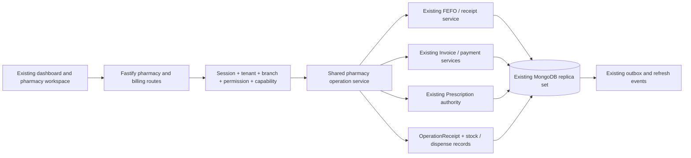

# Ekavyu Pharmacy production implementation plan

Prepared and researched: **19 October 2026 (Asia/Kolkata)**. Scope: enhance the existing product incrementally. The original audit and plan were prepared without application changes; implementation progress is recorded below. T26 includes targeted frontend dependency security patches. No live migrations, records, pricing publication or deployment have been changed under this work.

**Current scope — user clarification, 20 October 2026:** the entire project is in development, with no production customers or legacy production records. Skip hypothetical historical migrations/backfills, entitlement grandfathering and legacy deployment compatibility work. Earlier legacy audit notes remain reference history, not active delivery requirements. T25 is narrowed to current schema/index readiness and deterministic initial setup. Preserve current clinical/financial/security flows and genuine professional/release checks. This instruction is recorded in both repositories' `AGENTS.md` files.

Paths prefixed `F:` are relative to `D:/Project JK/frontend`; `B:` paths are relative to the separate `D:/Project JK/backend` repository. Proposed files are explicitly labelled **new**. Evidence identifiers below refer to inspected source, not assumptions from previous plans. Research identifiers link to the dated source register in section 22.

## 1. Executive Summary

### Current implementation checkpoint — 22 October 2026

**All feature tasks (T01–T25 and T27–T31) have local technical implementations, and T26 local engineering gates have passed.** T26 remains open for configured hosting, exact-revision CI and actual operational/professional evidence; a task count is not a production-readiness percentage. This checkpoint supersedes the older progress snapshots and migration assumptions below. No production deployment or live database/index changes have occurred.

T21 active drawers/closing, T22 bounded reports/exports, T23 verified product activation/continuity, T24 reviewed imports and T25 current schema setup are implemented; their current contracts are linked in the respective task cards. Their historical implementation evidence remains distinct from fresh T27 verification.

T27 now supports explicit sealed quantity/base-unit entry, remaining allowance and revision checks, repeated partial fills, immutable per-fill supply/invoice links, replay snapshots, restricted-register entries and patient tracker/print quantities. Unknown quantities keep one-supply semantics; dosage-derived allowance, external repeats and cross-branch source access remain blocked. Partial supply does not rewrite medical instructions, prior invoices or payments. A subsequent prescriber amendment requires explicit new quantity after any supply; returns do not replenish allowance. See [the quantity contract](pharmacy-prescription-quantities.md).

T27 verification (Level 4): **142 distinct backend cases across eight files and 74 frontend cases across four files passed**, including 30 → 10 + 20, concurrent 25 + 25, stale revisions, unit mismatch, sealed quantity tampering, paid-invoice preservation, H1 partial-fill/replay, note signing, setup indexes, tracker and print. Both package type checks passed; changed frontend files have no lint errors (existing warnings remain), and backend bundles were verified. Full release gates and professional/browser/device/provider/restore evidence remain T26.

T28 now provides organization-manager issuer/licence review in the existing branch settings dialog, with no automatic location creation or capability/product activation. Private form state resets on branch/account/permission changes, responses bind to the exact branch/organization, revisions and uncertain-save reloads protect writes, and payloads exclude response metadata. Switching to unregistered clears any prior GSTIN. **55 distinct backend and 36 frontend cases passed** across the affected tax/capability and issuer/location/navigation flows; both types passed and changed-file lint has no errors. See [branch administration](pharmacy-branch-administration.md).

T29 now supports reviewed single-batch transfers using the existing stock ledger and recorded commands: explicit compatible destination mapping, dual-branch approval, source dispatch, partial saleable/quarantine receipts, reviewed loss and quarantine return to source. Exact acquisition fractions and expiry/MRP provenance survive transfers. H/H1 stages require current classification and pharmacist evidence; X/narcotic, interstate, distinct-issuer/GSTIN and electronic-reporting requirements remain blocked. **99 distinct backend cases across five files and 59 frontend cases across two files passed**; both types, scoped lint (one existing warning) and five backend bundles passed. See [controlled transfers](pharmacy-stock-transfers.md).

T31 now reuses the shared provisioning transaction for verified independent pharmacy signup, purpose-bound email proof, one canonical product trial and organization-scoped staff MFA. Existing patient identities retain their records/credentials and can select their actual staff workspace. The pharmacy profile selects focused home/navigation/modules/mobile links/staff defaults. The first ordinary sale passes through owner APIs with no clinical enrollment or platform-root action. See [independent signup](pharmacy-independent-signup.md).

T31 focused verification: **29 distinct backend cases across three files and 30 frontend cases across four files passed**, including the 12 current signup/first-sale cases. Both package types, changed-file lint (no errors, existing warnings) and API/worker bundles passed. T26 adds the full-suite/security/build evidence; passing local feature checks do not approve production activation.

**T26 local engineering verification is complete.** Both registry audits report zero vulnerabilities. The fresh frontend suite passed all 159 files/1,128 cases; the final backend release auditor passed all eight gates, including all 221 files/1,941 cases, and generated its own approved engineering manifest. Native Next, existing vinext and all five backend bundles passed, as did types, lint and startup checks. Fifteen local Chrome viewport/state checks covered signup and the counter; they use synthetic API fixtures and do not certify physical devices or configured providers. Release fixes include atomic refund finalization across transaction retries, test-database index readiness, narrow-screen signup controls and the vulnerable tooling chain. See [release evidence](pharmacy-release-evidence.md) and [the deployment handoff](pharmacy-deployment.md). Exact-revision CI, configured hosting and actual professional, business, device/provider, restore and capacity evidence remain launch requirements. No deployment or offer publication occurred.

### Implementation progress — 19–20 October 2026

**T01 is implemented locally; not deployed.** Operational pharmacy routes now reject patient/family/guest roles independently of clinical grants, validate organization context, and apply existing staff branch authority to register reads/exports. Read-only staff retain stock/queue access without acquisition costs. Root register reads require an explicit, consistent organization or location. Existing pharmacy URLs, queue aliases and authorized clinic dispensing remain intact.

Changed backend files: `middleware/pharmacyGuard.ts` (new), `routes/pharmacy.ts`, `routes/scheduleH1.ts`, `controllers/medicine.ts`, `controllers/scheduleH1.ts`, `services/PharmacyInventoryService.ts`, and `tests/pharmacyAuthorization.test.ts` (new). Frontend changes make cost fields optional in the existing pharmacy DTOs and exercise the read-only workspace with cost-redacted data; no page layout or navigation was rebuilt.

Verification risk: **Level 4**. Four targeted regressions first reproduced the old consumer/cost/register exposure. After fixes, the new authorization file passed **23 tests**; existing `scheduleH1Register`, `pharmacyFulfillmentLoop`, `tenantIsolationAndPrescriptionSealing`, and `workspaceAuthority` files passed **29 tests**. The initial combined run found one new fixture missing required `DoctorAssignment.workingHours`; that fixture was corrected and the affected authorization file rerun successfully. Frontend workspace/alerts passed **20 tests**. Both package TypeScript checks and backend bundle build passed. Changed-file frontend ESLint reported zero errors and one existing `react-hooks/set-state-in-effect` warning on unchanged loading logic; whitespace checks passed.

No full test suite, production migration, payment-provider action or deployment ran. Frontend tests and backend bundling needed expanded local filesystem permission for generated Vite/dist files and then passed. Section 2 describes the **pre-implementation audit baseline**, preserved as evidence of what the corrections address.

**T02 is implemented locally; not deployed.** Aggregate-only dispensing now requires proof that no batch records exist and a known future expiry. Any structured history, including expired/depleted or incorrectly located records, prevents fallback to aggregate stock. Existing FEFO allocation and valid historical aggregate dispensing remain supported. Deleted medicines cannot receive stock, be adjusted or be dispensed; conditional writes and transaction retries also protect deletion after the initial read.

At the T02 checkpoint, medicine and batch quantities require non-negative safe integers, receipt/dispense quantities require positive safe integers, and prices require finite non-negative values. Receipt rejects aggregate overflow; allocation rejects corrupt stored batch quantities/prices. Metadata PUT and the absolute adjustment endpoint return **409** for structured quantity changes until T03 supplies batch-aware adjustments. Metadata PUT accepts an unchanged stock field for compatibility with the current edit form. Mode detection and aggregate edits run in the same transaction as the medicine write, so a concurrent first batch receipt forces a retry and rejection. The legacy adjustment and its required audit now commit together; T03's movement ledger, count revision and replay contract are recorded separately below.

Changed backend files for T02: `controllers/medicine.ts`, `services/PharmacyInventoryService.ts`, `models/Medicine.ts`, `models/MedicineBatch.ts`, `schemas/clinical.ts`, `tests/pharmacyInventory.test.ts`, and new `tests/pharmacyStockValidation.test.ts`. No storage-mode field or migration was added. Historical batch reads remain available under the existing authority checks.

Verification risk: **Level 4**. Seven targeted regressions first reproduced unsafe fallback and structured PUT behavior. Final scoped verification passed **77 tests** across `pharmacyInventory` (19), `pharmacyStockValidation` (23), `pharmacyAuthorization`, `pharmacyFulfillmentLoop`, `scheduleH1Register`, and `transaction`; backend `npm run check:fast` and whitespace/conflict-marker checks passed. Coverage includes missing legacy expiry, aggregate/batch mismatch, depleted/expired history, unsafe quantities, overflow, invalid prices, multi-line rollback, required-audit failure, concurrent deletion during edit/receipt/dispense, and a first receipt committing during an aggregate edit. One new audit assertion initially expected an unredacted reason; it was corrected to verify the retained numerical adjustment under the existing redaction policy. No frontend code changed for T02, so no frontend checks ran. No production build ran because entry points/bundling did not change, per T02's verification scope. No full suite, migration, live-data operation or deployment ran.

**T03 is implemented locally; not deployed.** Stock adjustment now requires a pinned `expectedQuantity`, medicine-wide `expectedRevision`, reason and stable `clientRequestId`. Structured adjustments select a batch; legacy aggregate adjustments prove that no batch exists. Conditional deltas update the selected batch and aggregate together with an append-only StockMovement, required audit and the existing OperationReceipt transaction. Replays return the original movement snapshot, and key reuse with changed details conflicts. Current staff/branch authority is checked before replay.

Receipts and dispensing also advance `stockRevision` and write movements, including FEFO lot allocations. The first inventory operation creates one prospective aggregate opening checkpoint, with no fabricated historical sources or data backfill. Batch/aggregate mismatches and corrupt lot quantities require review; positive counts cannot use expired or unknown expiry, including a batch whose catalogue still has a valid expiry. Damage/expiry reductions record write-offs, without asserting physical disposal or creating refunds. Quantity changes through metadata PUT, and unversioned absolute adjustment requests, now return actionable **409** responses; unchanged metadata-form stock values remain compatible. Inventory mutations require an active replica-set transaction, including development.

New backend files: `models/StockMovement.ts`, `services/PharmacyStockMovementService.ts`, `utilities/pharmacyInventory.ts`, and `tests/pharmacyStockMovements.test.ts`. Changed T03 backend files: `models/Medicine.ts`, `services/PharmacyInventoryService.ts`, `controllers/medicine.ts`, `routes/pharmacy.ts`, `schemas/clinical.ts`, and the existing inventory/stock-validation/authorization tests. Movement history is bounded and branch-scoped at `GET /api/pharmacy/medicines/:id/stock-movements`, requires `MANAGE_MEDICINES`, and survives medicine soft deletion. The new [stock adjustment API contract](pharmacy-stock-adjustments.md) documents snapshot/retry behavior and compatibility. No stock-count UI is introduced by this backend task.

Verification risk: **Level 4**. **110 distinct scoped tests passed across seven files**: `pharmacyStockMovements` (33), `pharmacyStockValidation` (23), `pharmacyInventory` (19), `pharmacyAuthorization` (23), `pharmacyFulfillmentLoop` (5), `scheduleH1Register` (4), and `transaction` (3). The first focused run passed 71 tests; review then found and corrected missing-batch-expiry inheritance, followed by 68 passing tests covering the final movement service and related authorization/fulfillment/register/transaction flows. Coverage includes real sale during a count, concurrent same/different-key counts, aggregate quantity restored after intervening activity, first batch receipt during a legacy count, deletion during adjustment, movement/audit failure rollback, expiry/write-off rules, corrupt totals, bounded authorized history, revocation before replay, model append-only guards and standalone fail-closed behavior. Final backend `npm run check:fast` and tracked/new-file whitespace/conflict-marker checks passed. No full suite, production build, migration, live-data operation or deployment ran. No frontend application code or caller of the new adjustment/history contract changed, so no frontend checks ran; entry points and worker bundling were unchanged.

**T04 is implemented locally; not deployed.** Dispensing now requires a stable `Idempotency-Key` and reuses the existing CommandReceiptService/OperationReceipt transaction. The trusted organization, branch and operation kind scope the key; the initiating actor is bound into its canonical payload hash and encrypted result. Claim, inventory movements, invoice creation/unpaid-visit append, prescription status, audit, versioned result snapshot and receipt link commit together with majority write concern. The optional transaction durability argument preserves existing helper callers' defaults. Mutable stock/prescription validation happens inside a new command's transaction; replay reads the original result first. Replays preserve the actual invoice, added amount and allocations after later invoice/stock changes. Notifications run after commit and are skipped on replay.

Authorized recovery is available at `GET /api/pharmacy/dispense-operations/:key?locationId=…`; submission and lookup require current staff, management, module and branch authority. Another actor cannot retrieve the initiating operator's result or reuse its key to create another dispense. Lookup uses `no-store` for successes and failures. No visible receipt after an uncertain response remains an unresolved outcome; it does not authorize a replacement key. Non-finite result amounts reject the transaction while legacy invoices may retain an absent optional `balanceDue`.

The frontend pins the submitted payload in memory and persists only an opaque reference under the actor/organization/impersonation/branch namespace. Axios requires the explicit dispense key and preserves it through auth refresh. Transport failure triggers lookup and offers same-payload/same-key retry; reload restores only the reference and looks up the committed result. The workspace shows the actual invoice and added amount, and waits for acknowledgment before another dispense. A missing result after reload keeps the reference for operator review; broader exception-resolution tooling remains T18. Storage failure prevents dispatch; late results stay out of a changed scope; an old confirmed result cannot acknowledge a newer reference from another tab. Frontend payload validation matches the backend's 100-stock-item/200-prescription bounds.

New backend files: `services/PharmacyOperationService.ts` and `tests/pharmacyDispenseRecovery.test.ts`. Changed backend files: `controllers/medicine.ts`, `routes/pharmacy.ts`, `schemas/clinical.ts`, `services/CommandReceiptService.ts`, `utilities/transaction.ts`, and the affected authorization, stock-validation, fulfillment, clinical, location-essentials and transaction tests. New frontend file: `src/lib/pharmacyOperations.ts`; changed frontend files: the pharmacy page, `src/lib/api.ts`, `pharmacyWorkspace.ts`, `PharmacyWorkspace.module.css`, and the workspace/payment-retry tests. The [dispense recovery contract](pharmacy-dispense-recovery.md) records response, retry, privacy, compatibility and review behavior. Other deployed integrations must adopt the header before this backend version is enforced.

Verification risk: **Level 4**. **115 distinct backend tests passed across targeted runs**: `pharmacyDispenseRecovery` (16), `pharmacyAuthorization` (24), `pharmacyStockValidation` (23), `pharmacyFulfillmentLoop` (5), `pharmacyStockMovements` (33), `transaction` (4), `clinical` (3), and `locationEssentialsCycle2` (7). **31 frontend tests passed**: workspace (23), payment/dispense transport retry (3), and alerts (5). Both package TypeScript checks, the hosted-payment boundary check, changed-file frontend ESLint and whitespace/conflict-marker checks passed; ESLint reported zero errors and one warning on existing loading-effect logic. Checks covered same/different-key concurrency, encrypted response recovery, append results, actor/branch revocation, canonical payload order, required-write rollback, non-finite snapshot rejection, majority durability, notification failure, reload/unknown outcomes, frozen retries, auth refresh, storage failure, scope changes and cross-tab acknowledgment. An adjacent queue-test fixture was corrected to grant its location manager a branch explicitly; production queue authority was unchanged. The response validator was corrected to preserve optional legacy `balanceDue`, and affected checks reran successfully. Existing missing controlled-route register context remains a T07 blocker; recovery tests exercise the controlled allocator with complete explicit audit context. No full suite, production build, migration, live-data operation, payment-provider action or deployment ran. No browser E2E or physical dispensing/printing certification is claimed.

**T05 is implemented locally; not deployed.** New dispense commands require the complete, duplicate-free selected prescription set to be active, sealed with verified integrity, current and consistent with the organization, location, patient, prescriber, completed encounter and linked appointment. Current signed-note membership establishes authority; focused visits without SOAP notes use the existing matching completion audit. Draft/stale notes cannot fall back to focused authority. Ordinary visit completion now seals finalized rows, including current note rows, and the queue/tracker/print selectors exclude unfinalized or superseded rows. No historical record is silently sealed or reclassified.

The workspace sends explicit per-prescription stock quantities before aggregation. A transaction locks the source visit/note and conditionally advances each prescription's fulfillment revision. An append-only `PharmacyDispense` stores the actual FEFO supply, per-prescription allocations, sale amounts and linked invoice. Source-prescription and invoice source-line uniqueness prevent deliberate new keys from completing the same source twice. New-command validation remains inside T04's recorded transaction; existing receipt hashes and encrypted replay snapshots remain compatible. Selected subsets remain supported; quantity-partial allowances remain T27.

Both charge compilers now use committed supply IDs and captured quantities/prices. Checkout preserves those lines on their linked bill; another invoice cannot copy them. Unfilled finalized medication appears separately as unbilled preview, with no catalogue quantity-one or free-text price estimate. New automatic consultation/checkout bills identify the corrected compiler with `clinicalChargeVersion: 1`. Unclassified historical/manual visit bills require review rather than text-based charge association. Paid, partially paid or explicitly issued bills stay unchanged; new supply uses a linked supplement. T06/T14 still own complete issuance/tax policy; T05 preserves the current dispensing tax calculation. Missing/adjusted/altered supply invoices require review rather than automatic recharge.

New backend files: `models/PharmacyDispense.ts`, `services/PrescriptionDispenseAuthority.ts`, `services/FinalizedPrescriptionSelection.ts`, `services/PharmacyChargeSource.ts`, and `tests/pharmacyPrescriptionAuthority.test.ts`. Changed backend files include the medicine, visit completion, invoice, public tracker and appointment-payment controllers; `AppointmentService`, `ChargeCaptureService`, `PharmacyOperationService`, Prescription/Invoice models, clinical schema and affected clinical/pharmacy/billing fixtures. Frontend changes send explicit allocations, label unfilled medicine in encounter/checkout previews and test those consumers. See [the prescription authority and source-charge contract](pharmacy-prescription-authority.md).

T05 verification risk: **Level 4**. **181 distinct backend tests passed across 18 scoped files**, including 40 new authority/source-charge cases, recorded-command recovery, stock/auth boundaries, ordinary and focused completion, cabin prescriptions, current-note sealing, tracker/printing, invoice/installments, consolidated checkout, variable fees, booking-invoice consultation reuse and transactional integrity. The final combined run passed 165 cases; the focused visit file passed 12; the final authority/clinical run passed 43, overlapping 39 earlier authority cases and adding the duplicate-latest-note and three clinical cases. **58 frontend tests passed across four files**: pharmacy workspace, billing workspace, encounter workspace and tracker authorization. Both package TypeScript checks, backend API/four-worker bundle build and changed-file frontend ESLint passed; ESLint reported zero errors and three warnings on existing effect logic. Final whitespace/conflict-marker checks passed.

Verification found and corrected ordinary completion leaving finalized rows unsealed, focused audit IDs being stored as strings, and a multikey invoice index indexing missing IDs as `null` on mixed clinical/pharmacy bills. Uniqueness now indexes a derived array containing actual supply-line IDs only; source duplication within and across invoices is tested. Old tracker/stock/auth fixtures now establish genuine finalized prescription authority instead of bypassing it. Frontend tests and bundling needed expanded local permission for generated Vite/dist files and then passed. No full suite, production data/index application, payment-provider action, migration or deployment ran. No browser E2E or physical dispensing/printing certification is claimed; complete release gates remain pending.

**T06's technical implementation is complete locally; not deployed. Professional review and production evidence remain pending.** New numbers use globally reserved branch series and India financial-year counters, with 16-character numbers, transaction-safe allocation, bounded sequences and no ObjectId-suffix collision. Old invoice numbers, rupee amounts, IDs and read URLs remain intact. New pharmacy issue requires an explicit India/INR issuer profile and reviewed medicine HSN, quantity-unit code, treatment and rate. Configuration uses existing organization-management and branch authority, trusted actor/time, optimistic revisions and required audit. There is no live profile or fabricated professional approval.

Actual inclusive lot prices now produce captured integer-paise base/CGST/SGST/gross facts. Zero rates survive receipt inheritance. Raw stored tax metadata is inspected before hydrated batch saves, so missing legacy fields cannot become the schema's default tax rate. Unsupported or unreviewed profiles, insufficient HSN precision, conflicting/missing lot tax metadata, unknown high-value recipient particulars and numbering exhaustion stop supply without committed stock/money changes. The issuer's professional reviewer must approve the explicit inclusive rounding policy before release; broader retail calculation remains T16.

Each new pharmacy supply issues its own immutable document, linked to the existing visit bill when present. This supersedes T05's new unpaid-clinical-draft append behavior: medical drafts and issued medicine documents are not combined implicitly. Issued/unpaid is distinct from paid. Clinical checkout excludes issued pharmacy charges; visit payment projections account for both bills, while invoice installments settle each actual document. Source IDs remain unique and replay retains the original captured result, including older receipts with an append result.

The shared print lifecycle now uses the captured pharmacy issuer/licences/GST particulars, recipient/delivery details, document kind, number/FY/issue time, HSN/unit/rates and captured tax amounts. It refuses incomplete issued snapshots, and current branding/prices cannot replace the issue snapshot. Signature mode is explicitly manual on print; no signature image or digital tax-signature claim is invented. Unreviewed clinical checkout keeps a generic invoice/receipt title.

New backend files: `models/InvoiceSeries.ts`, `models/PharmacyTaxProfile.ts`, `models/pharmacyDocumentSchema.ts`, `services/PharmacyDocumentService.ts`, `services/VisitInvoiceBalance.ts`, `utilities/pharmacyTax.ts`, `controllers/pharmacyTax.ts`, `schemas/pharmacyTax.ts`, `tests/pharmacyTaxDocuments.test.ts`, and the synthetic tax-fixture helper. Existing numbering, pharmacy, invoice, appointment-payment/UPI callback, source/charge and model paths were extended. New frontend files: `src/lib/pharmacyInvoice.ts`, `src/components/pharmacy/PharmacyInvoiceDocument.tsx` and its printing tests; billing and the unified document modal use the captured document. See [the tax-document/configuration contract](pharmacy-tax-documents.md).

T06 verification risk: **Level 4**. **183 distinct backend tests passed across 14 scoped files**, covering fiscal numbering/collisions/concurrency/exhaustion, inclusive and zero-rate pricing, actual lot metadata, issuer/classification authority, unsupported profile changes, immutable issue/source facts, command replay and rollback, stock fulfillment, separate consultation/pharmacy settlement, counter collection and UPI callbacks. The final five-file run passed 94 cases; earlier overlapping regression and tax/inventory runs passed 131 and 50 cases respectively. **39 frontend tests passed across four files**, including captured pharmacy printing, incomplete-snapshot refusal, the shared print lifecycle, clinical document defaults and billing. Both package TypeScript checks, backend API/four-worker bundle build, hosted-payment boundary check and changed-file frontend ESLint passed; ESLint reported zero errors and three warnings on existing effect logic. Whitespace/conflict-marker checks passed. Review corrected missing raw lot tax becoming a schema default, unsupported profile edits leaving old issue settings active, and visit payment projections ignoring separate pharmacy balances. Frontend tests and bundling required expanded local filesystem permission for generated Vite/dist files and then passed. No full suite, browser E2E or physical printer certification ran. Real issuer classification/registration, professional approval of numbering/rounding/signature practice, current reporting obligations and physical printer/handover validation remain release gates. No production index application, migration, real configuration, deployment or professional approval ran.

**T07's technical implementation is complete locally, 20 October 2026; not deployed. Professional and production validation remain pending.** The production dispense route now passes server-created source/invoice IDs, actor, issue time and prescription allocations to the allocator. H/H1 supply requires reviewed matching sale restrictions, active branch-specific pharmacist/prescriber evidence, current staff and doctor records, a matching sealed prescription in the latest signed note, and actual recipient/prescriber details. Missing raw classifications or evidence stop the command. Schedule X/narcotic supply remains blocked. Existing general-medicine connected supply is preserved; no drug name is treated as evidence of its legal schedule.

New append-only register entries capture each actual prescription/lot allocation with batch identity/expiry, quantity, names/addresses, registration/council and review particulars, plus note/encounter/dispense/invoice links. Stock, register, source, invoice, required audit and recorded result share the existing transaction. Replays preserve the committed result after qualification changes, while revoked staff/branch authority still denies access. New rows cannot use the old invented patient/prescriber/pharmacist defaults. Historical incomplete rows remain unchanged and visible with missing-evidence flags. H1 list/export defaults now exclude H prescription-register entries; explicit schedule filters retain historical access. Register responses use `no-store`.

Authorized organization managers can read/save professional reviews and review medicine dispensing classifications through branch-scoped APIs with trusted reviewer/time, optimistic revisions and required audit. Ordinary medicine management cannot change sale restrictions or approve qualifications. Evidence references are assertions requiring real professional review; no government verification, external-prescription upload, synthetic Patient, repeat allowance or legally certified digital signature is invented. See [the restricted dispensing contract](pharmacy-restricted-dispensing.md) for API details and release limits.

New backend files: `models/PharmacyProfessionalReview.ts`, `controllers/pharmacyDispensing.ts`, `schemas/pharmacyDispensing.ts`, `services/PharmacyRestrictedSupply.ts`, `utilities/pharmacyEvidence.ts`, and a synthetic restricted-fixture helper. Changed backend files include Medicine/Register models, the medicine/register controllers, pharmacy routes, inventory service, production-route register/recovery tests and historical authorization fixtures. No frontend application code changed.

T07 verification risk: **Level 4**. **183 distinct backend tests passed across eight scoped files**: register production path (32), recorded dispense/recovery (16), authorization (24), inventory (19), fulfillment (5), tax documents (31), prescription authority/source billing (42) and affected stock-validation metadata cases (14). The seven-file run passed 169 cases. Final review then blocked an unrelated metadata save from persisting a default over a missing legacy schedule; the two affected register cases and 14 metadata regressions passed, and TypeScript passed again. Both H/H1 allocation cases, shared-medicine prescription/lot splits, general supply, blocked X/narcotic categories, missing/stale evidence, genuine short names/lot labels, aggregate lot evidence, required register/audit rollback, same/different-key retry, concurrent review creation/revocation, scoped configuration, immutable records and historical flags/export separation are covered. Backend TypeScript and API/four-worker bundle build passed; tracked/new-file whitespace and conflict-marker checks passed. The first TypeScript check found enum/nullable fixture typing issues, which were corrected. No frontend checks were needed for backend-only code and additive unused register/configuration DTO fields. No full suite, browser/printer check, government registration verification, production index application, migration, live configuration, deployment or professional approval ran. Current schedule/qualification, pharmacist supervision, prescription endorsement/signature and electronic-register/inspection acceptance remain release gates.

**T30 is implemented locally, 20 October 2026; not deployed.** Existing summary and close routes share a receipt-based calculation. Each committed installment contributes its actual amount/date/method within the location's business day, including earlier bills and partially paid invoices. Online is not presumed UPI; exact minor-unit totals and configured report currency avoid mixed-method/currency sums. Local midnight and DST boundaries reuse the existing time utility. An unrelated invoice edit cannot create a collection. Reports capture an `asOf` cutoff; a later committed receipt belongs to a later snapshot.

Legacy invoices without receipt rows contribute one explicitly labelled compatibility payment only with full recorded paid amount, actual payment date and known method. No invoice-total or updated-time guess fills absent evidence, and receipt-bearing bills never use an invoice-level fallback. Missing/corrupt dates, amounts, methods, duplicated identities, mismatched balances, future evidence or unlike currencies require reconciliation. Incoming receipts on refunded/cancelled/deleted bills remain gross facts with a review issue; no refund or payout is inferred. Unassigned branch payment evidence is excluded from tenant totals and identified only by a generic ownership issue. Close is blocked while evidence needs reconciliation.

New saved reports retain receipt counts/basis, currency, timezone and cutoff alongside existing CashierShift fields. Snapshot and required audit commit together; invalid counted cash or an unexplained cash difference is rejected. Old saved amounts/dates remain unchanged and are presented as legacy invoice-based reports. The till UI uses receipt counts, local-day/currency labels and evidence warnings, independently blocks close when review is required and prints stored historical values. Active drawers, opening floats, refund/payout events, close idempotency and full payment/close coordination remain T21 and its dependencies. See [the receipt-based till contract](pharmacy-till-collections.md).

Changed backend files: `controllers/cashierShift.ts`, `models/CashierShift.ts`, new `services/TillCollectionService.ts` and `tests/tillReceipts.test.ts`. Frontend changes are confined to the existing billing page and billing workspace tests; existing endpoints and payment posting flows remain in place.

T30 verification risk: **Level 4**. **39 backend tests passed across two scoped files**: 34 receipt/till cases and five existing clinical-continuity/till cases. Coverage includes real installment API receipts, 40 cash/60 UPI on distinct dates, partially paid and older bills, later edits, exact paise, India midnight, both DST transitions, supported legacy full-payment evidence, uncertain residuals, invalid/duplicate/missing/future evidence, a later receipt after the cutoff, currency separation and USD online payments, refund/cancellation/deletion, zero waivers, counted cash validation, atomic audit rollback, old snapshots, staff/branch/consumer denial and unassigned ownership without identifier disclosure. Initial fixture expectations were corrected to use the shared hidden-branch `404` response and the close route's current local day. **22 frontend billing tests passed**, including receipt labels, other online collections, evidence blocking, USD formatting and unchanged historical report amounts. Both package TypeScript checks and the backend API/four-worker bundle build passed. Changed-file frontend ESLint reported zero errors and two warnings on existing effect logic; whitespace/conflict-marker checks passed. No full suite, frontend production build, browser/printer certification, live till close, data repair, migration, index application, provider/bank reconciliation or deployment ran.

**T08 is implemented locally; not deployed.** Existing clinic Locations can acquire an explicit pharmacy capability at the same ID. New pharmacy facilities start disabled; legacy locations retain included access. Settings require current branch/settings grants, a revision and review reference; enabling also requires the reviewed issuer profile from T06. Disable and new stock writes serialize in the same transactions, while authorized stock/history and committed-operation recovery remain available. Organization modules remain the master switch; paid entitlement evaluation remains T09/T23.

Named pharmacy action grants separate stock, cost, catalogue, inward, adjustments, queue, supply, register export and settings. Live Role lookup preserves revocation and explicit empty/custom roles. Four opt-in role templates use the existing role builder and branch grants. A pharmacy cashier needs no EHR, patient-directory or general billing permission; later retail money grants do not unlock generic clinical finance routes. The workspace reads a server capability DTO before loading records, omits unauthorized queue requests and actions, and clears records/forms if access cannot be checked. Settings are in the existing Locations menu. See [the capability and permission contract](pharmacy-capabilities.md).

T08 verification risk: **Level 4**. **229 distinct backend tests passed across 11 scoped files**: capability/settings, pharmacy authorization, inventory, stock movements/validation, dispense recovery, prescription authority, restricted register, roles, permission-cache revocation and facility domain. The broad regression run passed 228 cases; the final affected transaction run passed 97 cases, including the added explicit-session rollback case. Counts do not add repeated checks. Capability tests also cover actual cashier creation and branch assignment through existing APIs, empty/custom roles, live revocation, consumer/tenant/root-impersonation isolation, cost redaction, reviewed in-place enablement, module-off settings, stale/concurrent reviews, required-audit rollback, stock changes racing disable and committed replay after disable. A lock acquired too early initially blocked injected stock interleavings; moving the capability write to the end of the same transaction fixed that contention while retaining rollback, verified with a deterministic concurrent-disable case.

**79 distinct frontend tests passed across eight scoped files**, including 31 pharmacy workspace cases, settings revisions/unavailable access, custom-role presets, locations, branch grants, facility labels and navigation. A cost-prefill regression was corrected, and dialog-dismissal assertions wait for the existing exit animation. Both package TypeScript checks and the backend API/four-worker build passed. Changed-file frontend ESLint reported zero errors and six hook warnings; whitespace checks passed. No full suite, frontend production build, browser/printer certification, real licence/qualification review, role migration, pricing activation, live-data operation or deployment ran. See the capability contract for future retail grants that remain unavailable until their workflows are implemented.

**T09 is implemented locally; not deployed.** Optional location-product pricing on SaaSPlan, versioned paise quotes, compatibility tiers and captured selection schemas reuse the current subscription/payment/invoice models. The quote API validates owned branches, physical-location uniqueness, current price/capability revisions, configured tax/annual/extra-pharmacy prices and active doctor capacity. The billing screen previews server totals; product purchase and operational enforcement remain T23. No rates were seeded and no existing plan was converted or live grant activated. See [the commercial quote contract](pharmacy-commercial-quotes.md).

T09 verification risk: **Level 4**. **79 distinct backend cases across seven files and 12 frontend cases across three files passed**, including the requested ₹499/₹799/₹1,098/₹1,397 examples, tax/period bounds, snapshot evidence, tenant/branch/consumer authority, legacy compatibility, zero doctor/staff/location capacity and concurrent doctor creation. Both package TypeScript checks, changed-file frontend lint, hosted-payment boundary check and backend bundle build passed. A stale downgrade test fixture was corrected to use a real administrator membership rather than weakening branch authority. The focused arithmetic/quota fixtures also supply the existing required specialization and assert that client-supplied totals cannot change server pricing. No full suite, frontend build, live configuration, provider transaction, migration or deployment ran.

**T10 is implemented locally; not deployed.** Catalogue-only operators can register an empty product without invented batch, expiry or acquisition cost. Validated metadata, explicit versioned units and location-scoped barcode aliases preserve leading zeros, zero reorder/GST and legacy IDs. Unit changes cannot reinterpret existing quantities or depleted batch history. Inventory search, low-stock alerts and prescribed-ID lookup now use bounded server pages instead of loading the entire catalogue. Existing opening-stock requests retain receiving/cost checks; stock and reviewed tax/restriction changes remain separate. See [the catalogue contract](pharmacy-catalogue.md).

T10 verification risk: **Level 4**. **177 distinct backend cases across eight scoped files and 61 frontend cases across four files passed**. Regressions caught and corrected schema coercion of null/string stock or money, stripped tenant assertions, accessible stock-selector labels and a render-time ref access. Both package type checks, backend API/four-worker bundle build, whitespace checks and changed-file frontend lint passed (zero errors, six warnings). No full suite, frontend production build, browser/printer certification, index application, live records or deployment ran.

**T25-A read-only tooling is implemented locally; T25 remains partial.** The new scoped review CLI emits deterministic paginated exception manifests for inventory, orphan batches, invoice sources, restricted-register gaps, access mappings and actual index metadata. Data pages use snapshot transactions and abort without commits. Unknown units and stock differences never become opening stock. There is no apply mode or application-connection fallback. **21 focused backend cases and TypeScript passed**, including native Mongo command monitoring for absence of write/index/commit commands. Only synthetic data was reviewed. No real snapshot, migration, entitlement mapping or index change ran. See [the reconciliation contract and operating limits](pharmacy-reconciliation.md).

**T11 is implemented locally; not deployed.** Explicit stock/opening receipts capture receipt-line lot identity, unit version, exact rational acquisition cost, per-base prices/MRP, printed expiry precision, timezone/cutoff and received time. Command reservation, aggregate revision, lot, movement, required audit and received-result recovery share one transaction. Repeated printed batches retain distinct cost lots when reviewed index readiness permits them. Legacy inward keeps duplicate-label protection and cannot mix into captured lots. The workspace uses the new form for products with units, preserves a scoped opaque reference on uncertainty and supports re-entry under that same reference after reload. See [the receipt and index compatibility contract](pharmacy-stock-receipts.md).

T11 verification risk: **Level 4**. **216 distinct backend cases across nine scoped files and 53 frontend cases across three files passed**. Both package TypeScript checks, backend API/four-worker build, whitespace checks and changed-file lint passed (zero errors, four warnings). Tests include retained/missing index readiness, replay/source-line concurrency, corrupt stock-revision conflict, FEFO cost identity, expiry/DST, live authority, rollback and clinical/tax/register regressions. The modal test harness and custom-select interaction were corrected without weakening assertions. Only disposable synthetic databases changed indexes during readiness tests. No full suite, frontend build, live index/backfill, real browser/printer certification or deployment ran. Historical lot/unit backfill and enforced batch/index cutover remain reviewed T25 operations.

**T12 is implemented locally; not deployed.** The existing workspace now has branch-scoped supplier/customer records and purchase drafts, protected by purchasing/organization-management grants. Masters support both roles, actual GST/licence/contact data, archive state and revisions. Drafts retain supplier/product/unit snapshots, billed/free quantities, exact input paise, invoice identity/FY and stable source-line IDs. Company-wide supplier-invoice uniqueness prevents duplicate bills across branches. Creation reuses command receipts; revisions and required-audit transactions protect edits. Saving drafts has no stock, payable, payment or clinical-entity effect. See [the party and purchase draft contract](pharmacy-purchase-drafts.md).

T12 verification risk: **Level 4**. **50 distinct backend cases across two scoped files and 52 frontend cases across three files passed**. Both package TypeScript checks, changed-file frontend lint and backend API/four-worker build passed (zero lint errors, two warnings). Tests cover purchase-only authority without stock/EHR access, tenant and shared-branch boundaries, live revocation, invoice/GST identities with/without prepared indexes, snapshots after supplier changes, concurrent edits/replay, rollback, safe inputs, unknown licence validity without fabrication, bounded searches and branch-switch cleanup. A supplier-subdocument typing mismatch was corrected using an explicit snapshot projection. Verification reused passing results and reran only affected cases/files, without unrelated inventory/payment suites. No dependencies, full suite, frontend build, live index/data operations or deployment ran.

**T16 is implemented locally; professional rounding/tax review remains pending.** The shared `InvoiceCalculationService.ts` supplies versioned integer-paise/rational-unit calculations, inclusive/exclusive tax, explicit effective rates and tax modes, line discounts, deterministic invoice-discount allocation, MRP caps and explicit bounded round-off. Existing issued `inclusive-paise-v1` bills retain their exact rounding, four-field tax DTO, numbers and rupee projections; historical/clinical invoices are not recalculated. New/edited purchase drafts save server-owned calculation snapshots and show saved totals plus the difference from the supplier's stated total. Draft GST stays unsplit until place-of-supply evidence is reviewed, with no stock/payable/payment effects. See [the calculation contract](pharmacy-calculations.md).

T16 verification risk: **Level 4**. **116 backend cases across five files and 13 frontend purchase-form cases passed**, including synthetic sale/purchase/credit amounts, mixed-rate discounts, odd-paise tax splits, stable allocation, rational costs/free units, full discounts, MRP, invalid/overflowing inputs, legacy rounding parity, real issued-document/settlement/consolidated consumers, saved draft snapshots, injection rejection and old-draft read/replay compatibility. Both package TypeScript checks, backend API/four-worker build, whitespace checks and changed-file frontend lint passed (zero errors, one existing effect warning). The focused backend run reported 98.95 seconds and the frontend run 19.09 seconds; no full suite or repeated passing checks were needed. No frontend production build, browser/printer certification, professional approval, live records/indexes, migration or deployment ran. Retail issue and source-bound return integration remain in their respective T14/T15/T19 tasks.

**T13 is implemented locally; not deployed.** Saved supplier bills now post one frozen payable using reviewed source tax/state/cost evidence and the shared calculator. Separate source-bound deliveries receive partial billed/free quantities and multiple actual lots, with exact cumulative cost allocation and purchase/receipt references on stock movements. Expected revisions, stable command/delivery identities, required audits and transactions prevent duplicate posting, duplicate/over-receiving and partial commits. The existing workspace supports saved-bill posting review, remaining quantities, delivery history and opaque-reference recovery after reload. Legacy `/batches` now requires an explicit unlinked inward reason; its consumers must adopt that field before rollout. See [the posting and delivery contract](pharmacy-purchase-posting.md).

T13 verification risk: **Level 4**. **124 distinct backend cases across five files and 60 frontend cases across three files passed**. Coverage includes immutable posted facts and receipt history, same/different-key concurrency, missing indexes, repeat deliveries before index preparation, net/gross/odd/free costs, source caps, full unit drift, invalid/expired later-line rollback, required-audit rollback, reviewed tax/total checks, grants/tenant/consumer/revocation/disable boundaries, existing inward/FEFO, and UI validation, frozen retry, reload, storage failure, late results and incomplete server results. Both package TypeScript checks, backend API/four-worker bundle build, whitespace checks and changed-file frontend lint passed (zero errors, two existing effect warnings). An overloaded model-hook type, invalid-input test typing and a render-time ref read were corrected; successful unchanged checks were retained and reruns scoped to affected files. No full suite, frontend production build, real browser/printer certification, external professional approval, live data/index operation, migration, payment or deployment ran. Supplier settlement remains T20; broader operational exception tooling remains T18.

**T14 is implemented locally; not deployed.** Ordinary reviewed counter products can issue through the shared Invoice/PharmacyDispense/FEFO/calculation/numbering engine without creating clinical entities. Invoice kind, actual actor, optional customer, real unit/lot/printed-expiry/MRP evidence, paise calculation and tax snapshots are captured atomically with stock, required audit and recoverable command result. Separate pharmacy reads enforce current branch/sales authority; clinical billing/detail/payment-link/insurance/export paths exclude retail bills. The shared pharmacy print lifecycle accepts the committed retail snapshot and rejects incomplete evidence. This increment issues an unpaid bill; collection and paid receipts remain T17, quote/cart/scanning UX T15. See [the retail invoice contract](pharmacy-retail-invoices.md).

T14 verification risk: **Level 4**. **77 distinct backend cases across eight scoped files and 21 frontend print cases across two files passed**, covering anonymous/identified customers with no Patient/Doctor/Encounter, immutable facts, concurrent issue/replay, stale price/profile/unit/stock assertions, exact discount/tax/round-off totals, stock/audit/later-line rollback, classification/MRP, issuer/customer/tenant/grant/consumer/actor/disable boundaries, current clinical issue/collection/consolidation, reporting/CRM receipts and shared print. Both package TypeScript checks, backend API/four-worker build, changed-file frontend lint (zero errors/warnings) and whitespace checks passed. New fixture typing/required-name and print-format assertions were corrected with scoped reruns. No full suite, frontend production build, real scanner/printer validation, live data/index operation, migration or deployment ran. No compatibility layer or backfill was added for hypothetical production history.

**T17 is implemented locally; not deployed.** Pharmacy collection authority now records exact cash/manual UPI/card/split receipts, tender/change and identified-customer partial balances against the existing invoice ledger. Stable commands, required audits, immutable receipt groups and original-result recovery protect concurrent/repeated collections. Clinical full-pay and installments share the exact money mutation while preserving clinical authority and response contracts. The existing workspace supports collection-only operators and opaque-reference recovery. See [the collection contract](pharmacy-collections.md). Shift assignment remains T21.

T17 verification risk: **Level 4**. **101 distinct backend tests across eight files and 72 frontend tests across four files passed**, including concurrent installments/full-pay, overpayment, split totals/change, audit rollback, scope/revocation, retry/reload, immutable receipts, till totals and existing retail/clinical consumers. Both package type checks, backend API/four-worker build, payment-boundary check and whitespace checks passed. Changed-file frontend lint reported zero errors and three effect warnings. No full suite, provider action, real printer/scanner check, live database change or deployment ran.

**T15 is implemented locally; not deployed.** Sales-only staff can scan exact product barcodes, edit pack/loose quantities, select an optional recorded customer, hold/resume memory-only carts, review server quotes and issue/recover a counter invoice. Quote and issue share owned FEFO, unit, reviewed-price/tax and calculation preparation. Material quote hashes and current revisions reject stale evidence; a zero-total discounted bill settles without fabricating money. Saved invoices open T17 collection, so a payment failure never reissues stock. See [the counter contract](pharmacy-counter.md).

T15 verification risk: **Level 4**. **85 distinct backend cases across four files and 62 frontend cases across four files passed**, covering read-only quote/issue parity, different lot prices, exact leading-zero barcodes, bounded customer/product projections, permissions, stale unit/stock/profile/customer evidence, full discounts, existing retail/clinical payment paths, keyboard DOM flow, holds, retries, reload, branch changes, storage failure and collection failure. Both package type checks, backend API/four-worker build, payment-boundary and whitespace checks passed. Changed frontend code lint has zero errors and three existing effect warnings. No full suite, physical scanner/printer test, representative-store benchmark, live database change or deployment ran.

**T18 is implemented locally; not deployed.** Saved pharmacy bills and immutable collection receipts now have A4/80 mm/58 mm previews through the existing isolated print lifecycle. Reprint/failure never finalizes stock or money; earlier partial receipts keep their original balance, actor/date and change after later settlement. History offers actor/branch-authorized sale recovery even when new sales are disabled, retaining unresolved references and preventing acknowledgment from clearing another pending sale. Complete clinical dispense snapshots can use the same pharmacy document action. See [the print/recovery contract](pharmacy-print-recovery.md).

T18 verification risk: **Level 4** for document disclosure and recovery. **73 distinct frontend cases across five files passed**, including original partial receipts, incorrect invoice/branch/totals, physical-paper option selection, failed print/reprint, history without collection authority, opaque recovery/reload, unresolved/different references, branch changes and existing clinical/retail consumers. Frontend TypeScript, whitespace and changed-file lint passed (zero errors, three existing effect warnings). No backend contract changed. No real printer/scanner/browser certification, full suite, live records or deployment ran.

**T19 is implemented locally for captured retail sources; not deployed.** Original sold quantities/lots cap concurrent returns and cumulative source-price credits. Actual condition, quarantine and independent return/financial approval grants precede atomic quarantined lots, movements, an immutable return, separately numbered commercial credit note, required audit and recoverable result. Credits reduce due or expose a refund payable while actual receipts remain unchanged. The workspace supports source review, approval, uncertain retry/reload and saved credit-note printing. Tax adjustment needs professional review; T20 supplies confirmed payouts and supplier corrections. See [the sales-return contract](pharmacy-sales-returns.md).

T19 verification risk: **Level 4**. **163 distinct backend cases across seven files and 74 frontend cases across five files passed**, including source/credit caps, concurrent returns, immutable original facts, rational costs, odd paise/rounding, credit-aware collection/tills, audit rollback, quarantine exclusion/count-release rejection, live grants, disabled-capability continuity, scope, reload, retry, branch cleanup and credit-note printing. Both package TypeScript checks, backend API/four-worker build, whitespace and changed-file frontend lint passed (zero errors; existing fetch/effect warnings). No actual refund, tax filing/professional approval, physical device certification, full suite, live database change or deployment ran.

**T20 is implemented locally; not deployed.** Actual received lots now support source-capped supplier returns while expected credit remains pending until real supplier note evidence is allocated. Immutable supplier payment/refund and customer payout events enforce exact source balances and revisions, preserving original incoming receipts. Reviewed dated opening dues use separate supplier obligations or explicit customer opening balance statements with no supply/tax/stock effects. The workspace provides bounded statements, approval/confirmation forms, original-result recovery and statement/receipt printing. Opaque references now survive authority changes while private forms clear. See [the finance contract](pharmacy-finance.md). T21 consumes these facts for physical drawers; T23 finalizes commercial-expiry continuity.

T20 verification risk: **Level 4**. **185 distinct backend cases across ten files and 89 frontend cases across six files passed**, including source/on-hand/cumulative supplier return caps, actual partial note allocations, concurrent payments, normalized reference uniqueness, capped supplier/customer refunds, further returns after partial payout, immutable opening statements, no fake supply/clinical records, original receipts, source/actor/grant isolation, audit rollback, fiscal sequences, reload/retry, permission/branch cleanup and captured print evidence. Both package type checks, backend API/four-worker build, payment-boundary and whitespace checks passed. Changed-file frontend lint has zero errors and six fetch/effect warnings. No actual bank/provider/refund action, physical device/professional certification, full suite, live records or deployment ran.

**T01–T20 and T30 now have local technical implementations (21 of 31 tasks), plus optional T25-A diagnostics.** Professional evidence and release-readiness checks remain pending. The remaining 10 tasks are T21–T29 and T31, including T25's reduced initial-setup scope; this task count is not an effort percentage. Next: **T21 — active cashier drawers and immutable closing**. Quantity-partial dispensing remains T27.

**Keep the existing pharmacy, organization, location, authentication, inventory allocation, invoice and payment infrastructure. Complete their boundaries and add the missing retail operations incrementally.** The present pharmacy is a clinic dispensing workspace with useful inventory functionality. It is not yet a complete standalone retail pharmacy.

Source inspection confirms medicine registration/editing/soft deletion, paginated catalogue reads, batch receipt, FEFO allocation, low-stock/expiry alerts, a prescription dispensing queue, invoice creation or unpaid-visit append, payment collection, partial payments, printing infrastructure, till closing, subscriptions, staff membership and branch grants. Existing tests describe connected clinical journeys. These are **KEEP/EXTEND**, not replacement projects.

The most urgent issues are authorization composition, stock-mode ambiguity, direct aggregate edits, missing dispensing idempotency, insufficient prescription authority checks, disconnected controlled-drug register context, and inconsistent medicine charge capture. The present invoice identifier also exceeds the GST tax-invoice length constraint. These deserve P0 work before expanding the counter workflow.

Standalone support needs a patient-optional pharmacy invoice mode, pharmacy-specific permissions, independent onboarding/capability entitlements, medicine units/barcodes, supplier invoices and inward records, counter sales, returns/credit notes, receipt-based reconciliation and essential reports. A customer profile is optional for eligible ordinary cash sales; identified credit and legally restricted dispensing require appropriate identity and evidence without manufacturing a clinical Patient or Doctor.

Recommended delivery:

1. **P0: protect existing users.** Authorization regressions and fixes first; then stock consistency, retry safety, prescription validation, billing/register corrections and regulatory release gates.
2. **P1: complete standalone pharmacy.** Add compatible data contracts, onboarding, entitlements, purchasing, POS, settlement, returns, reports and practical migration/recovery.
3. **P2: refine connected and branch operation.** Quantity-level dispensing, clinical billing continuity, branch management and controlled transfers.
4. **P3: extension points only.** IPD/ward/admission linkage, complex offline synchronization, forecasting, marketplace and wholesale ERP are deferred.

The proposed ₹499/month standalone price is a business assumption, not a verified current plan. Cost discipline means short transactions, indexed bounded reads, the existing MongoDB deployment and workers, manual import/receipt fallbacks, and no new infrastructure service. Transaction integrity is a requirement even at this price.

**Audit limitation:** this is a source-and-test inspection, not a running-system certification. No tests, browser flows, deployed database, payment provider, printer or production licence were exercised. “Implemented” means the code path exists; “working in production” remains unverified. Historical frontend verification in `F:docs/pharmacy-workspace-refinement.md` is useful context but is not fresh evidence. Earlier plans are inputs, not proof: this audit specifically verifies the current replica-set test fixture, payment idempotency and existing till support rather than repeating older uncertainties.

## 2. Existing Pharmacy Implementation Audit

### 2.1 Repository evidence register

| ID | Inspected source and symbols | Finding and disposition |
| --- | --- | --- |
| E01 | `F:src/app/(dashboard)/dashboard/pharmacy/page.tsx`: catalogue/pending reads, `commit`, medicine/batch submit, dispense submit | Existing compact Inventory / Dispense / Alerts workspace, selected location, responsive tables/cards, shared modals, retained form values, write lock, scope-aware reads. **KEEP** interaction foundations. Dispensing sends patient, doctor and selected prescription IDs; success currently discards returned invoice details. |
| E02 | `F:src/components/pharmacy/pharmacyWorkspace.ts`: `readMedicineCatalog`, `prepareDispense`; `PharmacyAlertsCenter.tsx`; `PharmacyWorkspace.module.css` | Reads all pages, bounded at 500 pages of 100; duplicate medicine selections aggregate; positive safe integer quantities; no inferred dosage or fuzzy substitution. Reorder default 20; expiry alerts already exist. **KEEP** safety checks, replace full-catalog loading with bounded search for scale. |
| E03 | `B:routes/pharmacy.ts`, `B:schemas/clinical.ts`: `createMedicineSchema`, `dispensePrescriptionSchema` | Routes and aliases exist. Reads allow `MANAGE_MEDICINES` **or** `VIEW_EHR`; writes require `MANAGE_MEDICINES`. Strict create/dispense schemas reject additional properties. Create schema omits manufacturer/category/schedule fields the controller accepts, as well as reorder/tax settings; do not assume those settings work through the UI. |
| E04 | `B:models/Medicine.ts` | Location-bound catalogue and aggregate quantity, retail/cost prices, legacy batch/expiry, manufacturer, dosage-form category, schedule enum, reorder, HSN/GST defaults, soft delete, audit plugin. No explicit organization field/tenant plugin, barcode or pack conversion. Location ownership checks currently supply its tenant boundary. **EXTEND**, preserve IDs. |
| E05 | `B:models/MedicineBatch.ts` | Structured quantity, expiry, purchase/selling price, optional MRP, tax fields, status; unique `(medicineId,locationId,batchNumber)`. Optional organization field, audit plugin. **EXTEND** for repeated inward/cost lots and stock disposition. |
| E06 | `B:services/PharmacyInventoryService.ts`: `addBatchToMedicine`, `dispenseMedicineFEFO`, `getExpiringBatches` | Transactional receipt and FEFO with aggregate decrement; active future-expiry batches sorted by expiry. No eligible batches triggers aggregate fallback without checking whether *any* structured batch exists. Repeated physical batch number rejected. No append-only quantity movement record. **FIX/EXTEND**, keep FEFO service. |
| E07 | `B:controllers/medicine.ts`: `createMedicine`, `updateMedicine`, `deleteMedicine`, `adjustStock` | Creation stores aggregate-only opening quantity. Update assigns stock/prices directly without the creation validations; adjustment saves aggregate then creates audit separately, without adjusting batches. Soft delete preserves history but stock paths do not consistently exclude deleted medicines. **FIX**, retain routes with compatible validation. |
| E08 | Same controller: `getMedicines`, `getMedicineBatches`, `getExpiringMedicinesController` | Scoped list, escaped name/generic regex, counts, pagination headers; batch detail and expiry endpoints already exist. Expiry result can be unbounded and includes zero-stock expired rows; missing location returns empty. **KEEP/REFINE**, no duplicate alert engine. |
| E09 | Same controller: `getPendingPrescriptionsController` | Active nondeleted prescriptions grouped by encounter with patient/doctor/contact and appointment metadata; appointment fetch is already batched. No signed/finalized-note filter, response pagination, or separate queue permission. **FIX/EXTEND** minimum dispensing DTO. |
| E10 | Same controller: `dispensePrescription` | Requires Patient, may assign an unowned patient to organization before transaction, validates medicine location/quantity, defaults invoice doctor to current user, allocates FEFO, appends eligible unpaid visit invoice or creates one, audits and updates selected active prescriptions. No durable operation key, exact matched-count check, required prescription-to-stock mapping, or authoritative doctor/visit validation. **FIX**, preserve old endpoint via adapter. |
| E11 | `B:models/Invoice.ts`; `B:controllers/invoice.ts`: creation/list/details/payment/installment/consolidation | Existing money/document engine with patient and doctor required, GST line/header fields, INR fallback currency, payment entries and generation key. `recordPartialPayment` and consolidated checkout use operation receipts/transactions; full `/pay` path differs. Invoice line default HSN/SAC is clinical `999312`. **EXTEND** with pharmacy mode; do not create a parallel pharmacy invoice engine. |
| E12 | `B:services/ChargeCaptureService.ts`: `compileEncounterCharges`, `autoGenerateEncounterInvoice`; `controllers/invoice.ts`: consolidated checkout | Independently compiles active/dispensed prescriptions at catalogue price, quantity **1**, regardless of actual FEFO allocations; dispensing separately appends “Prescription Medicine” items. Recompilation can lose/duplicate or misprice medicine charges depending on visit sequence. **FIX** with explicit fulfillment charge references and sequence regressions. |
| E13 | `B:utilities/invoiceNumber.ts`: `generateLocationInvoiceNumber`; `B:models/Counter.ts` | Existing atomic yearly per-location counter; number `INV-{year}-{six-character suffix}-{six-digit sequence}` is normally 22 characters and calendar-year based. Global unique Invoice index remains useful. **KEEP** counter primitive, introduce compliant versioned numbering for new tax documents. |
| E14 | `B:models/ScheduleH1Register.ts`; `B:controllers/scheduleH1.ts`; `B:routes/scheduleH1.ts`; E06 audit-context creation | Existing register/export and service generation for H/H1/X/narcotic categories. Organization required; model lacks prescriber address; placeholders fabricate missing names/registration; E10 does not pass audit context. Service-only tests supply that context. Register handlers filter organization if present but not authorized branch grants. **FIX**, do not build another H1 register. |
| E15 | `B:utilities/transaction.ts`: `withTransaction`, `withClinicalTransaction`, `createWithSession`; `B:tests/setup.ts` | Production fails closed on standalone/unknown topology; Mongoose transaction AsyncLocalStorage enabled. Test fixture defaults to `MongoMemoryReplSet`, with explicit standalone override. **KEEP**; test atomicity in default fixture. Development compensation is not production concurrency protection. |
| E16 | `B:services/IdempotentMutationService.ts`: `mutationKey`, `claimMutation`; `services/CommandReceiptService.ts`: `executeRecordedCommand`, `commandHash`; `B:models/OperationReceipt.ts`; `F:src/lib/api.ts` | Stable-key validation, canonical hashing, unique `(scope,key)`, no TTL for financial receipts. Recorded-command service already reserves/writes/result-links transactionally and handles duplicate claims. Frontend auto-keys installments/consolidation only, in memory. **REUSE**, review key formats, transaction ownership and response replay; dispensing/receipt/adjustment currently do not use these services. |
| E17 | `B:middleware/auth.ts`, `utilities/permissions.ts`, `utilities/tenant.ts`, `services/LocationAccessService.ts`, `utilities/tenantPlugin.ts` | Revocable persisted sessions, authoritative role grants/cache invalidation, trusted `organization_id`, location ownership and `OrgMember.locationAccess` grants already exist. Consumer `checkLocationAccess` intentionally accepts other facilities; `VIEW_EHR` is granted to patient/family roles. This is unsafe when composed with staff pharmacy read routes. **KEEP** clinical consumer semantics, fix pharmacy route composition. |
| E18 | `B:models/Organization.ts`, `Location.ts`, `OrgMember.ts`; `utilities/facility.ts` | Organization is business tenant, Location requires organization, member supports all/selected location access with revision. Facility enum has clinic/hospital/diagnostic/medical/specialty/other; no pharmacy. Location has UPI VPA/merchant name, timezone, active/published state; licence/tax fields mainly organization-wide. **KEEP** entity model, add pharmacy classification/settings/capability separately. |
| E19 | `B:models/ModuleRegistry.ts`, `data/moduleKeys.ts`, `utilities/moduleAccess.ts`, `middleware/moduleGuard.ts` | Organization-level module flags; pharmacy is P1 and defaults enabled when no record. Root/portal consumers bypass module guard. No paid location-specific pharmacy entitlement. **EXTEND**; enabled module is not payment proof or staff authority. |
| E20 | `B:routes/onboarding.ts`; `controllers/onboarding.ts`: `createOrganization`, `addStaff`, `inviteStaff`, `acceptInvitation`, TOTP completion | Organization provisioning is root-only and creates org/admin/member/primary location/default modules/subscription in a transaction. **Does not require or create a doctor**. Doctor enrollment is separate. Generic pharmacist/cashier staff already supported. **REUSE**, add authenticated standalone provisioning without exposing root request privileges. |
| E21 | `F:src/components/organization/CreateOrganization.tsx`, `OrganizationSetupRequest.tsx`, `TeamManagement.tsx`, `MemberLocationAccess.tsx`; `B:routes/setupRequests.ts`, `models/SetupRequest.ts` | Existing root provisioning UI and public setup-request lead flow; not autonomous pharmacy signup. Team/branch grant UI exists. **EXTEND**, keep assisted setup as fallback. |
| E22 | `B:models/SaaSPlan.ts`, `Subscription.ts`, `SubscriptionPayment.ts`, `SaaSInvoice.ts`; `services/billing/SubscriptionService.ts` | Configurable plan prices/cycles/limits, trial/manual/paid sources, verified checkout/webhook activation, pending checkout, downgrade validation and payment review. No pharmacy product lines/location add-ons; Organization plan enum is starter/professional/enterprise. Current limits default doctors to 2 in several paths. **EXTEND**, do not assert proposed prices are implemented. |
| E23 | `B:middleware/subscriptionGuard.ts`, `services/billing/SubscriptionAccess.ts`; `routes/pharmacy.ts`, `routes/locations.ts`, `routes/staff.ts` | Guard principally controls new bookings/resources. Pharmacy routes do not attach subscription-active guard. Existing care intentionally remains available. **EXTEND** with action-specific pharmacy access, not a global write prohibition. |
| E24 | `B:controllers/cashierShift.ts`: `getTillSummary`, `closeTill`, `getTillHistory`; `models/CashierShift.ts`; `F:src/app/(dashboard)/dashboard/billing/page.tsx` | Till summary/close/history and Z-report UI already exist. Totals use paid invoices, amountPaid/total, last method, paymentDate/updatedAt and UTC day, not actual receipt events/cashier intervals; partial/split/prior-day payments can be miscounted. Closure is not uniquely constrained/idempotent. **FIX/EXTEND**, no replacement till product. |
| E25 | `F:src/lib/printBrand.ts`, `components/clinical/UnifiedDocumentModal.tsx`, `components/billing/VisitInvoices.tsx`, `components/billing/UpiPaymentModal.tsx`; `.../dashboard/billing/page.tsx` | Existing branded HTML print, invoice/receipt views, currency and UPI helpers. Billing form/navigation is patient/doctor/visit oriented. **REUSE** print infrastructure; pharmacy receipt template and patient-optional projections needed. |
| E26 | `B:controllers/clinicalNote.ts`: draft/sign; `controllers/appointment.ts`; `models/Prescription.ts`; `services/PrescriptionSealingService.ts`; `controllers/public.ts`: tracker | Active prescriptions may exist during draft; signing/sealing, supersession and immutable clinical fields already exist. Tracker computes pharmacy status from prescription status. **KEEP** clinical authoring/sealing; operational fulfillment must not overwrite medical instructions. |
| E27 | `B:services/AppointmentRefundService.ts`, `services/billing/RazorpayService.ts`, `services/PaymentReceiptEvents.ts`, `events/eventBus.ts` | Appointment/provider refunds and durable receipt delivery exist; receipt envelope requires appointment/patient. These are not general retail returns/refunds. **REUSE** verified-provider/outbox patterns selectively; avoid fake appointments for pharmacy receipts. |
| E28 | `F:src/app/(dashboard)/layout.tsx`, `lib/navigationOrder.ts`, `lib/routePermissions.ts`, `lib/permissions.ts`, `store/moduleStore.ts`, `store/locationStore.ts` | Shared permission/module-filtered navigation and role ordering exist; pharmacist role only changes ordering. Clinical modules default on; product-focused navigation not present. **REFINE** the shared shell, no separate pharmacy application. |
| E29 | `B:utilities/auditPlugin.ts`, `models/AuditLog.ts`; `scripts/mongoBackup.ts`, `scripts/mongoRestoreDrill.ts` | Transaction-aware audit hooks and backup/restore tooling already exist. Audit snapshots do not substitute for a typed stock quantity ledger. **KEEP**, add explicit movements and scope backup verification. |
| E30 | `B:tests/pharmacyInventory.test.ts`, `pharmacyFulfillmentLoop.test.ts`, `scheduleH1Register.test.ts`; `F:src/tests/pharmacyWorkspace.test.tsx`, `pharmacyAlerts.test.tsx` | Existing focused coverage for receipt/FEFO/duplicate batches, connected prescribing/queue/dispense/tracker and workspace alerts/forms. Does not establish all-expired fallback, adversarial API access, same-operation replay or full retail readiness. **EXTEND**, no current pass claim. |
| E31 | `B:routes/auth.ts`, `schemas/auth.ts`, `controllers/auth.ts`: `registerPatient`, `verifyEmail`; `models/User.ts`; `services/StaffMfaPolicy.ts` | Public `/api/auth/register` is explicitly Patient registration, creating clinical consumer context. Email verification and staff MFA infrastructure exist. **REUSE** verification/session primitives, not Patient registration, for new standalone business signup. |

Absent-flow conclusion is bounded: filename/content searches across `B:models`, `routes`, `controllers`, `services`, `tests` and pharmacy/billing frontend found no pharmacy supplier master, purchase invoice/GRN workflow, sales/purchase return inventory engine, credit-note model, barcode/unit conversion or controlled branch-transfer implementation. Existing invoices, till, admissions/bed concepts, refunds and clinical communication were checked before treating these as missing. No conclusion is made about uninspected external deployments or unpublished branches.

### 2.2 Actual end-to-end traces

**Current opening/inward:** pharmacy medicine modal → `POST /api/medicines` schema → `createMedicine` → location authority → `Medicine.create` with aggregate stock. Later batch modal → `POST /api/pharmacy/batches` → authority → `addBatchToMedicine` transaction → unique batch plus aggregate increment. Opening stock and later batches can therefore represent incompatible quantities unless reconciled; do not sum them blindly.

**Current connected dispensing:** clinical note/consultation creates Prescription → signing/sealing finalizes clinical record → pharmacy GET pending groups active rows → pharmacist explicitly maps catalogue items and quantities → `prepareDispense` aggregates stock lines → POST dispense → patient/location/medicine checks → transaction FEFO → unpaid visit invoice append/new invoice → audit → selected active rows marked dispensed → post-commit websocket event → workspace refresh and public tracker status. Patient, doctor, visit validation and signed-row filtering must be strengthened; event delivery is a refresh hint, not business commit evidence.

**Current billing:** invoice listing/visit checkout → existing Invoice routes → full or installment collection → Invoice payments/status/balance → optional appointment updates/receipt delivery. Separately, encounter charge compilation reconstructs prescription charges from catalogue items. That second derivation must be reconciled to committed pharmacy allocations rather than adding a second billing system.

**Current setup:** public setup request → root approval/provisioning → org + member + primary location + default modules + trial subscription → MFA → staff/location setup. A doctor is optional in provisioning already. The standalone blockers are retail sales/invoices, self-service product setup, default clinical modules and entitlements, not a need for a new tenant model.

### 2.3 Severity and confidence

| Finding | Evidence confidence | Priority |
| --- | --- | --- |
| Consumer roles can reach staff pharmacy reads through `VIEW_EHR`; register reads omit branch grants | Confirmed guard/helper composition; deployment exploit not executed | P0 |
| No-eligible-batch aggregate fallback; direct stock mutation can diverge from structured batches | Confirmed source branch/write paths | P0 |
| No durable dispensing retry identity; stale/mismatched prescription sets need not fail the sale | Confirmed source; concurrent impact requires focused regression | P0 |
| Restricted dispense lacks authoritative audit context; placeholders and missing prescriber address | Confirmed source/model; exact observed response depends on schema validation/data | P0 |
| Medicine charges independently compiled at quantity one; dispense GST fields omitted/tax zero | Confirmed calculation paths; sequence-specific financial impact to reproduce | P0 |
| Current tax-invoice number length 22 vs maximum 16 | Confirmed format plus official Rule 46 | P0 for new applicable tax invoices |
| Till sums paid invoice totals by UTC day/last method | Confirmed calculation; materiality depends on payment mix | P0 correction, P1 shift usability |
| No ordinary sale without a clinical Patient; Invoice requires doctor | Confirmed request/schema/model | P1 |
| Pharmacy mutations not subject to product-specific paid access | Confirmed routes; commercial policy requires new design | P1, without disrupting existing-care policy |

## 3. Architecture and Dependencies

The inspected stack is Next.js 16 / React 19 / TypeScript frontend, Axios, Zustand and available TanStack Query; Fastify 5 / Mongoose 9 / MongoDB backend on Node 24. Existing Redis/session/event/outbox integrations remain. The frontend working tree also contains vinext/Cloudflare experiments. **Pharmacy delivery does not depend on a hosting migration.** Package ranges are observations, not instructions to upgrade dependencies.



Reuse dependencies in this order: authorization helpers → idempotent transactions → allocation/movement facts → invoice/fulfillment linkage → retail contracts → UI. Within a transaction run sequential database operations, with the same session, bounded cart size and no provider calls, printing or message sends. Mongoose explicitly warns against parallel operations within a transaction [M02](https://mongoosejs.com/docs/transactions.html).

Framework guidance read locally: `F:node_modules/next/dist/docs/01-app/01-getting-started/02-project-structure.md` and `06-fetching-data.md`. Keep existing `src/app` route groups/client-workspace conventions and the external Fastify API. Do not move pharmacy mutations into a second Next API/Server Action backend. Read the installed guides again at implementation if installed versions change. Fastify request schemas and response serialization must cover new fields together [M03](https://fastify.dev/docs/latest/Reference/Validation-and-Serialization/).

## 4. Verified Industry Research and Competitor Comparison

Sources were retrieved on **2026-10-19**. “Manual” means an official vendor support/workflow/API document; “product claim” is not proof of behavior. Different GOFRUGAL and SWIL product variants are labelled. We did not log into competitor systems or benchmark them. Unverified recovery/atomicity guarantees remain explicitly unverified.

| Workflow | Verified competitor approach → source | Current Ekavyu | Actual gap → recommendation | Priority |
| --- | --- | --- | --- | --- |
| Counter speed | Marg ERP manual: counter-entry/customer serial, quantity entry, keyboard save, later bill conversion; counter entry changes stock before accounting [C01](https://care.margcompusoft.com/margerp/sale/44661/utils/crc32) | Prescription modal only, no ordinary cart | Add keyboard cart and hold/resume; commit stock and invoice together. Do **not** copy deferred accounting semantics | P1 |
| Shortcuts/barcodes | Marg shortcuts include counter/new bill/discount; RetailGraph manual exposes search/save/print/batch/branch shortcuts [C02](https://care.margcompusoft.com/margerp/general-queries/166661/1/SHORTCU), [C03](https://support.swildesk.com/portal/en/kb/articles/keyboard-shortcuts) | Standard form keyboard access, no scanner mapping | Browser-safe documented shortcuts; USB scanner as keyboard; explicit batch confirmation | P1 |
| Catalogue/units | GOFRUGAL RetailEasy manual supports box-to-loose conversion; purchase-return setting uses conversion factors [C04](https://community.gofrugal.com/portal/en/kb/gofrugalretaileasy/purchase-management), [C05](https://community.gofrugal.com/portal/en/kb/gofrugalretaileasy/tools/configuration/articles/purchase-return-with-conversion-functionality-31-1-2024) | Integer quantity without declared unit | Base units + immutable conversion snapshots for purchase/sale/return, no dose inference | P1 |
| Inward | GOFRUGAL batch/expiry manual enters supplier, invoice and batch; RetailGraph purchase manual includes vendor reference, HSN, quantity, MRP, sale rate, tax/discount/payment [C06](https://community.gofrugal.com/portal/en/kb/gofrugalretaileasy/inventory-management/physical-inventory/articles/batch-and-expiry), [C07](https://support.swildesk.com/portal/en/kb/articles/purchase-invoice) | Batch form records quantities/prices, no supplier liability/document | Supplier invoice with posted receipts through existing inventory service | P1 |
| Partial inward | RetailGraph manual separates purchase challan stock from later invoice clearing [C08](https://support.swildesk.com/portal/en/kb/articles/create-purchase-challan-convert-into-invoice) | Independent batch receipt | Record accepted quantity per receipt against one supplier invoice; no duplicated payable/stock | P1 |
| Batch/expiry | GOFRUGAL manual prevents selection of expired batch and displays batch prices [C06](https://community.gofrugal.com/portal/en/kb/gofrugalretaileasy/inventory-management/physical-inventory/articles/batch-and-expiry) | FEFO implemented; empty eligibility fallback unsafe | Correct fallback, display actual allocations/MRP; quarantine/disposition controls | P0/P1 |
| GST/discount | RetailGraph purchase manual has tax/discount details [C07](https://support.swildesk.com/portal/en/kb/articles/purchase-invoice); no competitor tax correctness certification | Invoice tax fields exist; dispense bypasses them | Shared server calculator with effective-rate snapshots, inclusive MRP and line discounts | P0/P1 |
| Returns/credit | Marg manual creates sale-return credit note with batch/expiry; eVitalRx official return API accepts medicine+batch, tax/discount and strip/loose quantity [C09](https://care.margcompusoft.com/margerp/sale-return/4244/1/crc32), [C10](https://docs.evitalrx.in/api-for-patient-app/orders/order-return) | Appointment refunds exist, no retail stock return | Source-line-limited return + credit note + separate refund/disposition | P1 |
| Reorder/dead stock | RetailGraph inventory support index describes min/max reorder and nonmoving reports [C11](https://support.swildesk.com/portal/en/kb/retailgraph/retailgraph-swilerp/inventory-management) | Reorder threshold/expiry alerts already present | **KEEP** alerts; bounded reorder and last-sale/no-sale reports, no forecasting | P1 |
| Credit/dues | RetailGraph purchase supports credit/payment details [C07](https://support.swildesk.com/portal/en/kb/articles/purchase-invoice); eVitalRx API documents credit and due date [C12](https://docs.evitalrx.in/api-for-b2b/orders/order-save) | Patient invoice installment/dues exist; no supplier accounts | Reuse invoices for receivables; identified pharmacy parties and supplier settlements | P1 |
| Reconciliation | RetailGraph manual distinguishes opening entry and actual stock reconciliation [C13](https://support.swildesk.com/portal/en/kb/articles/opening-stocks-entry) | Absolute aggregate stock adjustment | Batch count snapshot, revision check, reason and immutable delta | P0/P1 |
| Day end | GOFRUGAL **ServeEasy** manual chooses date/counter/user, opening cash and cash taken out [C14](https://community.gofrugal.com/portal/en/kb/gofrugalserveeasy/general/reports/reports-faq/articles/cash-hand-over-day-end-process); adjacent retail pattern, not pharmacy-specific certification | Till/Z-report exists but totals use invoice state | Extend existing till to receipt events, cash floats/payouts and cashier intervals | P0/P1 |
| Staff/branches | GOFRUGAL RetailEasy OnCloud manual supports transfer-in with received quantity; transfer reports include discrepancies [C15](https://community.gofrugal.com/portal/en/kb/gofrugalretaileasyoncloud/purchase/purchase-order/articles/how-to-transfer-stock-from-headquarter-to-branch-in-retaileasy-on-cloud-13-7-2022), [C16](https://community.gofrugal.com/portal/en/kb/gofrugalretaileasyoncloud/sales-management/transfer-out/articles/how-to-edit-stock-transfer-out-in-retaileasyon-cloud) | Existing branch grants and location inventory; no transfer workflow | **KEEP** grants; dual-authorized dispatch/in-transit/receive movements | P2 |
| Prescription link | eVitalRx official B2B API has optional doctor context [C12](https://docs.evitalrx.in/api-for-b2b/orders/order-save), **not** evidence of a retail clinical consent/dispensing queue | Existing queue, sealing, tracker and invoice integration | Fix authority first; extend quantity fulfillment after retail foundation | P0/P2 |
| Printing | GOFRUGAL manual separates save/print and save-no-print [C06](https://community.gofrugal.com/portal/en/kb/gofrugalretaileasy/inventory-management/physical-inventory/articles/batch-and-expiry); RetailGraph shortcuts expose print/preview [C03](https://support.swildesk.com/portal/en/kb/articles/keyboard-shortcuts) | Shared print infrastructure exists | Commit first; reprint same invoice/receipt; 58/80mm and A4 checks | P1 |
| Internet failure | No consulted manual establishes cross-device idempotency or conflict-free offline pharmacy writes | Client lock/refresh; no dispensing operation recovery | Durable operation status, same-key retry; block offline finalization; manual fallback SOP | P0/P1; full offline P3 |
| Migration/import | Marg official help documents XLS/DBF/CSV purchase import; eVitalRx product page claims CSV inward [C17,C18, product claim] | No pharmacy import workflow found | Bounded CSV mapping/dry-run with row identities, opening balances and reconciliation | P1 |

Verified UX principles are speed, visible batch choice, real units, source-linked corrections and end-of-day explainability. Competitor support pages do **not** establish legal compliance. We will not copy tax assertions, allow negative stock, auto-substitute medicines, import every competitor feature, scrape proprietary catalogues, or depend on paid vendor APIs.

## 5. Applicable Indian Regulations and Official References

These are engineering requirements for the supported Indian retail scope, with professional review gates. They do not certify any pharmacy's legal eligibility. Launch state(s), licence conditions, product classifications and tax profile are not present in the request. Delhi is an **official state example**, not an assumption that Ekavyu launches there.

| Requirement | Status / verified official basis | Product implication and release gate |
| --- | --- | --- |
| Pharmacy licensing and professional supervision | Mandatory where applicable. Delhi authority distinguishes retail Forms 20/21 and Schedule X Form 20F, and registered-pharmacist evidence [R02](https://drugs.delhi.gov.in/drugs/procedures-obtaining-licences), [R03](https://drugs.delhi.gov.in/sites/default/files/2025-07/updated_checklist_for_grant_of_retail_licence.pdf) | Per-location licence/form/issuing authority/status/retention review; pharmacist registration/council evidence. Software role is not a professional qualification. Validate each launch state's requirements before sales activation |
| Prescription H/H1/X and repeat/substitution controls | Mandatory. Rule 65(9–11A) requires appropriate prescription and controls repeat dispensing/substitution; Schedule X duplicate copy retained two years [R01](https://cdsco.gov.in/opencms/resources/UploadCDSCOWeb/2022/drug_rules/Drugs%20Rules%201945_2024%2009.pdf), pp.47–48 | Server-side restricted-sale approval with actual prescriber/recipient evidence, permitted quantity/repeat controls; no automatic salt/brand replacement. X/narcotic sales disabled until additional licence/NDPS review is complete |
| H1 separate register | Mandatory for H1 supply. Rule 65(3)(h) requires contemporaneous prescriber name/address, patient name, drug/quantity and three-year preservation [R04](https://www.cdsco.gov.in/opencms/export/sites/CDSCO_WEB/Pdf-documents/Ethics-Committee/Guideline-Document/Drugs_CosmeticsAct1940_Rules1945.pdf) | Repair existing register with prescriber address and immutable supply linkage. Never satisfy fields with fabricated “Walk-In”/“NMC-UNSPECIFIED”. Determine digital-register acceptability with state authority |
| Purchase/retail records, expiry and storage | Mandatory applicable Rule 65 records include supplier licence, medicine/manufacturer/batch/quantity; Rule 96 month/year expiry means last day of month [R01](https://cdsco.gov.in/opencms/resources/UploadCDSCOWeb/2022/drug_rules/Drugs%20Rules%201945_2024%2009.pdf), pp.45–49,113 | Capture supplier/document snapshots; month precision and timezone-safe expiry cutoff; keep expired/returned stock physically segregated and digitally non-saleable; pharmacist SOP/label storage requirements remain necessary |
| GST documents | Mandatory for applicable registered supply. Rule 46 specifies supplier/recipient particulars as applicable, date, serial ≤16 characters unique for FY, HSN/quantity/UQC, values/discount/tax and relevant supply fields [R05](https://cbic-gst.gov.in/pdf/15102020_CGST-Rules-2017-Part-A-Rules.pdf) | Version new numbers; snapshot supplier/GSTIN, customer details when required, tax type/rates/amounts and reverse-charge field. Registered composition/exempt profiles need appropriate bill of supply; unregistered shops cannot simply charge GST |
| GST discount/credit-note handling | Mandatory when claiming tax adjustment. Section 34 permits credit notes for returns/excess value; tax adjustment reporting has a following-FY 30 November/earlier annual-return limit [R06](https://taxinformation.cbic.gov.in/content-page/explore-act/1000304/1000001). Invoice-time discount valuation is described in CBIC sector FAQ [R07](https://cbic-gst.gov.in/hindi/sectoral-faq.html?initialSessionID=257-2271604-6843051&ld=SDINSOADirect) | Distinguish commercial credit from GST liability adjustment; original-line tax snapshots, CA-reviewed discount allocation and reporting cutoff. Do not mutate the issued tax invoice |
| Rates/HSN/e-invoice/transfer applicability | Mandatory where applicable; exact SKU rate map and turnover/transaction thresholds not established here. CBIC-hosted September 2025 rate notification demonstrates rates are versioned [R08](https://courier.cbic.gov.in/advisory/2025/NOTIFICATION%20NO.%209_2025-INTEGRATED%20TAX%20%28RATE%29%20-1759486719.pdf) | No blanket 5%/12% assertion. CA validates current effective notifications, HSN digits, exempt/composition/interstate rules, IRN/e-way applicability. Ineligible product profiles are blocked or explicitly outside pilot, not silently “supported” |
| GST record retention and electronic backup | Applicable mandatory Section 36: 72 months from annual-return due date, longer proceedings hold where applicable [R09](https://cbic-gst.gov.in/pdf/CGST-Act-Updated-30092020.pdf); official electronic-record guidance covers backup/readable production [R10](https://cbic-gst.gov.in/hindi/pdf/e-version-gst-fliers/eflier-accts-records21062017.pdf) | Retention engine/policy uses record category and legal hold; subscription cancellation never purges statutory records. Verify export/restore access and protected backups |
| Drug prices/MRP | Applicable mandatory price-control review. NPPA official DPCO index includes amendments through June 2026 [R11](https://nppa.gov.in/en/drugspricescontrolorder2013); no universal live ceiling list was validated | Store printed MRP separately, tax-inclusive sale amount cannot exceed lawful applicable cap; verify revised MRP/NPPA controls with pharmacist. Do not infer legal ceiling from purchase price or old NPPA tables |
| Privacy and consent | Mandatory law depends on commencement and applicable existing rules. MeitY G.S.R.843(E), 13 Nov 2025, phases DPDP Act provisions; core processing provisions commence 18 months after publication [R12](https://www.meity.gov.in/static/uploads/2025/11/c56ceae6c383460ca69577428d36828b.pdf) | As of this document, do not describe all DPDP processing duties as already commenced. Counsel confirms effective obligations, existing IT/SPDI duties, minors, breach workflow and transition dates; build minimization, purpose controls, export/audit and protected retention now |
| ABDM participation | Conditional ecosystem requirement, not a prerequisite for ordinary cash sales. Official HDMP requires consent-governed interoperability [R13](https://abdm.gov.in/static/media/health_management_policy_bac9429a79.80f74bc3e039c00acd4f.pdf) | No mandatory ABHA/customer clinical profile; no automatic cross-organization prescription discovery. If ABDM sharing is introduced later, apply current participation/consent specifications before enabling it |
| Recent proposed drug-rule changes | **Draft, not verified enacted**: CDSCO lists G.S.R.791(E) Sept 2026 CCTV proposal and G.S.R.861(E) advertising proposal [R14](https://cdsco.gov.in/opencms/opencms/en/Notifications/Gazette-Notifications/) | Track status during release regulatory review. Do not invent an enacted CCTV-hosting requirement or add video storage to ₹499 infrastructure |

The Rule 65 summary above is deliberately bounded. A registered pharmacist/regulatory adviser must produce the launch-specific checklist for H/H1/X, NDPS and any other applicable categories, repeat/partial dispensing, return resale, physical registers, inspection and prescription preservation. **H1 is not a generic legal label for every controlled medicine.** Keep the existing collection name for compatibility but apply category-specific policies. Existing code comments about “NMC 2023 compliance” are not proof of current legal status; retain sealing as an integrity control without repeating that certification.

Cash-sale customer optionality is conditional: do not request a clinical Patient simply for billing, but require recipient details where drug law, invoice value/type or identified credit requires them. An external prescriber may be represented by signed-document and prescriber snapshots; no Ekavyu doctor account/seat is required.

## 6. Recommended Standalone/Integrated Pharmacy Architecture

### 6.1 Preserve the three independent concepts

| Concept | Existing representation | Smallest compatible extension |
| --- | --- | --- |
| Business tenant | Organization | Keep identity, ownership, tax/business settings. Add optional onboarding product intent `pharmacy` without treating it as a security boundary |
| Physical branch | Location | Keep same ID for clinic plus pharmacy at same address. Add `pharmacy` facility enum for a pharmacy-only premises and pharmacy settings/capability on existing Location |
| Enabled product | ModuleRegistry org flags | Keep org switch; add explicit per-location capability selection and subscription entitlement. Require all relevant gates for new activity |
| User authority | User + OrgMember + Role + locationAccess | Keep memberships and session revocation. Use pharmacy-specific operational grants; no compulsory VIEW_EHR for pharmacists/cashiers |
| Money | Invoice / payments / Counter | Add pharmacy invoice variant and operational source references; one financial calculation/collection implementation |
| Inventory | Medicine + MedicineBatch | Retain location catalogue and stock IDs; record base-unit quantities and immutable movements; no parallel stock table or global medicine master |

**Standalone:** authenticated owner chooses Pharmacy → verifies account/MFA → existing provisioning service creates organization/member and one pharmacy location, zero doctor allowance, selected product profile → licence/tax/staff/opening stock review → eligible sales. No appointment, encounter, doctor, clinical Patient or clinic subscription is created to make this work.

**Clinic-connected:** authorized organization owner enables Pharmacy on an existing Location; entitlement adds ₹299/month for that location under the proposed commercial configuration. Preserve current prescription queue, stock, invoice IDs and clinical tracker. New pharmacy supplies use the same allocation/money services; where legal issuer/GSTIN permits, append to an **unissued** eligible visit invoice, preserving old unpaid-append behavior for legacy drafts. Issued/part-paid/paid documents receive a supplemental pharmacy invoice linked to the visit, not edited tax lines.

**Branches:** stock remains branch-specific. OrgMember grants control visible/usable branches independently of subscription capacity. Per-location enablement and licence/tax issuer snapshots select the bill series. A read across branches never becomes a default write location. Same organization does not prove same GST registration; tax review precedes transfer activation.

**Future hospital:** preserve optional source references (`encounterId`, existing appointment references) and typed source kind in operational records. Future admission/ward consumers can call the same stock allocation and invoice-charge functions under their own authority. Do not add ward stock, hospital tenants, separate hospital billing, beds or IPD tables under this plan.

### 6.2 Minimal service boundaries

Extract only the reusable orchestration from `controllers/medicine.ts` into **new** `B:services/PharmacyOperationService.ts`. Its confirmed responsibility is one stock-to-charge-to-fulfillment commit used by legacy dispense and new POS. Keep validation/auth in route/controller boundaries and recheck relevant persisted state within the transaction. `PharmacyInventoryService.ts` remains the allocator/receipt implementation. Extract **new** `B:services/InvoiceCalculationService.ts` from existing invoice arithmetic and reuse from clinical/pharmacy paths with versioned behavior. No microservices, second API client, broker, new database or generic event-sourced accounting framework.

## 7. Existing Feature Coverage and Gap Matrix

| Feature | Present coverage | Decision / missing increment | Tasks |
| --- | --- | --- | --- |
| Catalogue CRUD/soft delete | E01–E04,E07 | **KEEP**, validated unit/classification/barcode/settings extensions | T02,T10 |
| Opening/batch stock | E04–E08 | **KEEP**, reconcile storage modes, lot identities/movements | T02,T03,T11 |
| FEFO | E06 | **KEEP**, close no-eligible fallback and concurrency/expiry gaps | T02,T04 |
| Low stock/expiry | E02,E08 | **KEEP**, saleable vs physical quantities, bounded reporting | T22 |
| Standalone signup | E20,E21 assisted only; E31 Patient registration unsuitable | **EXTEND** existing provisioning + account verification | T08,T09,T31 |
| Staff/location roles | E17,E18,E20 | **KEEP**, pharmacy grants and explicit branch assignment | T01,T08 |
| Supplier/purchase | Batch inward only | **ADD** invoice/receipts/dues around existing allocator | T12,T13,T20 |
| POS ordinary sales | No patient-free path | **ADD** existing-workspace counter mode, existing Invoice | T14,T15 |
| GST/discount | Invoice fields and partial arithmetic | **FIX/CONSOLIDATE**, snapshot rates/inclusive price/numbering | T06,T16 |
| Prescription dispensing | Connected path exists | **KEEP/FIX** authority/idempotency first; quantity partial later | T04,T05,T07,T27 |
| Payments/receipts | E11,E16,E25,E27 | **KEEP**, scope and recovery generalization | T17,T18 |
| Sales/purchase returns | No inventory return engine | **ADD** source-bound corrections, not negative invoice lines | T19,T20 |
| Cash closing | E24 implemented | **FIX/EXTEND** source receipts, actor and business day | T21 |
| Customer credit | Patient balances/partial payments | **EXTEND** optional customer identity and opening dues | T17,T20 |
| Stock valuation/movements | Costs/audit snapshots | **ADD** typed append-only quantity/cost movements | T03,T11,T22 |
| Branch access/stock | E17,E18 | **KEEP**, location capability and transfer increments | T08,T28,T29 |
| Subscriptions | E22,E23 | **KEEP**, versioned product/seat/location quote and renewal | T09,T23 |
| Printing/recovery | E25, client write lock | **KEEP**, exact committed document reprint/status recovery | T04,T18 |
| System migration | No pharmacy importer | **ADD** safe CSV and additive legacy reconciliation | T24,T25 |

## 8. Detailed End-to-End Operational Workflows

The following are implementation acceptance specifications, not claims of current UI. Every workflow includes actor, state/API/data consequences, adverse behavior and verification; task cards specify implementation ownership. Standard writes require authenticated staff, authorized organization/location, action permission, applicable capability and operation key.

### W01. Signup, configuration, staff and opening stock

**Current/reuse:** E18–E23, existing root provisioning, MFA, setup request, generic staff and location-grant UI. Doctor creation is already separate. **Journey:** owner creates/verifies account, chooses Pharmacy and business/location, reviews configurable ₹499 quote, completes MFA, enters tax/issuer/licence/pharmacist settings, invites staff with selected-branch grants, then previews opening stock before posting. Assisted setup remains possible through existing request inbox.

**Changes:** T08–T11,T23–T25,T31; shared organization setup components and provisioning service; proposed verified-principal `POST /api/pharmacy/onboarding` accepts only a validated pharmacy intent, business and primary location, never root quotas/arbitrary plan grants. T31 supplies account ownership verification without Patient registration. Opening stock is an explicit receipt kind with batch, expiry precision, unit basis and cost/MRP. Zero-stock catalogue creation must be possible without fictitious batch details.

**Effects/rules:** transactionally create existing entities and product selection; verified trial/paid entitlement determines new activity. Each opening import/receipt writes movements once; stock opening is not a supplier payable. Owner may configure pharmacy without clinical privileges; only a qualified, authorized dispenser can approve restricted supplies.

**Edges/recovery:** repeated signup/account collision, partially completed payment, MFA failure, no staff branch assignment, unclassified legacy stock, opening cost missing, duplicated CSV. Resume setup by operation status; never retry provisioning into a second organization or charge twice. **Acceptance/verification:** start with no Doctor/Appointment/Encounter/Patient and complete a lawful ordinary sale; reject arbitrary plan/tenant input; repeat opening commit changes no stock twice. Organization provisioning, setup request, MFA and pharmacy onboarding tests plus manual first-sale journey.

### W02. Medicine catalogue, packs, price and barcode

**Current/reuse:** E01–E08. **KEEP** CRUD/search/soft deletion and explicit stock selection. **Journey:** stock manager creates identity (brand, generic/composition text, strength, dosage form, manufacturer), confirms regulatory category, sale/base/purchase units, conversion factors, barcode and reorder threshold; receipts hold actual batch price/MRP/expiry.

**Changes:** T02,T10,T11; E03 schemas, E04/E05 models and existing medicine modal. `POST/PUT /api/medicines` gains validated optional metadata; add bounded barcode/name/generic lookup. Costs restricted to purchase/report grants; retail search DTO excludes them. No licensed national catalogue dependency.

**Effects/rules:** integers in the smallest supported stock unit; e.g. 1 box = 10 strips × 10 tablets = 100 tablets, sale 2 strips + 3 tablets = 23 base units. A bottle/ampoule is indivisible unless a separately supported measurable product is explicitly configured. Liquid mL fractions/compounding remain unsupported; never assume “tablet” means a current legacy quantity unit. Conversion changes after stock exists need a new variant or controlled zero-stock conversion, not reinterpretation.

**Edges/recovery:** ambiguous/reused barcodes, same name different strength/packing, changed manufacturer batch MRP, zero GST, product sold then renamed. Preserve line snapshots; scanning selects product and still confirms eligible lot where barcode lacks batch. **Acceptance/verification:** round-trip purchase→sale→return units exactly; reject overflow/fraction/unknown conversion, duplicate barcode ambiguity and schedule downgrade without authority/reason. Target catalogue/schema and UI scanner tests.

### W03. Supplier invoice, purchasing and stock inward

**Current/reuse:** batch inward E05/E06/E08; no supplier/document flow found. **Journey:** purchaser chooses supplier or creates a supplier party with licence/GST/address, enters invoice number/date/financial year, medicines and billed/received/free quantities, pack rates, discounts/taxes, batch/expiry/MRP; compares totals to supplier bill; saves draft; posts accepted receipt quantities. Later receipt against same invoice supplies remaining quantity.

**Changes:** T12,T13,T16,T20; **new** purchase/party routes/controllers and PharmacyPurchase/PharmacyParty; existing batch service handles lot increment. No purchase-order approval ERP needed. Draft editing has no stock/payable effect; posting financial invoice establishes payable once, each receipt increases stock once. UI may combine invoice and full receipt in one finalization.

**Rules/validation:** supplier belongs to tenant; normalized supplier invoice identity unique per supplier/FY, across branches by default; legitimate split branch inward shares one invoice with receipt locations/permissions, rather than duplicate liability. Delivered/accepted/free/remaining totals cannot exceed approved expected quantities without explicit revised draft. All receipt lines validate units, expired/quarantine policy, tax profile and actual batch identity. Same printed batch with a new cost/MRP is a separate valuation lot.

**Edges/recovery:** duplicate supplier bill under new key, free packs vs commercial discount, partial shortage, mixed tax rates, new batch number reused with conflicting expiry, one line invalid, supplier rate changes after earlier receipt, network loss. One receipt transaction succeeds fully or not at all; operation lookup returns exact committed lots; never call legacy add-batch and purchase receipt for the same inward. **Acceptance/verification:** 100+10 pack purchase, partial 60 then 50 accepted, replay, same invoice conflict, supplier credit/balance and batch movement equality.

### W04. Batch inventory, expiry, adjustments and valuation

**Current/reuse:** E04–E08,E15,E29. **KEEP** batch detail endpoint/FEFO/alerts. **Journey:** stock manager opens medicine batches/movements, sees physical/saleable/quarantined quantities and cost visibility by permission, counts a selected batch, submits actual count plus reason/evidence and expected revision; supervisor confirms material variances. Quarantine, recall, damage, expiry and disposal are explicit states/movements.

**Changes:** T02,T03,T11,T22,T25. Legacy aggregate adjustment stays an adapter for truly legacy records until reconciliation; structured stock cannot use direct absolute aggregate edits. Reconciliation computes delta from a server-pinned revision; concurrent sales return conflict and require recount/rebase.

**Effects:** transaction changes lot quantities/disposition, aggregate compatibility projection, append-only movement and audit. Non-saleable stock remains traceable and must not become available through fallback. Valuation uses remaining lot base units × captured acquisition cost/rational per-unit basis; distinguish purchase tax recoverability and estimated gross margin. Accounting valuation policy requires CA approval; no unsupported statutory P&L claim.

**Edges/recovery:** all lots expired/depleted, deleted medicine, backdated receipt, recalled batch after earlier sale, positive adjustment without supplier bill, correction after a count is submitted, historical aggregate mismatch. Fail closed for ambiguous quantity; review queue preserves stock, never fabricates saleable lots. **Acceptance/verification:** no negative stock, movement arithmetic reconciles, expired/quarantined/soft-deleted items never allocate, concurrent count vs sale cannot overwrite stock. Replica-set inventory and reconciliation tests.

### W05. Fast retail POS, collection and receipt

**Current/reuse:** E01/E02 selection patterns, E06 allocator, E11 invoices/payments, E25 print/UPI. **Journey:** cashier opens POS at one explicit location, scans/searches medicine, selects unit/quantity/eligible batch if needed, optionally identifies customer, sees server-confirmed price/tax/discount quote, verifies restricted lines with dispenser, chooses cash/UPI/card or identified credit, finalizes, prints/reprints. Hold/resume drafts do not reserve stock.

**Changes:** T14–T18. Proposed `POST /api/pharmacy/sales/quote`, `POST /api/pharmacy/sales` and `GET /api/pharmacy/operations/:key`; Invoice `kind=pharmacy` with patient/doctor optional, operational PharmacyDispense linked to invoice and actual lots. Legacy `/dispense` remains supported. Never put cashier ID in doctorId to satisfy a retail sale.

**Effects:** one transaction claims operation, validates quote/context, allocates base units, creates invoice with immutable line snapshots and issue number, records confirmed manual payment if provided, writes dispense/movements/audit/register, and commits result. Credit creates unpaid balance linked to an identified customer. Ordinary anonymous cash sale stores no invented customer account. Counter collect permission does not expose clinical notes.

**Edges/recovery:** last unit sold elsewhere; barcode contains only product; stale price; same payload new purchase vs retry; UPI displayed vs actually credited; timeout after commit. Status recovery precedes new finalization; printer failure never repeats stock deduction. **Acceptance/verification:** keyboard-only ordinary sale without clinical records; exact replay returns same invoice; server revalidation catches conflict; split tender and change do not inflate amountPaid. Target API/transaction/UI POS and receipt tests.

### W06. GST, discounts, rounding and credit notes

**Current/reuse:** E11–E13 and existing document fields. **Journey:** owner configures registered/composition/unregistered tax profile and location issuer; cashier sees inclusive price, discount and tax breakdown; finalized document exposes supply particulars; authorized return/correction issues a linked credit note with appropriate commercial/GST classification.

**Changes:** T06,T16,T19. Shared calculator accepts trusted tax/category/price snapshots, unit basis, line and allocated invoice discount, supply state and document policy version. Line totals stored in paise with explicit rounding; ordinary UI does not manually determine GST liability. Rates are effective-dated configuration reviewed by CA, not hardcoded across all medicines.

**Effects/rules:** tax-inclusive MRP ceiling; for a hypothetical validated 5% item, ₹105 inclusive = ₹100 taxable + ₹5 tax, not ₹105 + ₹5.25. Invoice discount apportioned once across taxable lines with deterministic residual-paise allocation. Intra-state CGST+SGST or applicable UTGST vs interstate IGST based on validated supply context. Invoice rounding adjustment stored separately; total/tender/change reconcile. Credit note uses original line allocations and rates; original invoice remains immutable after issue.

**Edges/recovery:** zero rate must survive `0` rather than fall through `|| 5`; odd paise splits, mixed rates, full discount, capped discount authority, FY rollover, short sequence overflow, GSTIN changes, return after tax reporting deadline. **Acceptance/verification:** CA-approved golden calculations, line/header/print equality, ≤16-character unique new numbers and original historical number unchanged. Existing clinical invoice calculations are versioned/preserved unless a separately tested correction is approved.

### W07. Sales/purchase returns, refunds and stock disposition

**Current/reuse:** E27 appointment/provider refund behavior; no pharmacy stock-return engine. **Journey:** authorized operator finds original invoice/receipt/batch; chooses remaining returnable quantity/reason; pharmacist records condition and quarantine/resale/disposal decision; manager approves financial correction; system issues credit note or purchase return and tracks refund/credit settlement separately.

**Changes:** T19,T20; **new** PharmacyReturn and InvoiceCreditNote, extending invoice projections and stock service. Returns use operational sale/receipt IDs, not description matching. Purchase return references receipt lot, supplier and expected supplier credit; supplier's credit-note reference settles the claim without restocking again.

**Effects:** transaction conditionally increments source returned quantity, credits appropriate obligation, writes inventory movement/disposition and audit. Returned medicines default quarantine; only explicit qualified approval and validated policy permits resale. Refund is a money event with pending/confirmed/failed/review state; it does not imply resalable stock. Customer keeps credit or receives capped refund; an unpaid invoice return first reduces payable, not a cash payout.

**Edges/recovery:** cumulative/concurrent over-return, partial pack return, damaged/expired/unknown original batch, original GST rate changed, partially paid invoice, cross-location return, missing source invoice, payment provider timeout. P1 only same-branch source-linked returns; missing-source return requires reviewed exception with quarantine, no invented historical tax. Cross-branch return is P2. **Acceptance/verification:** sold 23, returned 5 leaves 18 returnable; replay/conflicting new keys cannot return 24 total; cash refund ≤ settled refundable amount; source invoice remains readable.

### W08. Cashier closing, reconciliation and credit

**Current/reuse:** E11/E16/E24, existing partial payments/till/Z-report. **Journey:** cashier opens a shift with float at location/drawer, records cash/UPI/card receipts against invoices; supplier payout/withdrawal/refund is recorded with source; sees expected cash and outstanding dues; counts physical cash, explains variance and closes. Manager views per-cashier and branch totals; later settlements preserve original receipt date.

**Changes:** T17,T20,T21. Extend CashierShift and embedded Invoice payments with actor/shift/receipt identity; introduce **new** PharmacyCashEvent for non-invoice money movements and supplier settlement allocations. Invoices remain the sole incoming-payment source; cash events must not duplicate those receipts. Credit customers/suppliers use PharmacyParty, never mandatory Patient/Doctor.

**Effects:** close snapshot includes opening float + cash receipts − cash refunds − payouts/withdrawals, excluding tendered change. Noncash totals remain separate; receipt timestamp and shift interval use location timezone. Split payment follows individual entries; credit sale is revenue/receivable, not cash. Opening dues are dated reviewed balances, not synthetic stock purchases.

**Edges/recovery:** prior-day invoice collected today, payment after close, concurrent close, shift crosses midnight, two cashiers one drawer, partial receipts, repeated settlement, refund pending vs completed. Use one active owner per drawer, unique closure key/revision, immutable close with supplemental correction; branch rollup must not sum duplicate closures. **Acceptance/verification:** manual ledger fixtures reconcile all methods and drawer variance; installment replay makes one receipt; expired subscription still allows settlement/history under explicit continuity policy.

### W09. Reports, expiry and reorder

**Current/reuse:** E02/E08/E24; alerts and till reports exist. **Journey:** manager chooses branch/date, opens low-stock/expiry/reorder, daily sales/returns/tax/collections/dues, stock valuation/movement and dead-stock lists; exports scoped CSV for accountant. Reader sees only permitted fields; cashier cannot infer purchase margin through export.

**Changes:** T22, existing alerts plus proposed paginated `/api/pharmacy/reports/:report` with allowlisted reports, date limits and permission-specific projections. Reorder shows base/purchase unit, saleable quantity and configured level; draft purchase suggestion does not place orders. Dead stock means no committed sales since a stated date, including never-sold products, not AI forecasting.

**Effects:** on-demand indexed summaries of actual movements, issue/credit facts and payment timestamps; no all-history polling dashboard. Sales totals, collections, returns/refunds and tax figures are separate measures. Inventory alert expiry cutoff matches allocator, with zero-stock and quarantine treatment explained.

**Edges/recovery:** branch revoked during export, too-large date range, new purchase with no sales, return changes margin, old aggregate costs unavailable, stale cache. Errors are visible; unknown valuation labelled, never zero profit by default. **Acceptance/verification:** report balances equal source fixture totals and do not expose another tenant/branch; bounded query plans/load target met on representative dataset; existing alert UX retained.

### W10. Prescription verification and clinic dispensing

**Current/reuse:** E09/E10/E12/E14/E26/E27. **KEEP** authoring, sealing, explicit mapping, queue and tracker. **Journey:** authorized dispenser sees finalized/prescribable rows only, checks patient/prescriber/medicine/quantity/repeat directions, maps actual stock, optionally records an external prescription, confirms quantity and final charges, dispenses; customer receipt and clinical status reflect committed quantities only.

**Changes:** P0 T04/T05/T07 for current all-selected-row behavior; P2 T27 for quantity-level partial dispensing and new source-aware charges/tracker. Current subset selection is retained: unselected rows remain active. Quantity instructions such as “1-0-1 for five days” are not safe machine-authorized quantities. Explicit pharmacist-confirmed allowance is needed where current prescriptions lack one.

**Effects:** same transaction verifies scope/finalization/supersession/repeat allowance and remaining quantity, records PharmacyDispense, stock/register/invoice effects and conditional fulfillment counters. Clinical status becomes dispensed only when the authorized obligation is satisfied; existing status enum may remain with additive fulfillment fields/projection. Do not edit sealed dosage or frequency. Cost is never written into clinical narrative.

**Edges/recovery:** draft active row, cancelled/superseded prescription, stale checkbox, other patient/doctor/visit ID, partial fill followed by repeated new key, return after dispense, doctor amendment racing supply, websocket failure. Recheck persisted authority inside transaction, version relevant rows; return history does not automatically reopen prescription allowance. **Acceptance/verification:** prescription→dispense→invoice→payment→tracker works for unpaid/issued/part-paid/paid visits; no double medicine charge, no leaked unrelated patient notes. External prescriptions need no clinical account or doctor subscription seat.

### W11. Multiple locations and transfers

**Current/reuse:** E17–E19/E28. **KEEP** Location IDs, staff grant revision and branch-specific stock. **Journey:** owner enables paid capability at selected existing/new branches; manager assigns staff; branch selector changes scoped stock/sales/report state; approved transfer specifies source/destination products and lots; dispatch deducts source into in-transit state, destination accepts actual quantity and explains short/damaged remainder.

**Changes:** T28/T29; new PharmacyTransfer only at P2. Map destination to compatible existing Medicine by confirmed identity/unit, never fuzzy name. Each dispatch/receive/cancel stage is keyed and conditional; receive requires destination authority, dispatch source authority, approval both per policy.

**Effects:** dispatched = received + still in transit + explicitly resolved loss/return; stock cannot exist in source saleable and destination saleable simultaneously. Same printed batch/cost/MRP retained. Same-GSTIN delivery challan vs distinct-GSTIN taxable transfer/e-way requirements are CA/state gates, not inferred from Organization.

**Edges/recovery:** duplicate receipt, partial receipt, destination inactive/unlicensed, branch access revoked mid-transfer, damage, missing target medicine, cancellation after dispatch, network loss between stages. Never reverse source stock automatically after goods leave; a documented return-to-source movement resolves it. **Acceptance/verification:** two-branch dispatch/partial accept/replay/loss reconciliation and source/destination isolation. P1 branch isolation tests are required even before transfer UI exists.

### W12. Subscription activation, renewal and retention

**Current/reuse:** E19/E22/E23, existing SaaS checkout/verification/invoices/downgrade. **Journey:** owner sees product/location/seat quote, accepts versioned configurable prices, pays through existing verified gateway flow, sees entitlement; renews/upgrades; cancellation/expiration changes new-activity access while preserving records and settlement/export continuity.

**Changes:** T09/T23. Product price lines, per-location entitlements and doctor add-ons extend one Organization Subscription. No pharmacy-only doctor seat, no clinic-base prerequisite. Same physical clinic+pharmacy location incurs clinic location charge plus pharmacy add-on, not a second facility charge.

**Effects:** checkout pins quote/version/resources/period, server verifies exact payment/currency and idempotent activation; pending failed renewal does not accidentally remove still-valid current entitlements. Downgrade previews target capabilities/usage and lets owner deliberately deactivate unneeded branches; never deletes stock or rewrites prescriptions.

**Edges/recovery:** late webhook after plan/location changes, captured payment/activation failure, concurrent checkouts, stale prices, zero-doctor limits treated as falsy, grandfathered legacy pharmacy enablement, subscription cancellation with outstanding dues/returns. Explicit continuity permits reprint, legal export, payment/refund resolution and safety quarantine; new sales/inward require active paid/trial grant. **Acceptance/verification:** ₹499 standalone, ₹799 clinic, ₹299 add-on calculations and renewal/replay/downgrade fixtures; no operational data purge on expiration. Retention/access commercial terms require review before public launch.

## 9. UI/UX and Navigation Changes

Retain `/dashboard/pharmacy` as the main product workspace and its current CSS, shared `Modal`, `DataTable`, `Button`, input/error and responsive-card components. Extend through pharmacy components under `F:src/components/pharmacy/`; do not turn the page into another multi-thousand-line billing page. New child views can share the existing route with validated `view` query selection; only introduce child routes where deep-linking materially helps. Existing route URLs/aliases remain valid.

| User context | Primary navigation | Default and restrictions |
| --- | --- | --- |
| Standalone owner/manager | POS / Sales, Inventory, Purchases, Suppliers, Returns, Reports, Settings | Default POS; settings links reuse team/location/commercial settings. Appointments, consultations, queue, doctors and hospital navigation absent |
| Standalone cashier | POS / Sales, permitted Returns, own closing/collections | No stock-cost/margin/supplier financial view unless granted; restricted items require pharmacist approval |
| Pharmacist | POS or Dispense queue, Inventory, authorized alerts/returns | Queue only with explicit prescription-queue permission and connected clinical capability; no general clinical note browse |
| Clinic plus pharmacy | Existing clinic navigation plus pharmacy workspace, authorized queue and linked bills | Preserve existing clinical defaults for existing users; focused pharmacy views depend on permission and location capability |
| Multiple branches | Same workspace with granted branch selector | One branch displayed as text; “all” only for reporting/read scope. Current scope visible near finalization button |

The frontend hides irrelevant capabilities using the effective server capability/permission DTO; backend enforcement remains independent. Organization “pharmacy intent,” facility type, role order and paid entitlement are four different values. Existing global P1 module defaults must not expose clinical navigation in a newly provisioned pharmacy profile. Do not switch all existing clinic owners to a pharmacy home screen.

Counter interaction specification:

- Focus search on opening POS/new cart; up/down selects result, Enter adds/selects batch, Tab follows medicine→unit→quantity→discount→tender. Offer non-conflicting shortcuts and a visible help panel; do not hijack browser print/save indiscriminately.
- Barcode scanner accepts keyboard input and terminator; preserve leading zeros. An unknown code opens an explicit lookup action. Product-only barcode must not invent batch/MRP. Same code across package levels requires explicit resolution.
- Compact rows show brand/strength/form, pack basis, available saleable units, chosen batch/expiry, price/MRP, discount and final amount. Cost is hidden by default and omitted from cashier DTOs.
- Hold/resume saves a tenant/location/actor-scoped draft on the server, without stock reservation or invoice number. Use a bounded draft record in operational storage only if needed; do not persist patient/prescription contents in local storage. On resume requote/revalidate everything.
- Display estimate until trusted quote; if stock/price/tax has changed, show changed lines and require acknowledgement. Never silently substitute formulation, batch price or taxable amount.
- Success shows operation status, actual invoice number, amount received/balance and Print/Reprint/View invoice/New sale. Do not label an unpaid dispense “Paid.” Distinguish added charges from whole appended bill total.
- Recoverable failures keep cart/form values; an uncertain finalization locks only that cart pending status recovery. Other reads remain usable. On tenant/location/account/grant change close private dialogs, discard obsolete reads and clear scope-bound drafts/outcome UI.
- Use existing modal focus management and pinned actions. Check 320px, 440px and 1440px, keyboard-only flow, scanner focus, screen-reader labels, dark/light errors and print contrast. Mobile is suitable for stock/purchase/dues management; counter keyboard efficiency targets desktop.

## 10. Database Models, Relationships, Indexes and Migration Strategy

### 10.1 Keep and extend existing collections

All new operational records use explicit `organizationId`, `locationId`, actor/time, schema/calculation version and immutable source references. Derive organization from authorized location; reject client inconsistency. Adding a tenant plugin before backfilling existing organization fields can hide historical records, so order the migration deliberately.

| Existing model | Additive changes | Important compatibility constraint |
| --- | --- | --- |
| Organization | Optional product onboarding intent; approved retention/business tax policy references | Preserve `_id`, current plan enum, onboarding and session semantics; do not make facility/product a tenant type |
| Location | `capabilities.pharmacy` enablement/config revision; pharmacy settings: issuer/GST state/profile, licence forms/numbers/authority/status/retention review, pharmacist assignment, receipt formats | A clinic Location can enable pharmacy without changing facilityType or creating a second branch. Add pharmacy enum to backend/frontend only for pharmacy-only premises |
| OrgMember / Role | Reuse branch grants; pharmacy role presets and optional professional-registration metadata on staff profile/settings | Preset is not legal qualification; empty explicit grants remain denial; permission changes invalidate existing caches |
| Medicine | Organization backfill then scoped enforcement; base unit, purchase/sale pack factors, unit-version, barcode aliases, strength/form, classification provenance/review, reorder; existing name/generic remain | Default legacy unit is **unverified legacy stock unit**, not automatically tablet/strip. Stock-mode `legacy_aggregate` / `batch` / `review_required` determined by reconciliation |
| MedicineBatch | Explicit org; lot/receipt origin, receivedAt, unit snapshot, original batch label, expiry month/date precision and normalized cutoff, acquisition cost numerator/denominator, MRP/price basis, blocked/quarantine/recall disposition | Keep existing IDs. A batch label is not a receipt/cost identity. See lot identity decision below; quantity remains integer base units |
| Invoice | `kind` default legacy/clinical; conditional patient/doctor requirements for clinical only; pharmacy customer snapshot/party, actor/shift, issue state/time, issuer/document snapshots, line source IDs and lot/unit/tax/discount/return projections, calculation/numbering versions, explicit rounding/credits | No global removal of clinical requiredness. Historical missing kind means clinical. Status remains collection state; add document issue state separately. Protect clinical DTOs and patient/family visibility |
| Invoice.payments | Receipt ID/operation identity, actor/shift, acceptedAt, confirmation evidence/status for manual/provider collection | Keep all old entries; mark unknown historical actor/shift explicitly. Payments array has existing 500-entry budget; return explicit limit/conflict rather than silently truncate |
| Prescription | Add operational fulfillment revision, confirmed authorized quantity/unit where applicable and fulfillment projection; keep medical fields/seals immutable | No inference from frequency text, no rewrite of old clinical core or unconditional migration to “partially dispensed.” Update sealing guards only for explicitly operational fields |
| ScheduleH1Register | Prescriber address, recipient/prescriber snapshots without compulsory Patient ref for external supply, actual actor/professional registration, dispense/line/lot IDs and reversal links | Preserve old collection, IDs and entries; patientId becomes conditional for new external records, never zero ObjectId. Category policy determines required evidence |
| CashierShift | Drawer/session identity, open/closed state/revision, start/end, opening float, receipt/event cutoff, frozen totals and closing operation key | Preserve old closed snapshots as legacy; do not recompute history invisibly |
| SaaSPlan | Commercial family/legacy tier, pharmacy/clinic product prices and add-on catalogue/version, explicit zero-doctor limits and configurable staff/usage limits | New commercial slug must not be assigned blindly to Organization.plan's three-value enum |
| Subscription / SubscriptionPayment / SaaSInvoice | Versioned selected product/location/seat lines, entitlement periods, quote fingerprint/price snapshot and activation revision | One org subscription/checkout engine; retain existing manual/trial/paid evidence and historical SaaS documents |
| OperationReceipt | Reuse scope/key/hash/result; add operation kind/location/result version and bounded recovery metadata where required | No financial TTL that allows replay after expiry; authorize before returning a receipt or decrypted response. Never store a second unencrypted copy of clinical data |

### 10.2 New models justified by immediate workflows

These are operational records around existing inventory/billing, not duplicate inventories or accounting engines. Final names are proposals; inspect for newly added equivalents before implementation.

| Proposed new file | Minimal responsibility and relationships |
| --- | --- |
| `B:models/StockMovement.ts` | Append-only signed base-unit delta/disposition transition by medicine/lot, source receipt/dispense/return/adjustment/transfer, operation+line identity, actor/time, cost/unit snapshot. Aggregate quantity remains a compatibility projection, not another freely editable balance |
| `B:models/PharmacyParty.ts` | Tenant-owned customer/supplier contact, address/GST/licence and credit terms; `kinds` can include both. Optional Patient link only when appropriate/authorized. Cash sales may have no party; credit requires one |
| `B:models/PharmacyPurchase.ts` | Supplier invoice header/immutable posted financial lines, branch receipt references and bounded partial-receipt records with unit/batch/cost/tax snapshots; payable total/settlement projection. Separate invoice posting from stock receipt identities |
| `B:models/PharmacyDispense.ts` | Immutable actual supply/allocations, clinical/external/ordinary source, linked invoice+item IDs, prescription-line mapping, authorized quantities and returnable projection/revision. Needed because one clinical invoice can contain several separate dispenses; not a second invoice |
| `B:models/PharmacyReturn.ts` | Source-bound sales/purchase return lines, quantity caps, condition/disposition, credit-note/supplier-claim linkage and processing state. Corrections are linked reversals, not document deletion |
| `B:models/InvoiceCreditNote.ts` | Issued note number/date, source invoice and line values/rates, tax/commercial classification, issuer snapshot and applied balance/refund linkage. Reuse Invoice calculator/numbering primitives |
| `B:models/PharmacyCashEvent.ts` | Non-incoming-receipt money facts: opening float, withdrawal/payout, supplier settlement, customer refund/credit application, source allocations and confirmation evidence. Never copy incoming Invoice payments as cash events |
| `B:models/PharmacyTransfer.ts` (P2 only) | Source/destination locations and confirmed medicine mapping, dispatched/received/in-transit/loss quantities, lot snapshots and stage keys/revisions |

Do not create PharmacyOrganization, separate pharmacy stock/invoice/payment-gateway collections, global medicine database, general-ledger ERP, warehouse hierarchy or admission models. Use existing OperationReceipt for import batch identity and result summary; no persistent import service is required. If held carts need persistence, use a bounded draft variant of PharmacyDispense with no financial/stock effects; finalized records are immutable.

### 10.3 Lot identity, unit and value decisions

Keep `MedicineBatch` as the physical/valuation-lot record. New receipt line gets a stable `receiptLineId`/lot identity; multiple rows may share printed batch number when cost, expiry, MRP, unit snapshot or receipt differs. Repeated receipt at a different cost must not overwrite the cost of remaining units. FEFO sorts expiry cutoff, receivedAt, `_id`; explicit lot selection is allowed only after server eligibility/MRP validation.

Replace the current unique batch-label index **only after** adding receipt/lot identities to legacy rows, deploying both-compatible reads and assessing conflicts. Enforce uniqueness on organization+receipt operation+receipt line. For the old `/batches` API, retain duplicate-number conflict behavior until client supplies a documented receipt identity; do not silently reinterpret an old retry as a new inward. New purchase receipts use the new lot identity deliberately. Ambiguous same-label/different-expiry data enters review.

Quantities are safe integers in base units, with positive integer factors. Prices/amounts are paise integers for issued new facts; pack acquisition cost can be represented by integer paise numerator and base-quantity denominator to avoid repeated unit rounding. Compute extended value before rounding; allocate residual paise deterministically. Do not convert an existing medicine's stock or historical rupee totals without a dry-run mapping and explicit approval.

### 10.4 Candidate indexes and query budgets

MongoDB single-document conditional writes and unique indexes complement transactions; neither makes independent cross-document stock/money writes atomic by itself [M01](https://www.mongodb.com/docs/manual/core/transactions/), [M04](https://www.mongodb.com/docs/manual/core/write-operations-atomicity/). Create indexes via existing deployment tooling, never blind `syncIndexes`/drop/recreate in request handling.

| Collection/query | Candidate index / constraint | Validation |
| --- | --- | --- |
| Medicine scoped active search | `(organizationId,locationId,deletedAt,normalizedName,_id)` after backfill; separate scoped barcode index, partial for nonempty values | Explain prefix/barcode queries with representative names. Existing case-insensitive contains regex is not assumed index-efficient; do not add Atlas Search dependency |
| Eligible batches | `(organizationId,locationId,medicineId,disposition,status,expiryCutoff,receivedAt,_id)` | Confirm actual planner/selectivity; don't retain every redundant index |
| Expiry alerts | `(organizationId,locationId,disposition,expiryCutoff,_id)` | Bound location/days, quantity positive; page results |
| StockMovement history | `(organizationId,locationId,medicineId,occurredAt,_id)`; unique `(organizationId,operationId,lineId,leg)` | Same operation cannot duplicate a stock leg; report/index overhead measured |
| PharmacyPurchase | Unique `(organizationId,supplierId,invoiceFY,normalizedInvoiceNumber)` for financial invoices; `(organizationId,locationId,postedAt,_id)` for branch receipts | Distinguish draft from posted uniqueness; multiple branch receipts reference one payable |
| PharmacyDispense | `(organizationId,locationId,createdAt,_id)`; `(organizationId,sourcePrescriptionId,createdAt)` if source stored as scalar allocation rows or targeted projection | Source-line concurrency also guarded by fulfillment/source revision, not only array indexes |
| Return/CreditNote | Unique operation identity; credit-note `(issuerId,series,FY,sequence)`; `(organizationId,sourceInvoiceId,createdAt)` | Cumulative returned quantity enforced conditionally inside transaction |
| Invoice | Keep existing global unique number/generation key; add scoped kind/date index and receipt date query only when explain supports it | New format globally unique under existing constraint; legacy clinical listing default preserved |
| Register | `(organizationId,locationId,dispensedAt,_id)`; unique `(organizationId,dispenseId,lineId,lotId,entryKind)` for new supply/reversal facts | No duplicate statutory supply on retry; no TTL |
| Shift/events | Partial unique active `(organizationId,locationId,drawerId)` for new shifts; unique close operation; event `(organizationId,locationId,shiftId,occurredAt,_id)` | Exactly one active owner; current legacy closure rows exempt through partial version filter |
| Subscription selection | Validate one effective canonical subscription per org before any new uniqueness; capability lookup indexed by organization | Current index is not a unique org constraint; dry-run duplicate audit before tightening |
| OperationReceipt | Existing unique `(scope,key)` | Scope contains operation kind+trusted organization+location; actor audit, result authorization |

### 10.5 Migration sequence

1. Inventory collections, indexes, IDs, current stock/batch sums, active/expired/quarantined quantities, duplicate supplier/number candidates, missing organizations/units, invoice charge provenance and existing module/subscription grants **read-only**. Report ambiguous records without guessing.
2. Add optional/versioned fields and new collections. Deploy readers that tolerate missing fields; keep old write behavior behind per-tenant feature flag while critical P0 fixes apply.
3. Derive organization from owned Location; detect disagreeing references. Explicitly map legacy quantity basis with owner/pharmacist. Identify aggregate-only records, batches representing a subset of aggregate, all-expired stock and inconsistent totals. Preserve all IDs.
4. Dry-run proposed opening/reconciliation movements. One migration marker per medicine/lot ensures replay cannot create extra stock. Never create a saleable opening balance for unexplained difference. Review/quarantine unknowns and preserve an exception manifest.
5. Backfill ownership and identity; build indexes with duplicate review; only then enforce new scoped filters/required fields and replace the batch-label uniqueness. Old endpoints use compatibility adapters. Freeze historical invoice/tax/clinical contents.
6. Reconcile before/after counts and quantity/value totals per tenant/location/medicine; review high-value and restricted categories. Enable new writes for pilot only, then expand by rollout gate.
7. Rollback is feature disable plus compatible readers and compensating operational records after new business writes. Restoring a backup over later sales is **not** a safe routine rollback. Restore drill runs in isolated target using existing tooling, preserving encryption keys and index/receipt facts.

## 11. API Contracts, Permissions and Subscription Entitlements

### 11.1 Existing APIs to preserve

Frontend Axios paths omit `/api`; backend paths below include it. Keep existing success envelopes and public pagination headers where present; additive contracts must update strict schemas and frontend types together.

| Existing route | Current purpose | Compatible plan |
| --- | --- | --- |
| `GET/POST /api/medicines`, `PUT/DELETE /api/medicines/:id` | Catalogue | Preserve URLs, IDs, soft deletion; explicit field allowlist and stock write separation; price/cost redaction by caller |
| `POST /api/pharmacy/batches`; `GET /api/pharmacy/medicines/:id/batches` | Receive/read batches | Preserve legacy duplicate behavior; route receipt through shared movement service; add pagination without silently changing old envelope |
| `GET /api/pharmacy/expiring` | Expiry alerts | Validate location/window, quantity/status and bounded results; expose pagination explicitly |
| `POST /api/pharmacy/adjust-stock` | Absolute stock adjustment | Keep legacy path for aggregate-only records; structured stock requires batch/revision; conflict with actionable message |
| `GET /api/pharmacy/pending-prescriptions` and `/api/pharmacy/prescriptions/pending` | Queue and alias | Keep alias, add staff/queue authority, finalized rows and pagination/DTO limits |
| `POST /api/pharmacy/dispense` | Connected supply | Preserve current body through adapter, actual invoice result and selected-row behavior; require stable header once all callers updated; no silent unkeyed financial retry |
| `GET /api/pharmacy/schedule-h1-register`, `/export` | Register | Preserve URLs; enforce staff/branch/field permissions and bounded export |
| `/api/invoices`, `/api/invoices/:id`, `/pay`, `/payments`; `/api/billing/till/*` | Existing billing/closing | Reuse for pharmacy-safe detail/payment/closing adapters; defaults maintain clinical listing/portal boundaries; standardize all exposed payment writes |
| `/api/billing/plans`, `/subscription`, `/checkout`, `/verify-payment`, `/checkout-status`, `/webhook` | SaaS commerce | Extend selected lines/quote version without bypassing exact payment verification |

### 11.2 Proposed minimal operations

These are proposed contracts, not endpoints found in this audit. Use existing route registration conventions and a **new** `B:schemas/pharmacy.ts` for new retail contracts, retaining E03 compatibility schemas. No new frontend networking layer.

| Operation | Contract and business response |
| --- | --- |
| `POST /api/pharmacy/onboarding` | Authenticated verified owner; server-selected pharmacy profile; provisioning key; no arbitrary grants/quotas. Result organization/location + next setup step |
| `GET/PATCH /api/pharmacy/settings?locationId=...` | Scoped licence/tax/receipt/product settings with revision; professional evidence redacted from ordinary search |
| `GET/POST/PATCH /api/pharmacy/parties` | Kind customer/supplier, scoped ID, contact/licence/GST/credit terms; no Patient creation |
| `GET/POST/PATCH /api/pharmacy/purchases` | Draft supplier invoice and revision; posting endpoint `/purchases/:id/post`; receipts `/purchases/:id/receipts` with accepted base quantities and receipt keys |
| `POST /api/pharmacy/sales/quote` | Location + medicine/unit/qty + optional requested eligible lot, discounts/customer/supply context, prescription evidence refs. Result computed lines, allocations preview, tax/price version and quote fingerprint; preview does not reserve stock |
| `POST /api/pharmacy/sales` | Stable `Idempotency-Key`, quote/fingerprint and cart/context; manual payment confirmation amount/method/reference if applicable. Server revalidates and commits Invoice + PharmacyDispense; returns operation/invoice/added charges/payments/balance/actual allocations/print-ready DTO |
| `GET /api/pharmacy/operations/:key?locationId=...&kind=...` | Authenticated same-scope recovery; not_found / in_progress / committed / failed_retryable / review_required. Never exposes receipt from another scope |
| `POST /api/pharmacy/stock-counts` and `/stock-counts/:id/post` or compatible adjustment extension | Batch actual quantity, expected revision, reason, actor approval. Persist review draft only if required; no stock change before posting |
| `POST /api/pharmacy/returns`, `/returns/:id/post`, `/returns/:id/refunds` | Source line/qty/disposition, approval and original tax snapshots; unique operation each stage; returned credit-note/refund status |
| `POST /api/pharmacy/parties/:id/settlements` | Customer allocation reuses Invoice payments; supplier allocations create non-incoming cash event linked to purchase; no negative amount workaround |
| `GET /api/pharmacy/reports/:report`, `/exports/:report` | Allowlisted report, permitted fields, scoped date/location/cursor, explicit row/date caps; CSV export audit |
| `POST /api/pharmacy/imports/validate`, `/imports/commit` | Bounded rows+manifest hash+column/unit mappings; errors and totals; commit chunk keys/idempotent row identity; no direct DB bulk bypass |
| `POST /api/pharmacy/transfers`, `/transfers/:id/dispatch`, `/receive`, `/resolve` (P2) | Source+destination authority, expected stage revision, exact lot/base quantities; separate stage keys |

Example retail finalization shape, intentionally distinct from a clinical prescription contract:

```json
{
  "locationId": "authorized-location-id",
  "quoteFingerprint": "server-computed-fingerprint",
  "customerPartyId": null,
  "items": [
    { "medicineId": "medicine-id", "unit": "strip", "quantity": 2, "unitVersion": 1 }
  ],
  "prescriptionEvidenceIds": [],
  "payment": { "method": "cash", "receivedPaise": 21000, "tenderedPaise": 22000 }
}
```

IDs in the example are descriptive placeholders; real schemas require ObjectIds and bounded strings/arrays. Tender/change is not revenue. Request cannot set trusted org, total, cost, tax, cashier identity or prescription approval. Errors use current envelope plus stable business codes: 400 invalid input, 401 session, 403 function/grant, 404 inaccessible object, 409 stale stock/price/state/key conflict, 402 new-activity entitlement, 428 missing required operation key, 503 unavailable transaction/authority. Do not present a 503/timeout as a confirmed rollback.

### 11.3 Permission model

Retain current MANAGE_MEDICINES/VIEW_EHR grants for **authorized staff compatibility**, then introduce named pharmacy permissions through existing Role resolution. Consumer roles must be denied at staff route entry regardless of broad clinical grants. New permissions do not require granting general EHR access.

| Proposed grant | Default intended actors | Scope |
| --- | --- | --- |
| `PHARMACY_VIEW_STOCK` | Pharmacy staff, permitted clinical staff | Saleable catalogue/batches without protected purchase cost |
| `PHARMACY_MANAGE_CATALOG`, `PHARMACY_RECEIVE_STOCK` | Owner/stock manager | Metadata and inward with source; no financial collection implied |
| `PHARMACY_ADJUST_STOCK` | Stock manager/supervisor | Reason/revision/approval; pharmacist authority for restricted disposition |
| `PHARMACY_SELL`, `PHARMACY_COLLECT_PAYMENT` | Cashier/owner | Ordinary sales/receipts; no restricted approval or clinical browse implied |
| `PHARMACY_VIEW_RX_QUEUE`, `PHARMACY_DISPENSE_RESTRICTED` | Authorized pharmacist | Minimum necessary prescription/recipient context plus qualification/location checks |
| `PHARMACY_PURCHASE`, `PHARMACY_VIEW_COST` | Purchaser/owner | Supplier orders/invoices/payable/cost views |
| `PHARMACY_RETURN`, `PHARMACY_APPROVE_REFUND` | Trained operator, then manager | Separate physical return and money approval; approval records real actor |
| `PHARMACY_CLOSE_TILL`, `PHARMACY_VIEW_REPORTS`, `PHARMACY_EXPORT_REGISTER` | Cashier own till, manager/report/export grant | Branch/date and field restrictions; generic analytics not required |
| `PHARMACY_MANAGE_SETTINGS`, `PHARMACY_TRANSFER` | Owner/branch manager as granted | No bypass of product, licence, source/destination or tenant checks |

Map legacy **staff** rights deliberately with a migration preview; do not widen every VIEW_EHR user to retail finance, and do not reset explicit custom/empty Role definitions. Existing pharmacist lacks MANAGE_BILLING; define pharmacy collection grant through shared money service instead of granting all patient billing. Existing owner/admin remains subject to real permission checks; root support actions are explicit scoped and audited.

### 11.4 Proposed commercial compatibility

Prices below are user-provided monthly assumptions. Tax inclusion, annual discounts, proration, staff limits and second standalone branch pricing need configuration/product decisions; do not publish invented discounts.

| Line | Proposed price | Entitlement rule |
| --- | --- | --- |
| Standalone pharmacy location | ₹499 | One pharmacy location, zero doctor requirement/allowance unless separately bought; pharmacy operational capabilities |
| Clinic location/base | ₹799 | First clinic location + one included organization doctor seat + supporting staff; additional clinic location ₹799 |
| Additional doctor | ₹299 | Additional active organization doctor seat; pharmacy professional registration is not a doctor seat |
| Pharmacy at already-paid clinic location | +₹299 | Pharmacy capability on the **same** Location ID; no extra physical-location charge |
| Hospital/advanced | Configurable later | No hospital feature implementation in this plan |

Recommended formula for a configured quote: sum distinct clinic-location lines + distinct standalone-pharmacy-location lines + pharmacy-on-clinic-location add-ons + excess doctor seats. A location cannot simultaneously receive standalone pharmacy base and clinic pharmacy add-on for the same period. A standalone→clinic upgrade replaces/reprices that line at a documented effective boundary; it does not retain both base charges. Default doctor inclusion is one per clinic organization; whether extra clinic locations include further doctors is unresolved and must remain configurable. Additional pharmacy-only branches need an explicit price before selling that tier.

Store quote line IDs/location IDs, price version, period/currency/tax and selected capability revision in existing SubscriptionPayment/SaaSInvoice. Activation consumes verified captured payment for exactly that quote; late capture on changed selection enters existing captured-review behavior. Keep a compatibility tier (`starter` etc.) separate from commercial family so current enum consumers survive. Fix truthy zero-limit checks such as `if (org && org.maxDoctors)` before relying on maxDoctors=0.

## 12. Inventory, Billing and Financial Integrity Rules

### 12.1 Atomic command boundary

For dispense, POS, inward, return, adjustment and transfer stages:

1. Authenticate and authorize function, tenant, branch and action-specific access before reading/replaying a private operation.
2. Normalize/canonicalize payload including units, quote/context and explicit source allocations. Scope key by trusted org/location/operation kind; same key plus different hash is conflict.
3. In one transaction claim OperationReceipt, reload relevant stock/source state and revision, validate ownership/deleted/expiry/recall and legal evidence, allocate/update conditional quantities and remaining source allowances.
4. Write movements, immutable supply/receipt/return record, invoice/credit/confirmed manual payment changes, required register and audit facts with the same session. Enforce unique identities before marking result.
5. Save stable committed response/result reference in receipt and commit. Only then publish external side effects; use existing durable outbox where delivery is required. UI/socket refresh may be best effort.

Use the existing transaction helper and replica-set topology; set/test appropriate majority durability on financial commits. Driver transient retry must not duplicate notifications or regenerate an independent business operation. A not-yet-visible receipt after uncertain commit does not authorize submitting a new key. Look up/retry same key with bounded backoff; unresolved outcomes enter operator review.

### 12.2 Stock invariants

- Quantity on every lot and its saleable projection stays ≥0; conditional decrement includes enough quantity, eligible disposition/status and trusted branch. Multiple requests with different keys cannot oversell a single lot.
- Only **truly aggregate-only** legacy records use aggregate fallback. Structured inventory with zero eligible lots fails unavailable; it cannot use catalogue stockQuantity to bypass expiry/quarantine.
- Physical on-hand quantity and currently dispensable quantity are different. Preserve the old stockQuantity interpretation until migration decides its projection; expose explicit physical/saleable/non-saleable values. Movement deltas reconcile to lot/projection balances from their reviewed opening baseline.
- Receipts/returns/adjustments/dispatch/receive own their stock legs. Payment collection/printing/subscription changes do not move stock. Invoice cancellation is not an implicit restock.
- Pack conversions use integer base units and immutable version. Receipt acquisition rates/MRPs are lot-specific; same label does not justify merging different prices or rewriting sold-unit costs.
- Date-only/month expiry is normalized from recorded precision using pharmacy location timezone; keep source label. Do not interpret MM/YYYY as the first day of that month. Unknown expiry/units on medicine stock require review before dispensing.
- Soft-delete blocks new stock selection/receipt/dispense while preserving historical references. Recall blocks future allocation even if status/quantity looked available in a client quote.

### 12.3 Financial invariants

- One actual supply allocation maps to one charge source; clinical charge compilation consumes committed quantities, not prescription catalogue quantity one. Issued invoice lines are immutable; new supply adds a new document or permitted unissued draft lines.
- Invoice total = sum trusted discounted taxable bases + tax components + explicit round-off. `amountPaid` derives from confirmed non-reversed receipts; customer credit and refund payable are explicit, not negative undocumented payments.
- Available balance for new collection = payable after credits − confirmed allocations. Transaction rechecks prevent overcollection from concurrent devices; repeated key returns same receipt.
- Store paise/rounding policy for new financial facts; retain existing rupee fields as API-compatible projections. Never silently re-round historical totals or turn 0% GST into default 5%.
- Return quantity and credit cannot exceed original remaining source. Repeated requests with different keys still hit source revision/returned-quantity constraints. Credit note and cash refund are separate; invoice credit reduces outstanding before creating refund payable.
- Manual UPI/card confirmation means staff recorded receipt evidence; QR rendered or customer screenshot is not server-verified payment success. Use existing provider verification only for supported integrated flows; P1 does not require a new paid payment product.
- New issued numbers meet issuer/FY uniqueness and length rules. Current atomic Counter is reused. Recommended globally unique series under current Invoice index: registered short issuer code (4), branch code (2), FY suffix (2), slash and sequence (6) = **15 characters**, e.g. `ABCD0126/000001`. Allocate issuer codes globally without collision, enforce limits and handle overflow by reviewed series change. CA approves actual format; retain legacy numbers unchanged.
- Invoice issue state is independent of paid state. Preserve old unpaid append only for legacy/unissued bill policy. Do not append tax lines merely because an issued invoice remains unpaid.

### 12.4 Controlled supply invariants

Actual prescription/recipient/prescriber/pharmacist authority must be present for restricted products. An internal Prescription ID alone is insufficient if draft, superseded, mismatched or exhausted. Full selected-row matching and per-line mapping must be validated; invalid IDs cannot be dropped while charging. An external signed prescription uses a protected evidence reference/snapshot, not synthetic clinical records. Record required controlled-drug facts at commit; missing legal evidence aborts supply. Keep ordinary eligible anonymous sales available.

## 13. Edge Cases, Failure Handling and Recovery

| Scenario | Simplest correct behavior | Required evidence |
| --- | --- | --- |
| Two tills sell last unit | Conditional lot decrement + same transaction/projection; loser gets stock conflict | Different-key concurrent tests; stock never negative |
| Same sale/dispense retried across tab/device | Unique scoped receipt + hash; replay same committed result | Concurrent same-key test, no second invoice/movement/register |
| New key repeats already-filled prescription | Source allowance/revision checked, not merely operation key | Concurrent different-key fulfillment test |
| No eligible structured batch, aggregate >0 | Reject unavailable; never legacy fallback | All-expired/depleted/quarantined/recall tests |
| Mixed lot MRPs/costs/expiry | Actual lot allocations split item snapshot; quote finalization revalidates | Two-lot one-medicine pricing and return tests |
| Pack rounding/partial strip | Integer base conversion, exact original unit snapshot; round amounts once | 23-base-unit sale/partial return, odd-paise cost fixtures |
| Restricted medicine no prescription/approval | Reject or remove line explicitly before sale; no generic-sale bypass | API tests for every supported category and external Rx |
| Draft/unsealed/superseded clinic Rx | Queue excludes nonfinal source; finalization rechecks and rejects stale state | Draft→sign/amend racing supply regression |
| Payment accepted externally, invoice commit fails | Never retry provider charge automatically; recovery evidence/review before allocation | Provider evidence matched by order/payment/amount/currency and operation |
| Invoice committed, print dialog/printer fails | Show saved result and reprint same ID | Print failure/reload without stock or money mutation |
| Browser/network dies before response | Keep minimal operation identity; authorized status lookup; same-key retry only | Inject timeout after commit, reauthenticate/recover |
| Same supplier invoice under different operation key | Business unique supplier/FY/invoice constraint, not only key | Duplicate case/spacing and cross-branch duplicate tests |
| Partial supplier receipts | Separate receipt identity and remaining quantities; payable posted once | Receipt replay/over-receipt/one-line failure rollback |
| Supplier invoice edited after posting | Correction/return/credit with link; no historical overwrite | Posted update denied, draft revision conflict |
| Refund initiated/provider times out | Pending/review, query provider evidence; no second automatic refund | Pending→confirmed replay, amount/currency mismatch |
| Customer returns expired/opened item | Quarantine by default; credit/refund policy independent of resale | No saleable increment without authorized disposition |
| Reconcile while stock sold | Count revision conflict/recount, never absolute overwrite | Concurrent count vs sale |
| Transfer dispatched; destination short | In-transit remainder/loss resolution; no invented destination stock | Conservation equation across stages/replays |
| Wrong org/location/body header | Session authority + owned reference + branch grant; generic inaccessible response | Cross-tenant IDs on read/write/export/status |
| Consumer VIEW_EHR/staff role revoked | Staff route denial and live authoritative grants | Patient/family/guest and cache-revocation regressions |
| Paid/part-paid/issued clinical invoice | Link supplemental pharmacy bill or source-aware unissued append; preserve paid money | All visit sequence permutations with actual quantities |
| Subscription expires during pending sale | Check allowed effective entitlement at commit; recover prior result regardless expiry | Concurrent expiration and replay; no orphan stock |
| Historical stock/invoice missing provenance | Read-compatible legacy label, manual review, prospective movement baseline | Migration dry run, no guessed taxes/units/source associations |
| Duplicate receipt key with different input | 409 and original result unchanged | Hash mismatch for sale/receipt/return/settlement |
| DB unavailable/nontransaction topology | Fail closed before supply; clear retry/review status | Existing transaction tests + production-mode topology fixture |

For an unknown outcome, never instruct “try again as a new sale.” Recovery UI states distinguish validation rejection, active processing, saved operation and review required. Browser persistence, if needed, stores only opaque org/location/operation identifiers in session-scoped storage; no tokens, patient names, drug lists or prescription images. Clear on logout/scope switch and enforce server authorization on lookup.

Offline P1 behavior: allow already-loaded read views with a stale badge and retain in-memory cart; disable authoritative stock finalization when connection cannot confirm. A pharmacist-approved downtime SOP can use manually numbered compliant documents and later **reviewed** reconciliation keyed by manual reference, with source evidence and duplicate checks. Do not promise offline stock reservations, background financial replay or service-worker caches of patient data. Complex synchronization remains P3.

## 14. Security, Performance and Infrastructure Cost Considerations

### 14.1 Security control mapping

Use **ASVS 5.0**, not remembered ASVS 4 numbering. This plan maps to verified chapter names; implementation review must cite exact versioned requirement IDs from the official release rather than invent numbers [S01](https://owasp.org/projects/asvs?adhoc_referrer=568483403&tab=main), [S02](https://cornucopia.owasp.org/taxonomy/asvs-5.0). API Top 10 remains an awareness/risk guide rather than a compliance certificate [S03](https://api-security.owasp.org/editions/2023/en/0x00-header/).

| Control/risk | ASVS 5.0 area / API category | Pharmacy implementation |
| --- | --- | --- |
| Tenant/branch/private receipt authority | V8 Authorization; API1/API5 | Staff-only operational route, trusted tenant, source object checks and explicit branch grants for list/detail/export/status |
| Request/response fields | V2 Validation/Business Logic; V4 API; API3 | Strict Fastify schemas, finite integer money/quantity, field allowlists, response DTO cost/clinical redaction |
| Duplicate/stale sensitive operations | V2 Business Logic; API6 | Durable keys, hashes, source revision, conditional stock/payment/return writes |
| Session/MFA/revocation | V6 Authentication, V7 Session, V9 Tokens; API2 | Reuse existing persisted sessions/MFA; never authorize from local store or client role alone |
| Exports/uploads/printing | V1 Encoding, V3 Web Frontend, V5 File Handling, V14 Data Protection | Escape receipt HTML, neutralize CSV formula injection, bound upload types/size/rows, private image storage/authorized downloads, no public patient URLs |
| Transport/secrets/logging | V11/V12/V13/V16; API8 | Existing TLS/secret/crypto controls, no-store authenticated responses, sanitized errors and redacted log data; audit actual approver |
| Resource use/import/provider calls | V4/V15; API4/API10 | Page/date/cart caps, rate limits, bounded provider retries, validate provider evidence, no arbitrary URL fetching in imports |

Recheck CSRF/origin protection of cookie-authenticated mutation paths in existing server configuration during implementation; do not infer correctness from Axios `withCredentials`. Do not weaken CORS/cookie/session settings for scanner/printer support. Prescription uploads use existing protected storage conventions after inspecting their access/signature limits, not base64 blobs in Invoice or logs. Automated communications are optional and purpose/consent controlled; ordinary receipt printing does not trigger marketing consent.

### 14.2 Query and operating budgets

- Target POS search P95 ≤300ms server time and finalization P95 ≤1s server time under representative pilot load, excluding provider/printing latency. These are proposed SLOs to measure, not current benchmark results.
- Normal catalogue search returns 20–50 projected results, bounded limit ≤100; indexed barcode equality first, normalized name/generic prefix next. Keep current pagination compatibility, avoid fetching 50,000 medicines on each location change or keystroke.
- Debounce search around 200–300ms, cancel stale reads and use query cache scoped to organization/location/permissions. Inventory freshness uses explicit post-write invalidation, existing events and manual refresh; no per-row polling or constant full-dashboard aggregation.
- Pending queue gets limit/cursor/date scope; avoid populating clinical notes/entire Patient/User objects. Batch-read sources in a cart, keep FEFO eligible-lot reads bounded, cap initial cart at a reviewed limit (recommend 100 lines) and reject larger rather than partial commit.
- Report queries are date/index bounded and server-projected. Start on-demand; only introduce cached daily aggregates when measured volume requires them. No new background workers or Redis service solely for pharmacy launch.
- Keep stock/money/register/audit writes necessary for integrity. Do not remove transactional audit to save writes. Inspect existing audit snapshot size and avoid adding image/large sensitive snapshots or duplicate ledger facts.
- Instrument query count, transaction duration/retries, unknown outcomes, stock conflicts, posting/reconciliation discrepancies and export size. Logs carry operation ID and tenant/location identifiers, not patient/prescription payloads.
- Existing MongoDB must support replica-set transactions and backups. A one-member local test replica set proves semantics, not production availability. Verify current hosting durability, storage/index/backup costs before pricing capacity.

At ₹499/month, establish a pilot budget using measured monthly operations, average cart lines, movement/register/audit document sizes, index bytes, backup retention and egress. Proposed internal target: shared infrastructure allocation ≤₹100–150 per active ordinary store/month before support/payment/tax costs; this is a budgeting assumption, **not** a cloud price quote or guarantee. Keep messaging/provider fees optional/metered through existing systems. Do not sell unlimited retention/storage/automated messaging without cost measurement. Low-cost product limits must be configurable and visible, not silent data truncation.

## 15. Backward Compatibility and Existing Data Preservation

1. Keep Organization/Location/Medicine/MedicineBatch/Prescription/Invoice IDs, routes and old pending alias. Add adapters around services rather than rewrite consumers. Current successful subset dispensing behavior and no-fuzzy-substitution UX remain.
2. Reads treat missing Invoice.kind as clinical; patient/family portal reads still require their own/family relationships. A nullable pharmacy customer is not a permission wildcard, and a customer phone match is not authority to link a Patient.
3. Conditional invoice schema requirements apply only to explicit pharmacy mode. Existing clinical API continues rejecting missing patient/doctor. Audit frontend billing page, UnifiedDocumentModal, VisitInvoices, patient bills, CRM receipt and provider paths before making optional fields public.
4. Source-aware charging migrates prospectively. Historical description-only items are not automatically matched by text/name. Ambiguous clinical bills get reconciliation review; never charge a second time simply because old source IDs are missing.
5. Do not rewrite sealed prescriptions, dosage/frequency, supersession links, register entries, historical tax rates/numbers, paid amounts or cashier closing snapshots. Add correction/reconciliation records with actual provenance; legacy missing values remain marked unknown.
6. Organization-level ModuleRegistry P1 defaults and existing included pharmacy access are captured before new commercial enforcement. Grandfather/trial/manual mapping is explicit and reviewable; no surprise ₹299 add-on or mass disablement.
7. Pharmacy route security fixes apply immediately to consumers/unauthorized branches; preserve authorized clinical staff reads through explicit staff compatibility policy until scoped grants deployed. Do not retain a data leak for URL compatibility.
8. Coordinated frontend/backend deployment introduces stable keys before requiring them. If legacy external callers exist, inventory them and publish a bounded transition; do not mint fresh keys on every unkeyed retry. Preserve response envelope, supply exact invoice IDs and conflict semantics.
9. Maintain rupee API projections for existing billing while versioned new paise calculations roll out. Currency is snapshotted; Indian pharmacy profile checks do not silently impose GST on existing international organizations.
10. Rollback-compatible readers and migration manifests remain available through pilot. Once new pharmacy rows exist, rollback to an old binary that assumes every invoice has patient/doctor is prohibited; keep the compatible reader release and disable new writes instead.

## 16. Phased Implementation Roadmap

No calendar estimates are asserted before the implementing team inspects current source again and establishes baseline checks. Relative complexity/risk appears in section 17. One small team can deliver coherent vertical increments; avoid creating a broad platform refactor as a prerequisite.

| Gate | Dependency-ordered delivery | Exit evidence |
| --- | --- | --- |
| G0 — protect current module | T01 → T02 → T03/T04 → T05/T06/T07; T30 existing till correction; regulatory review in T06/T07 runs alongside technical fixes | Consumer/branch denial, no expired fallback/oversell, exactly-once dispense, valid prescription/register context, source-aware clinical billing and correct new applicable documents/collection reports; existing clinic journey retained |
| G1 — compatible standalone foundation | T08 → T09 → T31; T10 → T11; T14 schema/service work; T25-A dry-run design | Patient-free pharmacy invoice works in tests; tenant/location/unit/movement baseline understood; compatible old consumers; focused signup/navigation; no pricing activation yet |
| G2 — business inward and counter | T12 → T13; T16 → T15; T17 → T18; T23 activates reviewed quotes | One licensed pilot store can onboard, inward and complete/recover/print ordinary sales without clinical entities |
| G3 — complete standalone operations | T19 → T20 → T21; T22; T24 → T25; T26 release gate | Returns/credit/refund/dues/close/reports and import reconcile; zero unresolved P0; pilot readiness checklist complete |
| G4 — connected/branches | T27 → T28 → T29; T26 gate repeated for new scope | Partial quantity and issued/paid visit billing correct; explicit per-branch capabilities/grants and transfer conservation |
| P3 — future only | Document references already provided; no build tasks | Admission/ward source compatibility retained; no IPD/AI/marketplace/offline ERP scope |

Tasks may be prepared independently where dependencies permit, but shared transaction/data-contract edits should land in sequence. T06/T07 professional review, T25 reconciliation and T26 readiness are release gates, not optional cleanup. Existing pharmacy safety fixes can ship separately before selling standalone access.

## 17. Detailed Implementation Tasks with Dependencies

Each card is an implementable increment. “Reuse” identifies existing sources; “change” includes expected edits and explicitly marked new modules. All future stock/money/auth/migration changes are verification **Level 4** unless a card says otherwise; T26 is Level 5. No task below is authorization to execute a migration or release as part of this planning session. Complexity S/M/L is relative engineering scope, not a time promise; risk concerns correctness/blast radius.

### T01 — P0 — Close pharmacy consumer and branch authorization gaps

Status: **implemented locally, 19 October 2026**; see section 1 for exact verification and limits.

- **Problem/evidence:** E03/E14/E17: patient/family VIEW_EHR can pass staff pharmacy reads; H1 list/export omit branch grants. Module flags do not repair this.
- **Objective:** deny consumers on all operational pharmacy routes and apply branch/object/field authority to every read/write/export.
- **Reuse/change:** reuse `B:middleware/auth.ts` staff-role denial, `utilities/tenant.ts`, `services/LocationAccessService.ts`, authoritative permissions. Change `routes/pharmacy.ts`, `routes/scheduleH1.ts`, `controllers/medicine.ts`, `controllers/scheduleH1.ts`; new `tests/pharmacyAuthorization.test.ts`.
- **Approach/contract:** deny patient/family/guest before staff operations; validate owned location and allowed-location sets even with no query location. Keep staff legacy grant mapping; redact cost/PII where not needed. No schema migration required.
- **Dependencies/order:** **first implementation task**, before any new endpoint. Add failing API regressions, then fix boundary; do not change shared consumer booking behavior.
- **Edges/compatibility:** root explicit scope, missing org, revoked/empty grant, branch omitted, forged header, direct batch ID and register export. Preserve authorized clinic staff/aliases; intentional consumer denial is security correction.
- **Acceptance/verification:** patient/family cannot read pending/register or stock costs at another facility; selected-branch pharmacist cannot read another branch even through export; authorized staff succeeds. Run new authorization file plus `tenantIsolationAndPrescriptionSealing.test.ts`, relevant `workspaceAuthority.test.ts` cases and backend `check:fast`.
- **Complexity/risk:** M / high, bounded to pharmacy entry points.

### T02 — P0 — Make legacy/structured stock eligibility unambiguous

Status: **implemented locally, 19 October 2026**; see section 1 for verification, compatibility and remaining T03 work.

- **Problem/evidence:** E06/E07: zero eligible batches falls back to aggregate; metadata PUT and adjustment can corrupt structured stock; deleted medicines remain available in some paths.
- **Objective:** prevent expired/non-saleable/soft-deleted stock allocation and invalid aggregate mutations immediately.
- **Reuse/change:** `PharmacyInventoryService.ts`, `controllers/medicine.ts`, `models/Medicine.ts`, `models/MedicineBatch.ts`, `schemas/clinical.ts`; extend `tests/pharmacyInventory.test.ts`.
- **Approach/implications:** prove absence of all structured batches before legacy fallback; positive safe integer/finite price validation on update; reject structured absolute edits until T03; filter deleted and blocked stock consistently. Add explicit storage-mode field only with legacy-safe absence detection and reconciliation path.
- **Dependencies/order:** T01; ship protective rejection before broader T11 migration.
- **Edges/compatibility:** all-expired/depleted batches, positive aggregate mismatch, unknown expiry, concurrent deletion, aggregate-only historical record and initial creation stock. Keep legitimate aggregate-only dispensing while rejecting ambiguity.
- **Acceptance/verification:** no-eligible structured medicine never dispenses; invalid PUT cannot create negative/fraction stock; existing FEFO and aggregate-only valid cases continue. Target inventory and affected fulfillment cases, `check:fast`; no production build unless entry/bundling changed.
- **Complexity/risk:** M / high inventory safety.

### T03 — P0 — Route stock edits through atomic quantity movements

Status: **implemented locally, 19 October 2026**; see section 1 and [the adjustment API contract](pharmacy-stock-adjustments.md). Historical provenance and unit/lot reconciliation remain T11/T25; the stock-count UI remains a later workspace increment.

- **Problem/evidence:** E07/E29: adjustment saves aggregate then audit; no batch delta or durable typed stock history.
- **Objective:** one reasoned, auditable adjustment that cannot overwrite simultaneous sales.
- **Reuse/change:** existing transaction/audit helpers and inventory service; change `controllers/medicine.ts`, `PharmacyInventoryService.ts`, models as needed; **new** `models/StockMovement.ts` and `tests/pharmacyStockMovements.test.ts`.
- **Approach/contract:** batch/count revision + reason + expected quantity, conditional delta in same transaction as movement/projection/audit. Opening reconciliation marker establishes prospective baseline; legacy absolute adapter only for proven aggregate mode. Separate metadata edit from stock edit.
- **Dependencies/order:** T02; movement primitive is prerequisite for all new inward/sale/return paths. T11 extends unit/lot identity later.
- **Edges/compatibility:** sale during count, audit failure, duplicate count, negative adjustment beyond available, damaged vs disposed quantities. Preserve old path with explicit unsupported-operation conflict rather than silent batch divergence.
- **Acceptance/verification:** concurrent count/sale produces correct delta or conflict; injected audit/movement error rolls back stock; replay creates one movement. New movement file + inventory/transaction cases, `check:fast`.
- **Complexity/risk:** M / high; avoid general ledger abstractions.

### T04 — P0 — Make current dispensing replay-safe and recoverable

Status: **implemented locally, 19 October 2026**; see section 1 and [the dispense recovery contract](pharmacy-dispense-recovery.md). Prescription-source authority remains T05, controlled-register completeness T07, and broader exception-resolution UI T18.

- **Problem/evidence:** E01/E10/E15/E16: mounted-client lock is not cross-device idempotency; current dispense has no durable receipt.
- **Objective:** same logical dispense produces one allocation, bill, fulfillment and register result under timeout/retry/concurrency.
- **Reuse/change:** prefer `CommandReceiptService.executeRecordedCommand`, `OperationReceipt`, existing mutation-key validation and transaction helper; change dispense controller/routes/schema, `F:src/lib/api.ts` and pharmacy submit/helper; **new** `B:services/PharmacyOperationService.ts`, focused recovery tests.
- **Approach/contract:** trusted org/location/kind scope, canonical payload hash, receipt claim/business writes/result in same transaction; stable response version/operation lookup with authorization. Reuse existing command helper, adapt only needed key/response support without changing its other consumers. Frontend pins key per deliberate operation through refresh/transport failures.
- **Dependencies/order:** T01–T03; old frontend callers updated before header becomes required. T05/T07 add stronger source/controlled checks within same boundary.
- **Edges/compatibility:** concurrent same/different keys, unknown commit, duplicate-key transaction retry, payload mismatch, permission revoked before replay; actual invoice append result. Never mint key server-side per unkeyed retry.
- **Acceptance/verification:** timeout-after-commit/retry returns identical invoice/added amount/allocations; no duplicated stock/audit/fulfillment. Replica-set concurrency and rollback cases plus frontend recovery/scope-switch tests; changed-file lint, both package type checks for altered contracts.
- **Complexity/risk:** L / high shared money/stock boundary.

### T05 — P0 — Validate prescription authority and stop duplicate medicine charge capture

Status: **implemented locally, 19 October 2026**; see section 1 and [the prescription authority contract](pharmacy-prescription-authority.md). Tax/document issuance remains T06/T14, complete controlled-register evidence T07, review tooling T18 and quantity-partial fulfillment T27.

- **Problem/evidence:** E09/E10/E12/E26: queue includes active drafts; ID filtering/matched-count not strict; charge compiler uses catalogue quantity one independently of dispensing.
- **Objective:** only authorized final prescription supply is charged, exactly once with actual quantity/price.
- **Reuse/change:** `controllers/medicine.ts`, `controllers/clinicalNote.ts` authority patterns, `models/Prescription.ts`, `services/ChargeCaptureService.ts`, `controllers/invoice.ts`, `controllers/public.ts`; **new** `models/PharmacyDispense.ts` as committed operational source.
- **Approach/contract:** verify complete selected ID set, patient/location/org/doctor/encounter/appointment relationship and finalization inside transaction; explicit prescription-to-stock allocations. Conditional source revision serializes supply. Charge compiler consumes committed dispense source IDs; display unfilled medication as unbilled preview only. No text matching for old invoice charge association.
- **Dependencies/order:** T04; existing selection-level behavior remains, quantity-partial is T27. Coordinate invoice draft/issued policy with T06/T14.
- **Edges/compatibility:** sealed/superseded/draft Rx, wrong patient ID, zero matches, partial selected subset, existing medicine charges without provenance, bill generated before/after dispense. Paid/issued bill uses linked supplement rather than editing.
- **Acceptance/verification:** every visit sequence yields actual dispensed quantity charged once; invalid/stale whole set aborts without stock/money change; tracker remains correct. Run fulfillment, cabin prescription, clinical-note, consolidated billing, invoice and prescription sealing affected cases; `check:fast`; frontend relevant visit/tracker tests if DTO changes.
- **Complexity/risk:** L / very high clinical-financial boundary.

### T06 — P0 — Correct applicable new tax documents without rewriting history

Status: **technical implementation complete locally, 19 October 2026; professional review and production evidence pending**. See section 1 and [the tax-document/configuration contract](pharmacy-tax-documents.md). No real profile is activated, and no regulatory compliance or completed external review is claimed.

- **Problem/evidence:** E10–E13 and R05: current 22-character identifier, dispense zero tax/default clinical code, inconsistent source calculations.
- **Objective:** new pharmacy documents have legal issuer particulars, approved numbering and explicit tax policy; current unsupported profiles cannot silently issue invalid tax invoices.
- **Reuse/change:** `utilities/invoiceNumber.ts`, `models/Counter.ts`, `models/Invoice.ts`, `controllers/medicine.ts`, `controllers/invoice.ts`, existing print DTO; scoped **new** numbering/calculation tests. T16 completes retail calculator use.
- **Approach/contract:** add numbering/document version and short globally reserved issuer/branch series; fiscal-year counters, ≤16 characters, overflow guard. Snapshot issuer/HSN/tax/issue state; CA confirms applicable profile and transitional clinical behavior. Keep old numbers/rupee amounts/read URLs intact.
- **Dependencies/order:** T04/T05 for actual source lines; professional review can begin after T01. Do not wait for POS launch to stop confirmed new applicable-document defects.
- **Edges/compatibility:** FY boundary in India, suffix collision, counter retry/overflow, invoice issued but unpaid, zero tax/exempt profile, historical number retrieval. Schema additions optional for old rows.
- **Acceptance/verification:** concurrent new document numbering unique/compliant; old invoice unchanged; line and printed fields match approved examples. Target invoice/fulfillment/Counter cases and print tests when changed; both type checks if shared DTO changes.
- **Complexity/risk:** M / high statutory-financial; professional review gate.

### T07 — P0 — Repair restricted dispensing and existing register production path

Status: **technical implementation complete locally, 20 October 2026; professional/production validation pending**. See section 1 and [the restricted dispensing contract](pharmacy-restricted-dispensing.md). No real approvals or live configuration were populated. External prescription, repeat, Schedule X/narcotic and additional signature workflows remain unavailable pending their own implementation and validation.

- **Problem/evidence:** E14: production dispense omits audit context; register model lacks prescriber address and uses placeholders; classifications lack real sale restrictions.
- **Objective:** restricted supply either commits authentic legally required records with stock/charge, or fails before dispensing.
- **Reuse/change:** existing `ScheduleH1Register`, `PharmacyInventoryService`, dispense controller, schedule routes/controllers and tests; protected evidence storage only after inspecting existing upload authority. No new register engine.
- **Approach/implications:** pass trusted patient/prescriber/pharmacist/dispense/invoice/lot snapshots; add address/evidence and category policy. Remove fabricated defaults for new entries; allow external recipient without synthetic Patient in T14 path. Introduce qualification checks; X/narcotic capability blocked until separately validated.
- **Dependencies/order:** T01/T04/T05; T06/R01–R04 professional decisions; all financial/register facts same transaction.
- **Edges/compatibility:** missing prescriber/recipient, general medicine (no H1 legal requirement), external prescription, repeat allowance, batch split and rollback; preserve historical incomplete entries with review flag, never invent missing details.
- **Acceptance/verification:** route-level restricted dispense creates required accurate entries once; missing evidence rolls back whole supply; branch export restricted. Extend `scheduleH1Register.test.ts` beyond service-only success and pharmacy authorization/fulfillment tests; `check:fast`.
- **Complexity/risk:** M / very high safety/legal.

### T08 — P1 — Add pharmacy capability and least-privilege role presets

Status: **technical implementation complete locally, 20 October 2026; not deployed**. Commercial entitlement remains T09/T23. See section 1 and [the capability/permission contract](pharmacy-capabilities.md). Existing roles and live licence configuration were not migrated.

- **Problem/evidence:** E18/E19/E28: org-level P1 defaults and clinical roles/navigation are not location product entitlements.
- **Objective:** independently configure pharmacy at existing/new Location with separate roles, licence and enablement.
- **Reuse/change:** `Location`, `OrgMember`, `Role`, `ModuleRegistry`, `utilities/facility.ts`, `utilities/permissions.ts`, `moduleAccess.ts`, `F:src/lib/facility.ts`, `src/lib/permissions.ts`, `src/lib/routePermissions.ts`, module/location stores, existing team/grant UI; **new** `B:controllers/pharmacySettings.ts` and pharmacy settings schema/service only as needed.
- **Approach/contract:** add pharmacy facility choice and per-location capability/settings; grant presets from section 11, explicit qualification metadata, branch assignment and server effective-capability DTO. Keep organization module as master switch, not payment proof. No general EHR requirement for cashier.
- **Dependencies/order:** T01; T09 supplies commercial entitlement evaluator; legacy mapping reviewed with T25.
- **Edges/compatibility:** empty custom role, multiple product location, disabled org module, revoked grants, root impersonation and existing pharmacist access. Do not globally overwrite Role documents or disable included legacy modules.
- **Acceptance/verification:** stock/counter/queue/cost scopes independently enforce; clinic Location can add pharmacy without new location. Relevant member-location, role-cache, module and UI navigation tests, changed-file lint and both type checks.
- **Complexity/risk:** M / high shared authority.

### T09 — P1 — Extend existing commercial catalogue and entitlement calculation

Status: **technical implementation complete locally, 20 October 2026; not deployed**. Product checkout, verified activation and operational entitlement enforcement remain T23. See section 1 and [the commercial quote contract](pharmacy-commercial-quotes.md).

- **Problem/evidence:** E22/E23: three-tier plan/doctor quotas and organization-wide modules do not express ₹499 pharmacy/location add-ons; zero maxDoctors can bypass truthy checks.
- **Objective:** server-computed quote/entitlement for distinct product/location/doctor lines while preserving current tiers.
- **Reuse/change:** `SaaSPlan`, `Subscription`, `SubscriptionPayment`, `SaaSInvoice`, `Organization`, `SubscriptionService`, `SubscriptionAccess`, `subscriptionSummary`, `controllers/billing.ts`, `schemas/billing.ts`, doctor-quota checks in `controllers/onboarding.ts`; existing billing settings UI.
- **Approach/contract:** configurable commercial family and legacyTier, versioned quote/line snapshots and effective periods, explicit zero limits, selected Location capability grants. Do not set unsupported commercial slug into Organization.plan; do not seed proposed prices automatically during code rollout.
- **Dependencies/order:** T08; before T23 activation. Validate quote formula in isolation before provider changes.
- **Edges/compatibility:** clinic+pharmacy same location, second clinic, doctor adds, stale prices, grandfather/manual/trial, current paid limits, unknown second-pharmacy price. Unsupported quote rejected rather than invented.
- **Acceptance/verification:** prices from configured fixtures yield 499 standalone, 799 clinic, 1098 clinic+pharmacy, 1397 clinic+pharmacy+extra doctor; no duplicated location line; maxDoctors=0 enforced. Billing/subscription/downgrade tests, `check:fast`; frontend billing tests/types on DTO changes.
- **Complexity/risk:** L / high revenue/access.

### T10 — P1 — Complete existing medicine metadata, units and bounded lookup

Status: **implemented locally, 20 October 2026**; see section 1 and [the catalogue contract](pharmacy-catalogue.md). Lot-unit snapshots and reviewed opening receipts remain T11; historical reconciliation and rollout are T25.

- **Problem/evidence:** E03/E04: strict create schema omits accepted schedule/manufacturer settings; no barcode/pack basis; full-catalog search loads every page.
- **Objective:** usable, validated pharmacy catalogue without replacing location-bound Medicine.
- **Reuse/change:** Medicine model/controller/schema, `F:src/components/pharmacy/pharmacyWorkspace.ts`, pharmacy medicine modal and shared inputs; **new** focused catalogue tests.
- **Approach/implications:** explicit metadata field allowlist, strengths/forms/composition, schedule review, unit factors/version, barcode aliases and reorder/HSN/rate configuration. Add paginated server search/barcode lookup with protected cost DTO. Zero-stock product creation doesn't require fictitious expiry/batch; old request still valid.
- **Dependencies/order:** T02/T08; T11 establishes lot units, T16 supplies effective tax rules.
- **Edges/compatibility:** same-name different pack/strength, reused barcode, leading zero, unsafe integer multiplication, zero GST, unit change on existing stock and old unverified basis. Keep original IDs and descriptive fields.
- **Acceptance/verification:** schema round-trip preserves configured schedule/reorder; correct product found beyond first page without all-page read; costs hidden; invalid conversion denied. Target frontend workspace/catalogue and backend create/update/schema tests; changed lint and both type checks.
- **Complexity/risk:** M / medium-high contract/inventory identity.

### T11 — P1 — Add lot-specific unit/cost/expiry snapshots and opening receipts

Status: **implemented locally, 20 October 2026; not deployed**. See section 1 and [the explicit receipt contract](pharmacy-stock-receipts.md). Existing indexes are not dropped. Historical lot identity/unit backfill and enforced cutover remain T25 review/apply operations; retained legacy uniqueness blocks repeated printed batches until then.

- **Problem/evidence:** E04–E06: legacy aggregate opening and batch inward differ; unique batch label rejects repeat inward at changed prices.
- **Objective:** support real repeated batch receipts/costs and explicit opening balance without reinterpreting old stock.
- **Reuse/change:** MedicineBatch/Medicine/StockMovement, `PharmacyInventoryService`, batch routes/controllers; existing batch dialog/detail; index preparation tooling. No new stock collection.
- **Approach/contract:** receipt-line lot identity, unit-version snapshot, cost rational/paise basis, MRP, expiry precision/cutoff and receivedAt. Legacy rows get stable lot identity through reviewed backfill; change unique index only after duplicate analysis. Opening receipt separate from supplier purchase.
- **Dependencies/order:** T03/T10; T25 dry-run and pilot data review before enforced batch mode/index replacement.
- **Edges/compatibility:** same printed batch different cost/MRP, malformed expiry month, opening+existing batches discrepancy, changed conversion and old duplicate endpoint retries. Keep old duplicate-number API conflict until new identity explicitly supplied.
- **Acceptance/verification:** repeated physical batch inward has traceable distinct cost lots; FEFO/valuation/expiry correct; opening replay doesn't double count. Inventory/movement and new lot/expiry tests, `check:fast`, scoped UI batch tests.
- **Complexity/risk:** L / high migration and stock valuation.

### T12 — P1 — Add supplier/customer party master and purchase drafts

Status: **implemented locally, 20 October 2026; not deployed**. See section 1 and [the purchase draft contract](pharmacy-purchase-drafts.md). T16 now adds saved draft calculations and stated-total differences. Draft capture does not establish an authoritative payable or receive stock; posting and partial receipts remain T13.

- **Problem/evidence:** no party/purchase flow found; ordinary supplier records cannot be represented by clinical Patient/Doctor.
- **Objective:** capture supplier invoice accurately before any stock or payable commit.
- **Reuse/change:** existing auth/tenant/transaction/UI forms; **new** `models/PharmacyParty.ts`, `models/PharmacyPurchase.ts`, `controllers/pharmacyPurchases.ts`, `routes/pharmacyPurchases.ts`, `schemas/pharmacy.ts`, pharmacy purchase/supplier components.
- **Approach/contract:** tenant-owned supplier/customer kinds, licence/GST/contact snapshots, normalized supplier invoice/FY identity and draft revision; bounded line items with expected units/cost/MRP/tax and free quantity. Archive parties without deleting source history. Existing generic pharmacist roles remain separate.
- **Dependencies/order:** T08/T10/T11; T16 calculator contract. Draft totals can preview but no stock movement/payment status is implied.
- **Edges/compatibility:** duplicate case/spacing invoice, old supplier renamed, same party both roles, no GST registration, invalid supplier licence and existing branch restrictions. No existing pharmacy records altered.
- **Acceptance/verification:** draft/save/reopen/validation keep values; nonpurchaser cannot access cost; duplicate posted invoice identity enforced later. New party/purchase draft integration and UI tests plus both type checks/lint.
- **Complexity/risk:** M / medium-high sensitive business data.

### T13 — P1 — Post supplier invoices and partial receipts atomically

Status: **implemented locally, 20 October 2026; not deployed**. See section 1 and [the supplier posting/delivery contract](pharmacy-purchase-posting.md). Posting and each separate delivery are atomic; payable settlement remains T20. Actual supplier/tax/valuation review and T25 index/cutover evidence remain release gates.

- **Problem/evidence:** E06 batch receipt lacks supplier financial/source/retry semantics.
- **Objective:** one payable per supplier bill and exact once-only stock per accepted receipt.
- **Reuse/change:** T12 purchase modules, `PharmacyInventoryService.addBatchToMedicine` logic, StockMovement, operation receipts; **new** `services/PharmacyPurchaseService.ts`; extend existing batch adapter and purchase UI.
- **Approach/implications:** separate financial posting key from receipt keys; one combined full-inward action allowed. Validate expected/received/free unit totals and receipt revision; write cost-lot/movement/projection/source in transaction. Reuse calculator; no payable on opening stock. Partial receipt records bounded; explicit cap/refusal if unusually large invoice needs splitting.
- **Dependencies/order:** T04/T11/T12/T16. T20 later settles supplier dues, not stock.
- **Edges/compatibility:** duplicate invoice different key, repeat delivery, overreceipt, invoice revised after first receipt, expiry discrepancy, transaction failure after first lot. Old `/batches` receives with explicit unlinked-inward reason, cannot also post same purchase.
- **Acceptance/verification:** full/partial/free quantity fixtures reconcile stock and payable; invalid line aborts whole receipt; key replay and concurrent remaining receipt safe. New purchase posting/receipt integration tests plus inventory regression, `check:fast`.
- **Complexity/risk:** L / high money/stock consistency.

### T14 — P1 — Add patient-optional pharmacy invoices through the existing engine

Status: **implemented locally, 20 October 2026; not deployed**. See section 1 and [the retail invoice contract](pharmacy-retail-invoices.md). Ordinary reviewed products issue without clinical entities. Current clinical flows keep their patient/practitioner rules. Restricted external prescriptions, paid receipts/collection and quote/cart UX remain separate authorized increments; no legacy migration requirement applies.

- **Problem/evidence:** E10/E11/E25: patient/doctor required and fake doctor fallback; shared readers presume clinical context.
- **Objective:** ordinary standalone sale issues a valid invoice without creating clinical entities.
- **Reuse/change:** Invoice and item schema, `controllers/invoice.ts`, billing route/schema authority, PharmacyOperationService/PharmacyDispense; F billing types, UnifiedDocumentModal, VisitInvoices and bills projections where actually affected.
- **Approach/contract:** explicit pharmacy kind/customer snapshot/party and actual createdBy; conditional clinical Patient/Doctor requirement; typed allocation source refs and pharmacy-safe reader. Missing kind stays clinical; legacy staff invoice listing retains default filter while pharmacy sales use explicit kind. Reuse calculation/payment services with pharmacy grants.
- **Dependencies/order:** T04–T08/T10/T11; T16 versioned totals required before retail issue.
- **Edges/compatibility:** anonymous eligible cash, external restricted Rx, identified credit, clinical patient link, international currency, old paid invoices and portal authorization. No fake doctor/patient or nullable-authority shortcut.
- **Acceptance/verification:** no-clinical-record fixture creates pharmacy invoice and receipt; clinical create still rejects absent patient/doctor; patient/family cannot read another customer bill. Invoice/authorization/portal/print/CRM receipt regressions, both types and lint for changed frontend.
- **Complexity/risk:** L / very high shared billing contract.

### T15 — P1 — Extend current workspace into keyboard counter sales

Status: **implemented locally, 20 October 2026; not deployed**. See section 1 and [the counter contract](pharmacy-counter.md). Synthetic API/DOM workflows passed; physical scanner, real printer and representative-store checks remain release evidence. Ordinary reviewed products only; restricted supplies retain their authorized workflow.

- **Problem/evidence:** E01/E02 existing selection is prescription-only, no ordinary cart/hold/scan/payment view.
- **Objective:** fast POS within existing route/design, sharing stock and invoice services.
- **Reuse/change:** existing pharmacy page/CSS/helpers, shared modal/table/input, location store, API client; **new** pharmacy POS/cart/sales components; new sale routes/controller/schema calling PharmacyOperationService. Keep Inventory/Dispense/Alerts views.
- **Approach/contract:** bounded server lookup, unit quantity, optional customer, restricted approval and trusted quote; stable finalization identity, actual result/receipt view and revalidation on resume. Hold draft has no invoice number/stock effect; server-scoped bounded draft variant only if necessary.
- **Dependencies/order:** T08/T10/T14/T16/T17; T18 supplies print/recovery polish. No second frontend app or financial calculator.
- **Edges/compatibility:** wrong branch, product-only barcode, last-unit conflict, stale quote, same cart new sale vs retry, mobile focus, reading stock while operation uncertain. Preserve existing clinic queue and inventory UX.
- **Acceptance/verification:** keyboard-only scan→qty→cash→saved bill; no Patient/Doctor prompt for eligible ordinary sale; legitimate repeated separate purchases get distinct IDs; uncertain retry does not. New POS UI/API tests, existing workspace/alerts, lint/types and manual scanner workflow.
- **Complexity/risk:** L / high UX-financial contract.

### T16 — P1 — Consolidate paise, inclusive GST and discount calculations

Status: **technical implementation complete locally, 20 October 2026; professional rounding/rate review and production activation pending**. See section 1 and [the calculation contract](pharmacy-calculations.md). Existing pharmacy issue and saved purchase drafts reuse the shared engine; future retail issue and source-bound returns adopt it in T14/T15/T19. Historical values and legacy clinical policy remain unchanged.

- **Problem/evidence:** E10–E12 arithmetic paths differ, binary rupee calculations/default rates and invoice discount not consistently applied before tax.
- **Objective:** one versioned calculator for new pharmacy issue/return/purchase documents with approved rounding.
- **Reuse/change:** extract existing invoice arithmetic to **new** `InvoiceCalculationService.ts`; integrate invoice/pharmacy/purchase/credit-note services and print DTOs; reuse HSN/tax fields and Counter; no new tax library needed initially.
- **Approach/implications:** integer paise/rational unit basis, effective rates/profile, inclusive selling MRP, line discount and deterministic invoice-discount allocation, taxable base and GST/UTGST/IGST, explicit round-off. Preserve old calculation version for historical/legacy clinical documents; approved fixes to new clinical issue covered separately.
- **Dependencies/order:** T06/T10; before T13/T14/T15 finalized transactions. CA validates golden cases and rate configuration before activation.
- **Edges/compatibility:** 0%, odd-paise split, 100% discount, mixed rates, negative/NaN/overflow, pack per-unit fractions, tax-inclusive cap and legacy rupee projection. No mass historical recalculation.
- **Acceptance/verification:** approved invoice/purchase/credit examples match totals/print; allocated discounts and taxes sum exactly; rate-zero preserved. New focused calculator tests plus invoice/consolidation consumers; backend type check, frontend DTO/print tests/types if changed.
- **Complexity/risk:** M / high financial/statutory.

### T17 — P1 — Reuse payment collection with explicit pharmacy authority and recovery

Status: **implemented locally, 20 October 2026; not deployed**. See section 1 and [the collection contract](pharmacy-collections.md). Actual actor/date and immutable receipt groups are captured; T21 adds shift assignment/closing. Manual confirmation does not claim bank/provider verification.

- **Problem/evidence:** E11/E16/E25/E27: installment idempotency exists, full `/pay` differs; pharmacy staff lack billing grants and receipt paths assume patient/appointment.
- **Objective:** cash/manual UPI/card/split/credit collection against existing pharmacy invoice with one confirmed money effect.
- **Reuse/change:** `controllers/invoice.ts` payment methods, OperationReceipt/CommandReceipt helpers, Invoice.payments, `src/lib/api.ts`, UpiPaymentModal and payment forms; factor a shared money mutation function only where needed.
- **Approach/contract:** authorize pharmacy invoice with pharmacy collection grant, validate finite paise/remaining balance in transaction, stable receipt/actor/shift ID and manual evidence. Standardize exposed full-pay path using same semantics. Retail sale may atomically include confirmed manual receipt; optional provider workflows remain separate verified state machines.
- **Dependencies/order:** T04/T14/T16; T21 adds full shift close. Do not couple basic receipt to appointment-based outbound communications.
- **Edges/compatibility:** concurrent installments, overpay, cash tender/change, partial then full, cancelled/credited invoice, provider amount mismatch, same-key timeout/replay. Preserve existing patient collection rules and idempotent installment consumers.
- **Acceptance/verification:** split entries sum exact paid amount; new key cannot overcollect; replay returns same receipt; QR alone never marks paid. Billing/payment/authorization tests and new pharmacy settlement cases; both types/lint when API changes.
- **Complexity/risk:** L / high money/security.

### T18 — P1 — Print committed pharmacy documents and recover uncertain outcomes

Status: **implemented locally, 20 October 2026; not deployed**. See section 1 and [the print/recovery contract](pharmacy-print-recovery.md). Synthetic workflows pass; actual printers/scanners and professional/release evidence remain T26.

- **Problem/evidence:** E01 success discards invoice result; E25 reusable print exists but clinical template/labels; no reload recovery for dispense.
- **Objective:** bill/receipt remains retrievable when network/printer/browser fails.
- **Reuse/change:** `printBrand.ts`, UnifiedDocumentModal/print actions, pharmacy result UI, API client and T04 status endpoint; **new** pharmacy receipt presentation/operation-recovery tests.
- **Approach/contract:** print immutable server DTO with legal issuer/number/date/lines/batch/expiry/unit/tax/discount/payment; receipt separate from tax invoice. Reprint same ID, print count informational only. Session-scoped opaque operation identity survives reload; no local PHI cache. Pending lookup reauthorizes scope.
- **Dependencies/order:** T04/T06/T14/T15/T17. Printing is post-commit and cannot call finalization.
- **Edges/compatibility:** blocked popup, printer offline, print cancel, 58/80mm/A4, large line count, unknown commit and session expiry. Existing clinic print still works; supplementary bill linkage clear.
- **Acceptance/verification:** failed print/reload/reprint has zero new stock/money effects; correct committed total visible. Focused print/recovery/browser tests and manual real printer/scanner checks; lint/types for changed components. Real-device check remains release requirement if unavailable locally.
- **Complexity/risk:** M / medium-high recovery and document disclosure.

### T19 — P1 — Implement source-bound sales returns and credit notes

Status: **implemented locally for captured retail sources, 20 October 2026; not deployed**. See section 1 and [the sales-return contract](pharmacy-sales-returns.md). Commercial credits retain original tax evidence and require professional tax-adjustment review. Actual refund confirmation remains T20; clinical supplies retain their existing source contract.

- **Problem/evidence:** E11/E27 payment refund status is not pharmacy stock return or line-level credit.
- **Objective:** cap returned quantities/credits and keep stock condition separate from refund.
- **Reuse/change:** PharmacyDispense source, Invoice calculation/numbering/payment/authority and inventory movements; **new** PharmacyReturn, InvoiceCreditNote and `PharmacyReturnService.ts`, return routes/controller/UI.
- **Approach/contract:** same-branch source line+lot/unit, cumulative return revision, reason/disposition and approval; transaction creates credit and stock/quarantine movement once. Original invoice untouched; default quarantine, not saleable. Refund request creates explicit payable/confirmed event only after T20 money integration.
- **Dependencies/order:** T03/T07/T14/T16/T17. Before standalone release; not optional postlaunch cleanup.
- **Edges/compatibility:** cumulative over-return with different keys, split batch, expired/opened medicine, fully unpaid/part-paid, return after tax deadline and history without source mapping. Legacy exceptional return reviewed, no fabricated allocation.
- **Acceptance/verification:** source quantity/credit cannot be exceeded concurrently; old tax snapshot used; quarantine cannot sell; replay creates one note/movement. New return/credit integration, inventory/invoice regression, types and focused UI return tests.
- **Complexity/risk:** L / high stock/tax/refund correctness.

### T20 — P1 — Complete purchase returns, supplier settlement and customer dues/refunds

Status: **implemented locally, 20 October 2026; not deployed**. See section 1 and [the finance contract](pharmacy-finance.md). Actual incoming collections remain in Invoice payments; outgoing/credit events and reviewed opening statements have explicit source identities. Drawer assignment/closing remains T21 and commercial-expiry continuity T23.

- **Problem/evidence:** E24/E27 existing till/provider flows lack pharmacy payables/credits and supplier-return disposition.
- **Objective:** explain all customer/supplier balances and outflows without a full accounting ERP.
- **Reuse/change:** PharmacyPurchase/Party/Return/CreditNote, existing invoice receipts and provider evidence patterns; **new** PharmacyCashEvent and focused settlement service/routes/UI.
- **Approach/contract:** source-receipt purchase return deducts eligible stock into supplier-return movement; expected supplier credit tracked until credit-note evidence allocated. Supplier payments/refunds/cash payouts are events with immutable source allocations. Customer credit applies to invoice or becomes capped refund payable; incoming collections stay Invoice payments, not duplicate events. Opening dues require reviewed dated source.
- **Dependencies/order:** T13/T17/T19; T21 consumes these facts.
- **Edges/compatibility:** partial supplier credit, return exceeding receipt on-hand, refund pending/failed/provider unknown, over-allocation, preexisting legacy customer balance and expired subscription continuity. Do not reuse appointment refund by creating fake visit.
- **Acceptance/verification:** opening + bills − credits − settlements = due per party; replay and concurrent different-key allocations cannot overpay/refund; no stock effect on payment. New purchase-return/dues/refund tests, existing payment refund cases if shared provider changes; backend types and UI scoped tests/lint.
- **Complexity/risk:** L / high financial corrections.

### T21 — P1 — Correct and extend existing cashier till/closing

Status: **implemented locally; not deployed**. Active drawer identity, serialized collection/close, immutable closing and receipt-report separation are described in [cash drawers](pharmacy-cash-drawers.md).

- **Problem/evidence:** E24 paid-invoice/last-method/UTC totals omit partials and misdate prior receipts; closures can repeat. Accounting correction itself is P0 when exposed in existing closing reports; full shift UX is P1.
- **Objective:** reuse CashierShift/Z-report for receipt-based drawer/cashier totals and immutable close.
- **Reuse/change:** `controllers/cashierShift.ts`, `models/CashierShift.ts`, `routes/billing.ts`, current billing till UI; Invoice.payments and PharmacyCashEvent facts. Shared clinical till totals benefit from corrected receipt basis.
- **Approach/contract:** active drawer owner/session, location timezone interval, opening float/cash in/out, split-method sums, receipt actor/shift and cutoff/revision. Unique active drawer and close key; server computes totals/variance, not client submission. Legacy closed snapshots remain marked legacy.
- **Dependencies/order:** T30 corrected receipt basis, then T17/T20 for new event semantics. Do not postpone confirmed report correction solely for shift UI.
- **Edges/compatibility:** midnight, previous invoice paid today, part-pay, multi-cashier same drawer, close racing payment, post-close correction, refund pending, unknown old actor. No reclassification of old receipts to a guessed cashier.
- **Acceptance/verification:** fixture cash equation and noncash totals exact; concurrent close once; existing till route/print remain usable. Add cashier integration/rollback tests plus affected billing/payment UI tests and both type checks.
- **Complexity/risk:** M / high financial reconciliation.

### T22 — P1 — Extend alerts into bounded operational reports

Status: **implemented locally; not deployed**. Bounded allowlisted reports, source/cost grants, reviewed audited exports and pharmacy cash-event scoping are described in [operational reports](pharmacy-operational-reports.md).

- **Problem/evidence:** E02/E08 alerts exist; no full movement/valuation/purchase/dues/dead-stock pharmacy reporting found.
- **Objective:** essential daily decisions and accountant export from trusted source facts at low query cost.
- **Reuse/change:** PharmacyAlertsCenter, existing expiry/catalogue endpoints, till reports, StockMovement/Invoice/Purchase/Return projections; **new** allowlisted report handlers and pharmacy report components.
- **Approach/contract:** date/location/cursor caps; low stock uses saleable units and reorder basis, expiry consistent with allocator; stock valuation and dead-stock rules explicit; sales/collections/returns/tax/dues separate. Export uses grant-specific DTO, CSV injection neutralization and audit. No paid analytics module prerequisite.
- **Dependencies/order:** T03/T11/T13/T19–T21; prepare alert pagination earlier with T10. Only add indexes justified by explain/load evidence.
- **Edges/compatibility:** unknown historical costs, never-sold stock, zero quantity expired lots, scoped export after revocation and large date window. Keep current low/expiry alert behavior and visible errors.
- **Acceptance/verification:** report totals reconcile source fixture and closing balance; no cross-scope/cost leakage; query/read budget met. Existing alerts tests + new report/tenant/export tests and synthetic explain/load review; frontend lint/types as needed.
- **Complexity/risk:** M / medium-high data exposure/report accuracy.

### T23 — P1 — Activate, renew and expire product entitlements safely

Status: **implemented locally; not deployed**. Sealed quote/payment evidence, current branch footprints, existing checkout recovery, manual/trial/free activation and continuity are described in [commercial activation](pharmacy-commercial-quotes.md). No real prices or subscriptions were activated.

- **Problem/evidence:** E22/E23 existing checkout robust but product grants/continuity absent; pharmacy routes currently ungated commercially.
- **Objective:** preserve verified payment activation while enforcing new-activity pharmacy access without deleting or stranding records.
- **Reuse/change:** SubscriptionService/RazorpayService, SubscriptionAccess/guard, billing routes/controllers, plan and subscription UI, existing webhook/review/downgrade tests. Product quote from T09, capability from T08.
- **Approach/contract:** quote-bound checkout intent; exact captured amount/currency/version; transactional activation of location lines/periods once. Explicit active-new-business vs continuity actions; safety/settlement/export/replay remain authorized without new sale entitlement. Map legacy/manual included pharmacy before enforcement.
- **Dependencies/order:** T09; operational pilot T14–T18; T25 grant audit. Business approval of configured prices/tax/terms is release gate, not code seed side effect.
- **Edges/compatibility:** late webhook, changed locations/plan, concurrent checkout, free/manual/trial, cancelled-but-valid period, expired branch with dues and sold stock. Existing clinical-care availability policy preserved.
- **Acceptance/verification:** replay activation once; no clinic prerequisite/doctor seat for standalone; add-on no double location charge; expired new sale denied but old operation/receipt recovered. BillingAndSubscription, BillingAndPayments, subscriptionDowngrade targeted cases, frontend subscription tests, both types; run payment-boundary script when frontend checkout changes.
- **Complexity/risk:** L / high billing/access.

### T24 — P1 — Add reviewed CSV onboarding/import without duplicate stock or liability

Status: **implemented locally; not deployed**. Bounded mapping/review, source identities, grouped opening lots, resumable source posting and audited export are described in [reviewed imports](pharmacy-imports.md). No real file was imported.

- **Problem/evidence:** batch-entry only; real stores need catalogue/opening stock and dues porting; competitor exports vary.
- **Objective:** bounded reproducible migration from operator-provided exports without proprietary integrations.
- **Reuse/change:** T10–T13 commands, party/settlement opening records, OperationReceipt and shared upload/UI controls; **new** `services/PharmacyImportService.ts`, import schema/controller and inventory import view. No installed package unless existing parsing cannot safely support quoted CSV and licence review approves a small parser.
- **Approach/contract:** column mapping/preview; explicit units, source IDs, invoice/receipt identity and hash; validate rows, duplicates, totals and classifications. Commit bounded chunks with stable manifest/row operation keys; opening stock/dues are separate from historical turnover. Produce downloadable reconciliation/error result within this feature, not extra planning documents.
- **Dependencies/order:** T11/T13/T20, migration rules T25. Never execute live import as a test.
- **Edges/compatibility:** quoted commas, BOM, formula text, date formats, leading-zero barcode, repeated file/chunk, changed mappings, unknown unit/rate/expiry, interrupted import. No silent partial success; UI states posted/failed/unprocessed rows.
- **Acceptance/verification:** rerun same manifest no duplicates; invalid row never enters stock; totals match reviewed opening source; corrections compensate only affected unsold quantities. Synthetic import unit/integration cases, bounded load check and manual preview/recovery; types/lint for changed contracts.
- **Complexity/risk:** M / high migration/data quality.

### T25 — P1 — Verify current schema/index readiness and initial setup

Status: **implemented locally for current schema/index readiness and initial setup**. Disconnected preview, read-only readiness and explicit repeat-safe setup are described in [schema setup](pharmacy-setup.md). There is no production legacy data to migrate. T25-A diagnostics remain optional; historical backfill/cutover and entitlement grandfathering are skipped. No live index operation ran. See [the scope correction](pharmacy-reconciliation.md).

- **Objective:** deterministic fresh-install setup using the current intended models, ownership, units, source identities and indexes.
- **Reuse/change:** existing database index preparation/setup workflow; align model indexes and readiness checks, document development fixture/reset procedures without deleting data automatically.
- **Approach:** verify required receipt, clinical-source, invoice and party identities on disposable fresh databases. Do not invent stock history or add migration infrastructure for nonexistent customers.
- **Dependencies:** current feature schemas and T24 import validation; initial readiness before standalone release. Backup/restore and production operational evidence belong to T26.
- **Acceptance/verification:** fresh setup supports pharmacy plus clinical fixtures, repeated index preparation is safe, stale development indexes give actionable errors and no application request drops indexes. Focused setup/index/flow tests and appropriate types/build checks.
- **Complexity/risk:** S–M / database identity and setup integrity.

### T26 — P1 — Gate standalone release with operational and regulatory evidence

Status: **local engineering verified, 22 October 2026; hosting and operational approvals pending**. The final frontend suite passed 159 files/1,128 cases; the backend auditor passed eight of eight gates and 221 files/1,941 cases. Dependency audits, types, lint, builds and startup evidence are recorded in [the release record](pharmacy-release-evidence.md). Retain those full CI/release gates for the reviewed revision pair. Actual pharmacist/tax/product approvals, supported browsers/scanners/printers/provider flows, isolated backup/key recovery with agreed RPO/RTO and measured cost/load remain external release evidence. Synthetic checks do not close these gates. Follow [the deployment handoff](pharmacy-deployment.md) for staging.

- **Problem/evidence:** E30 and audit limits: source/test existence does not certify a live pharmacy, printer, licence, backup or provider.
- **Objective:** controlled pilot/release with all section 20 checks and safe rollback rather than a feature-complete claim alone.
- **Reuse/change:** existing CI workflows, `docs/verification-workflow.md`, backup/restore/index tooling, monitoring/outbox; keep operational findings in this plan/release record. No production code change solely for checklist completion; add targeted tests only where acceptance lacks coverage.
- **Approach/contract:** Level 5 gates for both changed repositories, synthetic pharmacy + clinic journeys, CA/pharmacist/state review, test receipts/printers and measured load/cost. Pilot one opted-in store/branch first; capture opening/reconciliation baseline and support SOP. Write-enable flag only after readiness review.
- **Dependencies/order:** all P0 including T30; all required P1 T08–T25 and T31 including returns/close/import/independent-signup gates; external validation in section 21. T27–T29 repeat gate for expanded scope.
- **Edges/compatibility:** rollback after new patient-optional invoices, degraded DB, failed renewal, pending refund, printer offline and broken socket. Compatible reader release always available.
- **Acceptance/verification:** zero unresolved P0, reconciled stock/receipt/till/tax examples, tested isolated restore and recovery, provider test-mode evidence where used, legacy clinic smoke passed. Full CI/release checks only now; never falsely report browser/printer/legal verification absent evidence.
- **Complexity/risk:** M coordination / high release; not a substitute for earlier scoped tests.

### T27 — P2 — Extend connected dispensing to explicit quantity fulfillment

Status: **implemented locally; professional and production evidence pending**. See the current checkpoint and [quantity fulfillment](pharmacy-prescription-quantities.md). External repeat supply and cross-branch prescription access remain unavailable; no clinical quantity is inferred from dosage instructions.

- **Problem/evidence:** E02/E10/E26: current subset selection exists, but each selected prescription row is marked dispensed regardless of quantity obligation.
- **Objective:** support safe partial quantities/repeats and source-aware clinical billing/tracker without changing sealed medical instructions.
- **Reuse/change:** existing queue/helper/dispense modal, Prescription operational fields, PharmacyDispense, ChargeCaptureService, public tracker and existing clinical events/print. T05 already fixes P0 authority/double charging.
- **Approach/contract:** per-prescription authorized base quantity/unit and remaining allowance/revision; multiple supply records aggregate operational status; current status retained until completed. External repeat evidence handled under policy. Return does not automatically reopen allowance; prescriber-authorized amendment is separate.
- **Dependencies/order:** T05/T07/T14/T19 and standalone G3; pharmacist approval of quantity/repeat semantics. Do not infer quantity from dosage text.
- **Edges/compatibility:** partial fill then different branch/dispenser, concurrent amendments/supersession, paid invoice supplement, mixed fulfilled/unfilled selection, old records without allowance. Existing completed/dispensed data stays historical.
- **Acceptance/verification:** 30 authorized, 10 then 20 supplied, remaining 20 then 0; concurrent 25+25 cannot exceed 30; exact charges/tracker. Extend fulfillment/clinical-note/sealing/consolidated invoice tests, frontend queue/tracker tests, both types/lint.
- **Complexity/risk:** L / very high clinical safety.

### T28 — P2 — Complete branch capability administration and scoped workspaces

Status: **implemented locally; not deployed**. Existing branch assignment, shared location selection and commercial quoting are retained. The owner can now review actual branch issuer/licence details in existing pharmacy settings. Branch grant/product/capability and invoice/report scopes remain separate; see [branch administration](pharmacy-branch-administration.md).

- **Problem/evidence:** E18/E19/E28: branch grants exist but pharmacy capability/commercial selection and standalone branch UI need explicit context.
- **Objective:** manage multiple pharmacy locations under one Organization while maintaining per-branch roles/invoices/reports/licence and price lines.
- **Reuse/change:** LocationManagement, MemberLocationAccess, shared layout/location/module stores, Location/OrgMember, entitlement DTO, scoped report and stock queries. Do not create another branch selector/store.
- **Approach/contract:** owner configures capability and licence at existing physical branch; preview distinct quote lines; all-scope reports read-only; scoped cache/draft cleanup on branch changes. Per-branch user assignment independent of purchased capacity.
- **Dependencies/order:** T08/T09/T23/T25/T27; P1/T01 already requires branch isolation before this administration polish.
- **Edges/compatibility:** one branch text display, branch revoked during request, inactive branch with retained records, clinic+pharmacy same ID, foreign GST registration and root support scope. Existing clinical navigation not switched globally.
- **Acceptance/verification:** staff sees only granted branch facts; owner totals are scoped explicit aggregate; no new location charge when merely enabling pharmacy at paid clinic branch. Existing member/location/navigation tests plus pharmacy branch integration/UI cases and both types/lint.
- **Complexity/risk:** M / high tenant/location/commercial context.

### T29 — P2 — Add controlled stock transfers using existing stock service

Status: **implemented locally for reviewed same-issuer/state/GST-registration transfers; not deployed**. See [the transfer contract](pharmacy-stock-transfers.md) and current checkpoint. Manual delivery-document/review references are required; tax invoices/e-way bills or unsupported jurisdiction/category approvals are not generated or inferred. Professional and operational validation remains T26.

- **Problem/evidence:** no transfer flow found; branch-specific Medicine records require deliberate identity mapping and real in-transit accounting.
- **Objective:** source dispatch/destination receipt conserve quantities and preserve batch/cost evidence.
- **Reuse/change:** PharmacyInventoryService/StockMovement/OperationReceipt, branch authority/settings and existing location UI; **new** PharmacyTransfer model/service/routes/controller and transfer view.
- **Approach/contract:** explicit compatible source/destination medicine/unit map; approval, dispatch, partial receive and discrepancy/return-to-source stages; unique operation key/revision per stage, source lot leaves saleable stock at dispatch, destination gains accepted quantity at receipt. No saleable duplicate in transit. Tax documents follow reviewed same/distinct-GSTIN policy.
- **Dependencies/order:** T11/T20/T28; regulatory/CA transfer/e-way validation before enablement. No cross-tenant transfer, warehouse or wholesale ERP.
- **Edges/compatibility:** lost/damaged stock, expired in transit, duplicate receive, revoked permission, cancelled after dispatch and conflicting destination mapping. Existing inventory APIs unaffected.
- **Acceptance/verification:** dispatched equals received+in-transit+resolved disposition; replay and concurrent receives cannot exceed dispatch; both branches authorized independently. New transfer concurrency/rollback/tenant tests, inventory regression, scoped UI/type/lint checks; repeat T26 release gate.
- **Complexity/risk:** L / high physical inventory and tax.

### T30 — P0 — Correct the existing till collection calculation first

Status: **implemented locally, 20 October 2026; not deployed**. See section 1 and [the receipt-based till contract](pharmacy-till-collections.md). This corrects collection facts and preserves historical snapshots; active drawers, actual outflows, unique close and full payment/close coordination remain T21.

- **Problem/evidence:** E24: current till sums whole paid invoices using last method/paymentDate/updatedAt, which can omit installments and miscount split or earlier collections.
- **Objective:** make existing summary/close reports use actual confirmed receipt amounts and business-day boundaries before standalone launch.
- **Reuse/change:** `controllers/cashierShift.ts`, existing `Invoice.payments`, `utilities/locationTime.ts`, current billing till UI/types and cashier/invoice fixtures; preserve `CashierShift` historical snapshots.
- **Approach/contract:** sum payment entries by actual paidAt/method in location-timezone day, scoped by granted location. Legacy invoices with no payment entries require a clearly labelled, nonduplicating compatibility rule using recorded paid evidence; uncertain amounts enter reconciliation review. Do not use updatedAt as a collection timestamp. No new shift schema is required for this first correction.
- **Dependencies/order:** T01, then T04/T17 shared receipt semantics only if needed; independent of T20/T21 new payouts/shift UX and can ship during G0. T21 consumes this corrected receipt basis.
- **Edges/compatibility:** partially paid invoice, prior-day bill paid today, split cash/UPI, later unrelated edit, midnight, legacy full-pay path without payment entries and refunded status. Keep old closed snapshots unchanged and preserve existing endpoints.
- **Acceptance/verification:** ₹40 cash installment today on ₹100 invoice counts ₹40, not ₹0/₹100; later ₹60 UPI counts on its real day/method; editing invoice later adds no collection. Add focused cashier/receipt integration cases plus affected `billingWorkspace.test.tsx`, backend types and frontend types/lint if DTO changes.
- **Complexity/risk:** M / high existing financial-report accuracy.

### T31 — P1 — Complete independent business signup and pharmacy-first navigation

Status: **implemented locally; release evidence pending**. See [independent signup](pharmacy-independent-signup.md) for verified ownership, canonical trial, MFA, replay and focused workspace contracts. Focused integration covers signup through first ordinary sale; final shared regression/security/build evidence is recorded under [T26](pharmacy-release-evidence.md).

- **Problem/evidence:** E20/E21/E28/E31: organization provisioning is root-only, public signup is Patient registration, and role ordering alone retains clinical navigation/default modules.
- **Objective:** verified pharmacy owner can establish one business/location and enter a focused counter workspace without clinical enrollment or platform-root assistance.
- **Reuse/change:** extract reusable transaction from `controllers/onboarding.ts` into **new** `B:services/OrganizationProvisioningService.ts`; retain root route adapter. Reuse User/email-verification/password/session/MFA primitives in `controllers/auth.ts`, `routes/auth.ts`, `schemas/auth.ts` and `StaffMfaPolicy`; add **new** `B:routes/pharmacyOnboarding.ts`, `B:controllers/pharmacyOnboarding.ts`, `F:src/app/pharmacy-start/page.tsx` and `F:src/components/pharmacy/PharmacyOnboarding.tsx`. Change existing `CreateOrganization`/setup-request components only where shared, `F:src/app/(dashboard)/layout.tsx` and dashboard home selection, routePermissions/navigationOrder/module store for pharmacy product context.
- **Approach/contract:** signup creates pending business identity/ownership challenge, never Patient. Verify account ownership before membership creation; for a new identity, a provisional User with no organization membership receives no operational session/grants. Existing accounts require fresh verified identity, not email matching alone. Verified onboarding proof is limited to provisioning the caller's new business, not setting arbitrary quotas/roles. Transaction creates Organization/admin membership/Location/product trial; then issue current staff session with required MFA enrollment. Explicit pharmacy defaults hide clinical modules, preserve assisted setup and existing clinic profiles.
- **Dependencies/order:** T08/T09 and T01; before G2 pilot. T14/T15 provide first sale; T23 paid upgrade. Onboarding-only proof must be compatible with existing MFA route allowlist/session resolver, not a global auth bypass.
- **Edges/compatibility:** duplicate signup or timeout after org commit, existing patient account becoming business owner, unverified email, reused verification challenge, trial abuse, root-only field injection, MFA pending, refreshing setup. Preserve existing Patient signup and root provisioning contracts; no doctor/appointment creation.
- **Acceptance/verification:** signup→verify→MFA→one pharmacy branch→staff/settings→POS works with no clinical records/root action; replay creates one organization; product home/navigation stays pharmacy-focused and existing clinic owner home unchanged. Extend organizationProvisioning/auth/setup-request tests, **new** pharmacy onboarding tests, frontend organization/navigation/first-sale tests; both type checks and changed-file lint.
- **Complexity/risk:** L / high authentication/provisioning and shared navigation.

Current dependencies: T25 covers current schema/index readiness and deterministic initial setup. Historical backfill/cutover proposals are superseded by the development-only scope correction. T30 is a G0 P0 financial correction; T21 completes drawers/closing. T09 quotes and T23 paid activation remain separate increments. T31 owns verified independent signup and focused workspace defaults; T28 provides reviewed branch administration. All implemented increments feed the final T26 engineering and external evidence gate.

## 18. Focused Testing and Acceptance Criteria

### 18.1 Verification policy and exact command strategy

This planning change is **Level 1, documentation only**: review the new file, references, task dependencies and `git diff --check`. No application lint, type check, build, DB suite or production service action is warranted for this document. The following are **future implementation commands**, not claimed results.

Follow `F:docs/verification-workflow.md` and both repositories' AGENTS instructions. Finish a coherent edit, classify its highest risk, run direct tests plus dependent boundary regressions; repeat only failed/changed checks. Frontend tests are excluded by frontend tsconfig, so `tsc` is not test-file type coverage. Both repositories are separate; run both only when their code/shared contract changes.

| Future change | Commands from correct root | Notes |
| --- | --- | --- |
| Backend stock/dispense | From backend: `npm test -- tests/pharmacyInventory.test.ts tests/pharmacyFulfillmentLoop.test.ts tests/scheduleH1Register.test.ts`; add new direct authorization/idempotency/movement files when created; `npm run check:fast` | Existing fixture uses replica set by default. Do not set standalone override for atomicity/concurrency evidence |
| Backend authority/clinical charge integration | `npm test -- tests/tenantIsolationAndPrescriptionSealing.test.ts tests/clinicalNote.test.ts tests/cabinPrescriptionAndLabOrder.test.ts tests/consolidatedBillingAndBreak.test.ts tests/invoice.test.ts`; narrow `-t` cases once coverage confirmed | Include consumer/private-route, source ID and clinical-money boundary cases; don't assume import-based related-test selection finds route registrations |
| Backend subscriptions/payment | `npm test -- tests/billingAndSubscription.test.ts tests/billingAndPayments.test.ts tests/subscriptionDowngrade.test.ts tests/billingAuthorization.test.ts`; `npm run check:fast` | Add direct pharmacy quote/activation/refund fixtures; existing suites are not proof of new cases |
| Frontend workspace | `npm test -- src/tests/pharmacyWorkspace.test.tsx src/tests/pharmacyAlerts.test.tsx`; `npx eslint 'src/app/(dashboard)/dashboard/pharmacy/page.tsx' src/components/pharmacy/pharmacyWorkspace.ts` | Replace/add changed code paths and new POS tests. Inspect actual affected UI/scanner flow |
| Shared invoice/printing/client | `npm test -- src/tests/billingWorkspace.test.tsx src/tests/patientInvoiceCheckout.test.tsx src/tests/patientInvoiceReadRecovery.test.tsx src/tests/patientInvoiceCurrency.test.tsx src/tests/unifiedPrinting.test.tsx`; changed-file ESLint; `npx tsc --noEmit` | Include API client/direct print consumers and new recovery cases. Do not blindly run all listed files for unrelated changes |
| Shared navigation/organization | Target `authAndNavigation`, `memberLocationAccess`, `organizationCreation`, `organizationSetupRequest`, `subscriptionDowngrade` frontend files and relevant backend membership/provisioning tests | Use filenames with actual `.test.tsx` suffixes and confirm current existence before execution |
| Runtime/entry/index-script change | Backend `npm run build` where packaging changes; startup probes if runtime/startup changed; `npm run check:tenants` only after inspecting its prerequisites and when scoping source changes | Never run migration/seed/live backup as an ordinary check |
| Frontend checkout boundary | `npm run check:payments` when checkout source changes | Preserve provider separation and existing boundary script |
| Release only | Existing full CI/release scripts in each changed repository: full lint/types/tests/security/build as configured; backend `npm run audit:release` only at release gate | It writes artifacts and runs broad checks. No broad suite during this planning task |

There is no tracked Playwright/Cypress E2E runner established by the verification workflow. Add scenario tests using current Vitest/Fastify fixtures and record manual browser/device evidence; do not claim automated E2E execution. New proposed test files in task cards do not exist yet. Browser/transaction/provider/printer tests must use synthetic/test-mode data, never real patient or financial transactions as a validation shortcut.

### 18.2 Required test scenarios and release evidence

| Area | Minimum acceptance set | Owned by |
| --- | --- | --- |
| Isolation | Two tenants, two branches, owner/cashier/pharmacist/doctor/patient/family/guest; no-query list/detail/export/status; forged organization/location/headers; revocation during open cart | T01,T08,T28 |
| Stock | Same/different operation keys racing last unit, all-expired structured fallback, aggregate-only legacy, deleted/blocked stock, mixed expiry/MRP/cost, failure after first allocation/audit and before invoice commit | T02–T04,T11 |
| Prescription | Draft vs signed, superseded, wrong patient/doctor/visit, invalid/stale subset, reused source with new key, mapped actual items, missing restricted evidence, register retry/rollback | T05,T07,T27 |
| Money/tax | Inclusive/exclusive prices, mixed approved GST rates, zero/exempt, odd paise and discounts, FY number collision/overflow, full/partial/split payment/credit, old clinical values unchanged | T06,T14,T16,T17 |
| Inward | Supplier duplicate under new key, same physical batch different inward cost, free quantities, partial/overreceipts, one invalid line and bill/stock posting failure | T12,T13 |
| Returns/refunds | Cumulative concurrent source overreturn, partial paid credits, quarantined/expired disposition, old tax snapshots, provider pending/failed/mismatch, supplier credit delay | T19,T20 |
| Closing | Prior invoice/partial receipt today, split methods, opening float/payout/refund, two drawers/cashiers, midnight, close race/replay and post-close correction | T30,T21 |
| Recovery | Timeout after commit, auth refresh/reload, same-key result retrieval, key hash mismatch, printer/socket failure, revoked scope and offline finalization disabled | T04,T18 |
| Subscription | Standalone zero doctors/no clinic; one physical location no double charge; trial/manual/paid/late webhook/renewal/downgrade/expiration and continuity actions | T09,T23 |
| Migration | Legacy modes/units/org/lot identity conflicts, dry-run repeat, partial import resume, legacy invoice without source, backup restore matching stock/receipt/counter/register | T24,T25,T26 |
| Branch transfer | Dispatch/receive/loss conservation, duplicate receive, identity mismatch, expired in transit, dual authority and same/distinct-GSTIN policy | T29 |
| Performance/usability | Representative store dataset and concurrent tills, bounded reads/exports, keyboard scanner, retained cart/error, 320/440/1440 widths, 58/80mm/A4 actual prints | T15,T18,T22,T26 |

Definition of complete standalone: one opted-in organization with no clinical records can configure a licensed branch, purchase/import opening stock, sell ordinary medicines, appropriately handle supported restricted prescriptions, issue correct document/receipt, settle dues, return/refund with disposition, close till and export reconciled reports. All acceptance cases affecting that scope pass and external release gates are recorded. Existing clinic-connected full-row dispensing still passes; quantity-partial/multi-branch expansion is separately gated.

## 19. Release, Deployment and Rollback Strategy

1. **Capture baseline:** record existing clinic pharmacy journeys and source/test state, branch permissions, stock/batch totals, invoice/source ambiguities and current grants. Keep unrelated frontend hosting experiments out of pharmacy PRs.
2. **Ship P0 protections independently:** T01 first, then stock/retry/source/register/document/till corrections. Coordinate key-requiring endpoint with frontend callers. Instrument denied routes/conflicts without PHI payload logging.
3. **Deploy compatible readers and optional schemas:** pharmacy mode/nullable customer readers land before retail writes. Add collections/indexes through reviewed tooling. Confirm framework/runtime startup only where those entry points change.
4. **Prepare rollback and data gates:** inspect backup encryption/key availability and isolated restore report; migration dry run, exceptions, same-version index compatibility and feature flags. Permission migrations preserve custom denials. Professional reviewers approve supported tax/licence/restricted categories and sample documents.
5. **Pilot cutover:** one licensed consenting branch; short scoped stock-write pause, physical/unit reconciliation, reviewed opening baseline and incremental import. Reconcile counters/operation receipts/lot/movement/register/invoice/payment totals before enabling POS. Keep assisted support and paper downtime SOP ready.
6. **Enable ordinary sales, then supported restrictions:** exercise synthetic/test-mode end-to-end paths in staging; production operator completes legitimate normal business with monitoring, not artificial test charges. No X/narcotic enablement until separate legal/operational requirements validated.
7. **Observe a complete operating cycle:** at least first purchase, sale, return/credit/refund, closing and renewal/recovery rehearsals. Reconcile daily against source receipts and inventory; inspect transaction latency/conflicts and budget. Expand by tenant flag only after no unresolved integrity errors and support readiness.
8. **Rollback trigger:** any cross-tenant/branch disclosure, repeated unknown operation outcome, negative/divergent stock, duplicate charge, incorrect issued document, unrecoverable purchase/refund or migration loss disables new writes for affected scope. Preserve read/recovery/settlement/safety access as authorized; involve incident owner and pharmacist/finance.
9. **Rollback mechanics:** turn off new business capability/feature, keep compatible reader/service release, resolve in-flight operations by key. Prefer code fix/roll-forward plus explicit compensating business events. Do not delete movements/receipts, renumber invoices or restore stale database over subsequent business. Restore only via controlled incident procedure with captured post-backup transactions and reconciliation plan.
10. **P2 rollout:** use same G4 gate for partial dispensing and branches/transfers; source and destination reconciliation precede transfer activation. Pharmacy release is independent of Cloudflare/vinext rollout.

## 20. Production Readiness Checklist

These are production evidence gates. Local implementation and automated verification are recorded in the current checkpoint and [release evidence](pharmacy-release-evidence.md); they do not approve the operating environment, professional scope or deployment.

- [ ] T01 API regressions prove staff-only operational pharmacy and granted-branch isolation for list/detail/register/export/recovery.
- [ ] Production database supports required transactions/durability; all used stock/money/register/audit writes share one transaction; no production compensation fallback.
- [ ] Exactly-once command/replay and source-quantity concurrency cases pass; unknown outcomes have an operator recovery route.
- [ ] Structured all-expired/depleted/quarantine/recall/deleted stock never falls back to aggregate; no negative/overwritten stock.
- [ ] Actual initial stock units and batch totals reconciled; ambiguities reviewed/quarantined; current schema/index readiness and repeat-safe imports verified. No hypothetical historical backfill is required.
- [ ] Actual dispense allocations generate one correct charge; clinical invoice creation/consolidation/issued/paid paths and tracker pass regressions.
- [ ] Restricted categories supported at launch have authentic required evidence/register entries and qualified actor approval; unsupported categories blocked.
- [ ] Pharmacist/regulatory adviser validates launch state licence/supervision, prescription/partial/repeat rules, records/digital acceptability, storage/returns and restricted product scope.
- [ ] CA validates tax profiles, effective HSN/rates/discount/rounding, short FY numbering, credit notes, transfer/e-invoice/e-way applicability and sample print documents.
- [ ] Standalone user completes sale with zero Doctor/Appointment/Encounter/clinical Patient and no clinic subscription; optional identified customer/credit works.
- [ ] Business-approved configured product quotes activated only through the verified existing payment flow or an explicitly authorized free/trial/manual grant; the same physical location is not charged twice.
- [ ] Supplier invoice uniqueness, full/partial/free inward, purchase returns/credit and supplier balances reconcile.
- [ ] Sales returns cannot over-credit/restock; disposition/quarantine and cash/provider refund states are independent and auditable.
- [ ] Full/partial/split/manual receipts reconcile; QR alone is never confirmation; existing full-pay and installments have consistent key safety.
- [ ] Receipt-based till/T30 correction and T21 shifts account for actual dates, methods, actor, float/payout/refund and unique closing.
- [ ] POS is practical with keyboard/barcode, retained errors/cart, visible batch/MRP/unit, committed totals and reprint/recovery; required physical printer formats tested.
- [ ] Report/export bounds, source reconciliation, branch/field redaction and CSV injection checks pass; no expensive background polling.
- [ ] CSV catalogue/opening stock/dues porting has preview, explicit units, repeated-chunk protection, error manifest and reconciled totals.
- [ ] Privacy counsel records effective DPDP/existing-law obligations and retention/legal-hold/closure/export terms; notices and permissions minimize data.
- [ ] Protected prescription storage, session/MFA/revocation, CSRF/origin checks, no-store responses and audit/error logging reviewed for changed paths.
- [ ] Backups, encryption-key recovery and isolated restore meet agreed RPO/RTO; restored operation receipts/counters/stock/money/register reconcile.
- [ ] New-write feature flags, compatible rollback release and downtime/reconciliation/support procedures tested; pending refunds/checkouts recoverable.
- [ ] Risk-scoped checks passed during development and full existing CI/release gates passed before deployment; browser/provider/printer/legal evidence accurately labelled.
- [ ] Cost/load measurements support the configured ₹499 product limits and retention/support commitments; no unsupported “unlimited” claim.

## 21. Unresolved Questions and External Validation Requirements

These are material uncertainties with default recommendations. They do not block writing this plan or routine implementation preparation; they gate the relevant launch action.

| Question / owner | Recommended default / required validation | Blocking gate |
| --- | --- | --- |
| Launch state(s), licence forms and professional supervision — product + registered pharmacist/state adviser | Choose first pilot state explicitly; per-location licence/registration evidence, current retention/conditions; verify electronic registers/records accepted | Sales activation |
| Schedule X/narcotic/NDPS and other restricted categories — pharmacist/regulatory counsel | Block new X/narcotic sales by capability until all additional licences, storage, records and professional rules are reviewed. No assumption existing enum means lawful support | Category enablement |
| Exact current prescription repeat/substitution/partial quantity policy — pharmacist/counsel | Explicit signed evidence and allowance; no fuzzy substitution or dosage-derived quantities; external Rx without tenant Doctor | Restricted supply / T27 |
| SKU HSN/tax/MRP and July/Sept 2025 onward amendments — CA/pharmacist | Effective-dated reviewed product data; zero/exempt and composition/unregistered supported deliberately. NPPA June 2026 amendment implications not substantively verified here | Document issue |
| E-invoice/e-way/GST registration/transfer thresholds — CA | Do not assume ₹499 customer size exempts all. Pilot excludes unsupported transaction types until implemented/validated; same org is not same GSTIN | Relevant supply/transfer |
| DPDP phased commencement, existing IT/SPDI duties, minors/breach/retention — privacy counsel | Current official commencement is staged; verify notifications at release. Set category retention/legal holds and secure export; avoid claiming blanket already-effective DPDP processing compliance | Production personal-data terms |
| Doctor inclusion per extra clinic location, standalone second-branch price, staff/storage allowance — product/finance | One included organization doctor as default; price extra standalone branch explicitly before sale; all prices configurable | Selling multi-location/add-on tier |
| ₹499/₹799/₹299 inclusive of GST, annual discounts/proration, refunds/grace — finance/product | Monthly list prices as given; no invented annual discount; quote snapshots and current-period continuity. Validate tax display/terms | Paid commercial activation |
| Existing paid/manual/trial pharmacy inclusion — product/operator | Audit subscriptions/modules, grandfather current grants for reviewed periods; no surprise add-on charges or clinical disablement | Enforcement rollout |
| Historical aggregate stock unit, batch completeness and cost — pharmacy owner | Unit/quantity review from source export/physical count; no auto-tablet assumption. Ambiguity review/quarantine | Legacy stock write enablement |
| Historical medicine-charge overlap/source ambiguity — finance/clinic owner | Review existing unpaid/paid invoices; preserve historical facts; no automatic name-based backfill or rebilling | Existing clinic migration |
| Real supported scanners, 58/80mm printer/browser combos — pilot pharmacy | USB keyboard scanner and browser print first; actual device verification. No silent promise of native ESC/POS/direct printer integration | Counter readiness |
| Production Mongo topology/backup durability and RPO/RTO — operations | Verify current deployed setup; proposed starting objectives RPO ≤24h/RTO ≤4h only if business accepts and measured tooling meets them; captured provider evidence supports reconciliation after restore | Release |
| Offline operational tolerance — pharmacist/operator | Online authoritative finalize; manual downtime documents and reviewed recovery, no complex synchronization | Operational SOP |
| Competitor offline/idempotency, digital-register legality, external product catalogue licence — research/product/legal | Unverified; do not use as implementation guarantee. No proprietary medicine catalogue import without rights | Any dependent claim/integration |

### Quality review of this plan

| Review concern | Decision/control checked |
| --- | --- |
| Rebuilding existing working functionality | KEEP evidence for FEFO, catalogue, alerts, queue, Invoice/payments, till, print, membership, checkout and outbox; new models have bounded missing operational responsibilities |
| Clinical dependency removed safely | Explicit pharmacy invoice mode, optional party/patient/doctor, external prescriber snapshots; clinical requiredness and portals retained |
| Authorization and paid access confused | Separate staff/function/tenant/branch/module/capability/subscription/licence gates; legacy grants and continuity actions explicit |
| Duplicate money/stock engine | Existing Invoice/payment and Medicine/Batch allocator retained; movements/supply/return are source facts, not parallel balances |
| Conflicting priorities | T01 first; T30 receipt calculation in G0; T21 later shift/outflow completion. P2 quantity partial does not defer P0 authority/charge fixes |
| Circular dependency risk | T25-A preflight vs T25-B final cutover explicit; T09 quote vs T23 activation; new-tenant/synthetic implementation possible before legacy migration |
| Historical changes | No renumbering/repricing/sealed-note rewrite, no guessed unit/charge mappings, review manifests and compatible readers |
| Essential integrity despite scope limits | Replica-set transaction, source revision, key/hash/unique constraints, quantity/return/payment caps and safe unknown-outcome recovery mandatory |
| Startup practicality | Existing stack and workers, bounded queries/import, simple reports/POS/browser print; no pharmacy microservice, new DB, forecasting, marketplace or hospital ERP |
| Evidence quality | Current source symbols/tests inspected, source-only vs runtime claims separated, official sources dated, competitor variants and unavailable full fetches labelled, drafts not enacted law |

No readiness box is checked merely because a task or source exists. T01–T20 and T30 have technical implementations locally as recorded in section 1; professional review, real-device and production-release evidence remain pending. Continue with **T21**, preserve current clinical/financial/security flows and re-read current files before each task. The development-only scope excludes hypothetical historical backfills. Concurrent unrelated repository changes may have occurred since this audit.

## 22. Research Sources with Links and Verification Dates

All entries below were accessed/retrieved **19 October 2026**. “Indexed text” means the search tool returned substantive official source content but a subsequent full-page open failed; the claim is limited to that returned text. No inaccessible page is asserted to have been read in full. Source publication/compilation dates are distinguished from access date. URLs are official primary sources; vendor product claims are labelled. This is a source register, not an exhaustive statement that every later amendment was reviewed.

### Competitor workflows

| ID | Direct official source | Verification/use |
| --- | --- | --- |
| C01 | [Marg ERP: process of Counter Sale entry](https://care.margcompusoft.com/margerp/sale/44661/utils/crc32) | Manual text retrieved: temporary customer entries, stock effect and later sale-bill conversion; do not copy deferred financial posting |
| C02 | [Marg ERP shortcut keys](https://care.margcompusoft.com/margerp/general-queries/166661/1/SHORTCU) | Official shortcut table retrieved; keyboard counter/search/discount/save actions |
| C03 | [RetailGraph/SwilERP keyboard shortcuts](https://support.swildesk.com/portal/en/kb/articles/keyboard-shortcuts) | Manual opened; transaction/search/print/batch/branch keys |
| C04 | [GOFRUGAL RetailEasy purchase-management conversion guide index](https://community.gofrugal.com/portal/en/kb/gofrugalretaileasy/purchase-management) | Official support index explicitly describes box purchase / loose sale; detailed configuration not independently exercised |
| C05 | [GOFRUGAL RetailEasy purchase return with conversion](https://community.gofrugal.com/portal/en/kb/gofrugalretaileasy/tools/configuration/articles/purchase-return-with-conversion-functionality-31-1-2024) | Dated path 31 Jan 2024; official steps for return conversion configuration retrieved |
| C06 | [GOFRUGAL RetailEasy creating batch/expiry items](https://community.gofrugal.com/portal/en/kb/gofrugalretaileasy/inventory-management/physical-inventory/articles/batch-and-expiry) | Manual retrieved: supplier invoice/inward, batch choice, expired exclusion and save/no-print |
| C07 | [RetailGraph/SwilERP purchase invoice](https://support.swildesk.com/portal/en/kb/articles/purchase-invoice) | Official manual retrieved: vendor reference, batch/expiry/HSN/MRP/rates/discount/tax/payment details |
| C08 | [RetailGraph purchase challan and invoice conversion](https://support.swildesk.com/portal/en/kb/articles/create-purchase-challan-convert-into-invoice) | Official workflow retrieved: inward document and later invoice clearing; no claim about database atomicity |
| C09 | [Marg ERP fresh-goods/sale return](https://care.margcompusoft.com/margerp/sale-return/4244/1/crc32) | Official steps retrieved: sale return/credit note and batch/expiry quantities |
| C10 | [eVitalRx Order Return API](https://docs.evitalrx.in/api-for-patient-app/orders/order-return) | Indexed official API text retrieved; full open later errored. Medicine+batch, quantity/strip-loose, tax and payment modes; not proof of UI or refund guarantees |
| C11 | [RetailGraph inventory-management knowledge base](https://support.swildesk.com/portal/en/kb/retailgraph/retailgraph-swilerp/inventory-management) | Official index describes reorder, nonmoving stock, reconciliation/conversion/valuation articles; use limited to described workflow coverage |
| C12 | [eVitalRx B2B Order Save API](https://docs.evitalrx.in/api-for-b2b/orders/order-save) | Official API text retrieved: quantity in pills, batch/MRP/tax, credit/due date and optional doctor; explicitly B2B, not retail consent/dispensing evidence |
| C13 | [RetailGraph opening stock and reconciliation](https://support.swildesk.com/portal/en/kb/articles/opening-stocks-entry) | Official manual retrieved: opening product/lot/batch/expiry and actual-stock count |
| C14 | [GOFRUGAL ServeEasy cash handover/day end](https://community.gofrugal.com/portal/en/kb/gofrugalserveeasy/general/reports/reports-faq/articles/cash-hand-over-day-end-process) | Official adjacent retail workflow; date/counter/user/opening cash/cash out, not pharmacy-specific feature certification |
| C15 | [GOFRUGAL RetailEasy OnCloud HQ/branch transfer](https://community.gofrugal.com/portal/en/kb/gofrugalretaileasyoncloud/purchase/purchase-order/articles/how-to-transfer-stock-from-headquarter-to-branch-in-retaileasy-on-cloud-13-7-2022) | Official received-quantity/branch transfer workflow retrieved; dated path July 2022 |
| C16 | [GOFRUGAL RetailEasy OnCloud transfer-out edit/report guide](https://community.gofrugal.com/portal/en/kb/gofrugalretaileasyoncloud/sales-management/transfer-out/articles/how-to-edit-stock-transfer-out-in-retaileasyon-cloud) | Official text retrieved: edit permission and transfer/discrepancy reports; no recommendation to edit finalized Ekavyu dispatches |
| C17 | [Marg ERP purchase-import hold/reimport guide](https://care.margcompusoft.com/margerp/transaction-import/133306/1/after-purchase-import-item-getting-hold) | Official manual retrieved: XLS/DBF/CSV import and hold configuration; not proof of complete legacy porting |
| C18 | [eVitalRx pharmacy efficiency and CSV inward](https://www.evitalrx.in/products/run-your-pharmacy-efficiently/) | Official **product claims**, not manual/tested guarantee: CSV inward and scan workflow. Does not validate “always accurate” marketing wording |

### Indian regulation and guidance

| ID | Direct official source | Verified scope / limitation |
| --- | --- | --- |
| R01 | [CDSCO Drugs Rules compilation, amended through 1 July 2024](https://cdsco.gov.in/opencms/resources/UploadCDSCOWeb/2022/drug_rules/Drugs%20Rules%201945_2024%2009.pdf) | PDF opened, 963 pages; relevant Rule 65 pages 43–49 and Rule 96 p.113 inspected via text. Compilation is not a guarantee all later amendments included |
| R02 | [Delhi Drugs Control: procedures for obtaining licences](https://drugs.delhi.gov.in/drugs/procedures-obtaining-licences) | Official retail forms/professional/premises guidance retrieved; Delhi-specific example, not nationwide licence approval |
| R03 | [Delhi updated retail licence checklist, July 2025](https://drugs.delhi.gov.in/sites/default/files/2025-07/updated_checklist_for_grant_of_retail_licence.pdf) | Official checklist retrieved; Forms 20/21/20F and pharmacist evidence |
| R04 | [CDSCO official older Rules compilation, H1 Rule 65 text](https://www.cdsco.gov.in/opencms/export/sites/CDSCO_WEB/Pdf-documents/Ethics-Committee/Guideline-Document/Drugs_CosmeticsAct1940_Rules1945.pdf) | Indexed H1 separate-register/three-year text retrieved; cross-checked in R01 p.44. Historical compilation, not a current schedule list |
| R05 | [CBIC consolidated CGST Rules, 15 October 2020: Rule 46](https://cbic-gst.gov.in/pdf/15102020_CGST-Rules-2017-Part-A-Rules.pdf) | PDF opened; tax-invoice particulars/≤16 characters inspected. Historical consolidated text, current applicability/amendments require CA review |
| R06 | [CBIC Tax Information Portal: Section 34 credit/debit notes](https://taxinformation.cbic.gov.in/content-page/explore-act/1000304/1000001) | Indexed current official amended text returned 30 November/annual-return limit; later direct open failed. Reverify at implementation/release |
| R07 | [CBIC sectoral FAQs: invoice series/discounts/transfer challan](https://cbic-gst.gov.in/hindi/sectoral-faq.html?initialSessionID=257-2271604-6843051&ld=SDINSOADirect) | Official FAQ text retrieved; informational/historical examples, governing amended law prevails |
| R08 | [CBIC-hosted Notification 9/2025 Integrated Tax (Rate), 17 Sept 2025](https://courier.cbic.gov.in/advisory/2025/NOTIFICATION%20NO.%209_2025-INTEGRATED%20TAX%20%28RATE%29%20-1759486719.pdf) | Official-hosted indexed rate document; not an audited full medicine HSN/rate matrix or substitute for relevant central/state notifications |
| R09 | [CBIC CGST Act compilation, 30 Sept 2020: Section 36](https://cbic-gst.gov.in/pdf/CGST-Act-Updated-30092020.pdf) | Official text retrieved: 72-month retention and proceedings hold. Verify current amended obligations with CA |
| R10 | [CBIC/NACIN accounts and records guidance](https://cbic-gst.gov.in/hindi/pdf/e-version-gst-fliers/eflier-accts-records21062017.pdf) | Official guidance retrieved: records, electronic backup/readable production; publication 2017, not current tax rate authority |
| R11 | [NPPA DPCO 2013 orders/amendment index](https://nppa.gov.in/en/drugspricescontrolorder2013) | Indexed official list includes 13th amendment dated 30 June 2026. Detailed amendment/active SKU ceilings not fully verified; pharmacist review required |
| R12 | [MeitY G.S.R.843(E), DPDP Act commencement, 13 Nov 2025](https://www.meity.gov.in/static/uploads/2025/11/c56ceae6c383460ca69577428d36828b.pdf), [official Rules/timeline/corrigendum index](https://www.meity.gov.in/documents/act-and-policies/digital-personal-data-protection-rules-2025-gDOxUjMtQWa?pageTitle=Digit) | Commencement PDF opened; phased 1-year/18-month provisions verified. Index lists Rules dated 14 Nov 2025 and Dec corrigendum; do not use Jan 2025 draft as final law |
| R13 | [ABDM Health Data Management Policy](https://abdm.gov.in/static/media/health_management_policy_bac9429a79.80f74bc3e039c00acd4f.pdf) | Official policy retrieved: consent/privacy-governed interoperability; 2020 document, current ABDM integration specification validation required before participation |
| R14 | [CDSCO Gazette Notifications current index](https://cdsco.gov.in/opencms/opencms/en/Notifications/Gazette-Notifications/), [G.S.R.791(E) Sept 2026 CCTV draft](https://cdsco.gov.in/opencms/resources/UploadCDSCOWeb/2018/UploadGazette_NotificationsFiles/2026.09.08%20G.S.R.%20791%28E%29_Draft%20notification%20for%20amendment%20in%20the%20Drugs%20Rules%201945%20regarding%20mandatory%20installation%20of%20CCTV%20surveillance%20system%20at%20sales%20premises.pdf) | Current index/draft text retrieved; Sept CCTV and advertising items labelled **drafts**, no final enactment asserted |

### Architecture and security

| ID | Direct official source | Decision supported |
| --- | --- | --- |
| M01 | [MongoDB transactions](https://www.mongodb.com/docs/manual/core/transactions/) | Multi-document transaction/durability and replica-set requirements; opened current manual |
| M02 | [Mongoose transactions](https://mongoosejs.com/docs/transactions.html) | Session/transaction handling, AsyncLocalStorage and no parallel operations within transaction; current docs opened, match behavior against installed version |
| M03 | [Fastify validation and serialization](https://fastify.dev/docs/latest/Reference/Validation-and-Serialization/) | JSON Schema validation and response serialization/projection; official current docs opened |
| M04 | [MongoDB atomicity](https://www.mongodb.com/docs/manual/core/write-operations-atomicity/), [unique indexes](https://www.mongodb.com/docs/manual/core/index-unique/) | Conditional single-document writes and uniqueness complement transactions; both opened |
| S01 | [OWASP ASVS official project/stable 5.0.0](https://owasp.org/projects/asvs?adhoc_referrer=568483403&tab=main) | Stable 5.0.0 and versioned requirement citation guidance retrieved; no invented exact control IDs |
| S02 | [OWASP ASVS 5.0 taxonomy](https://cornucopia.owasp.org/taxonomy/asvs-5.0), [OWASP ASVS cheat-sheet index](https://cheatsheetseries.owasp.org/IndexASVS.html) | Chapter mapping for validation, auth/session, authorization, data protection and logging |
| S03 | [OWASP API Security Top 10 2023](https://api-security.owasp.org/editions/2023/en/0x00-header/), [API5 function-level authorization](https://api-security.owasp.org/editions/2023/en/0xa5-broken-function-level-authorization/) | Object/function/property authority, resource use, business-flow and provider risks; official current edition retrieved |

Repository framework sources (read locally on the same date): Next.js installed `01-app/01-getting-started/02-project-structure.md` and `06-fetching-data.md`; frontend/backend `package.json`, both AGENTS files and frontend verification workflow. Repository audit source paths/symbols are catalogued in section 2 and are the authority for current Ekavyu behavior.

**Handoff:** the project is development-only: skip hypothetical legacy migrations/backfills and use current intended contracts. **All feature implementations and T26 local engineering gates are complete. Follow [the deployment handoff](pharmacy-deployment.md) and record remaining host and operational evidence in [the release record](pharmacy-release-evidence.md).** Exact-revision CI and professional, business, device/provider, restore and operational evidence remain release gates. No production deployment has occurred under this document.
